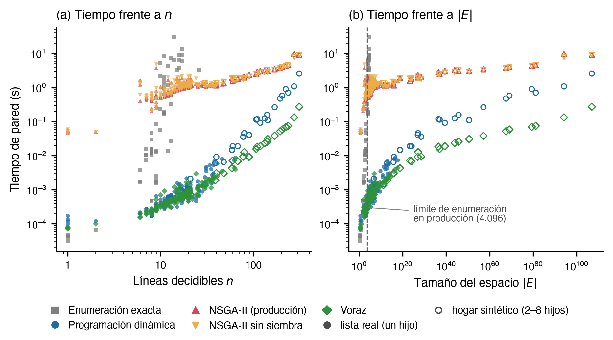
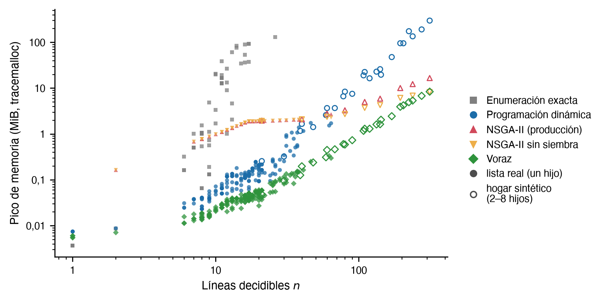
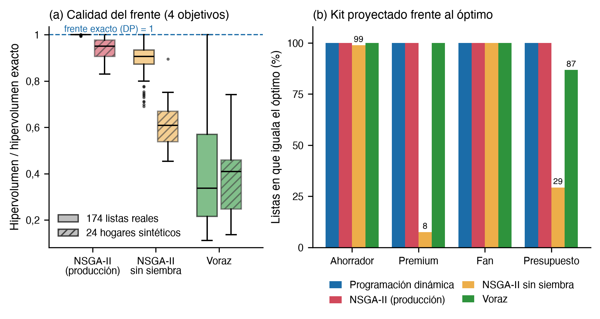

# 06 · Optimización de kits: ¿NSGA-II, enumeración, programación dinámica o una regla?

## Pregunta

¿Qué algoritmo construye mejor el frente de Pareto de los kits (costo, fidelidad de marca,
disponibilidad y personaje) y los kits que se proyectan de él (Ahorrador, Premium, Fan y con
presupuesto)? ¿Se justifica NSGA-II frente a un método exacto o a una regla voraz?

Esta carpeta reúne tres comparaciones:

| | Comparación | Datos | Estado |
|---|---|---|---|
| A | NSGA-II, voraz por perfil, exhaustivo y aleatorio (Alternativas §2) | 9 instancias sintéticas (de 4 a 8 ítems, 2 o 3 candidatos) | re-ejecutada; idéntica |
| B | NSGA-II de producción (v3), Laya (421 M, 4 modalidades), reglas, azar y óptimo exacto (benchmark Laya, FINAL) | 175 listas reales, 4 escenarios | agregados recalculados desde los crudos; idénticos |
| C | **Enumeración exacta, programación dinámica, NSGA-II (v7) con y sin siembra, y voraz** (propia) | 175 listas reales y 24 hogares sintéticos | nueva → [RESULTADOS.md](RESULTADOS.md) |

## A. Alternativas §2 (instancias sintéticas)

El puntaje es una escalarización ponderada por perfil, normalizada con la enumeración completa; el
*gap* es relativo al óptimo exhaustivo. NSGA-II usa pop = 100 y gen = 40.

| Método | Gap medio frente al óptimo | Óptimos (de 9) | Gap máximo | Tiempo medio |
|---|---:|---:|---:|---:|
| Exhaustivo | — | 9 | — | 0,0001–0,034 s |
| NSGA-II | 0,07 % | 8 | 0,64 % | 0,107 s |
| Voraz por perfil | 11,92 % | 4 | 53,53 % | ≈ 0 s |
| Aleatorio | 159,34 % | 1 | 290,86 % | 0,003 s |

Los 36 *gaps* se reproducen exactamente. El REPORTE concluye «se mantiene NSGA-II», pero el exhaustivo
es más rápido que NSGA-II en las 9 instancias ([CORRECCIONES #15](../CORRECCIONES.md#06-optimización)).

## B. Benchmark Laya contra NSGA-II (FINAL, optimizador v3, 4 de octubre de 2026)

Las métricas de `docs/informes/benchmark-laya/resumen.json` se recalcularon desde las 6.285 filas de
`resultados.json.gz` **sin ninguna diferencia**. Porcentaje de listas en que el kit iguala el óptimo:

| Competidor | Ahorrador (174) | Premium (174) | Fan (157) | Presupuesto: cabe | Presupuesto: calidad | Presupuesto: iguala |
|---|---:|---:|---:|---:|---:|---:|
| Óptimo exacto | 100 | 100 | 100 | 100 | 100 | 100 |
| NSGA-II (producción v3) | 100 | 100 | 100 | 100 | 40 | 1 |
| NSGA-II, mejor punto del frente | — | — | — | 100 | 94 | 28 |
| Regla simple (v3) | 80 | 100 | 100 | 100 | 37 | 1 |
| Kits de reglas + juez perfecto | 100 | 100 | 100 | 100 | 93 | 34 |
| Laya A (línea aislada) | 0 | 1 | 92 | 18 | 10 | 0 |
| Laya B (lista completa) | 0 | 1 | 58 | 50 | 26 | 0 |
| Laya C (secuencial) | 0 | 1 | 92 | 18 | 13 | 0 |
| Laya D (juez de kits) | 6 | 1 | 18 | 99 | 59 | 1 |
| Al azar | 1 | 0 | 53 | 43 | 28 | 2 |

Además: NSGA-II reproduce el mismo kit con 5 semillas en el 94,5 % de las listas donde corre; el
Ahorrador iguala el óptimo en el 99,4 % de las 870 corridas; y en el 68,5 % de las listas (y escenarios)
la escalera de costo marginal dominaba algún punto del frente (5 % de sus puntos en promedio). Los
tiempos (29 listas, Windows y CPU de 16 núcleos) son de 5,3 s en media por los tres kits.
**Conclusión del benchmark:** Laya no compite; el aporte del frente está en el compromiso con
presupuesto. Las correcciones v4 (heurística por costo de línea, siembra con la escalera y
recomendación con la mejor marca que cabe) se confirman con el optimizador vigente en la comparación C.

## C. Comparación propia: enumeración, DP, NSGA-II y voraz

Detalle completo, tablas, complejidades y la respuesta a «¿por qué NSGA-II y no DP?» en
**[RESULTADOS.md](RESULTADOS.md)**. Las cifras clave:

| Algoritmo | Tiempo mediano por lista | Memoria pico mediana | HV/HV* medio | Frente exacto | Escenarios (Ah., Pr., Fan, Pres.) |
|---|---:|---:|---:|---:|---|
| Enumeración exacta (\|E\| ≤ 60.000) | 47,7 ms | 1,54 MiB | 1 | 100 % | — |
| **Programación dinámica** | **0,64 ms** | **0,12 MiB** | **1** | **100 %** | 100 / 100 / 100 / 100 % |
| NSGA-II (producción) | 996 ms | 1,79 MiB | 0,9998 | 89,7 % | 100 / 100 / 100 / 100 % |
| NSGA-II sin siembra | 1,02 s | 1,79 MiB | 0,9015 | 7,5 % | 98,9 / 7,5 / 100 / 29,3 % |
| Voraz | 0,57 ms | 0,04 MiB | 0,4299 | 1,1 % | 100 / 100 / 100 / 86,8 % |





## Conclusión

Con la formulación vigente, que es separable por línea, **la programación dinámica es exacta, unas
1.400 veces más rápida que NSGA-II y más liviana en las listas reales**. La calidad del NSGA-II de
producción (frente exacto en el 89,7 % y todos los kits óptimos) se debe a la siembra voraz. La
ventaja medible del NSGA-II es su costo acotado (n^0,5 contra n^2,6 de la DP) y su extensibilidad a
términos no separables (consolidación entre hermanos dentro del costo, costo por tienda, coherencia de
personaje), que hoy no están en el objetivo.

## Reproducir

```bash
export TUKIT_FINAL=/ruta/a/FINAL            # clon de Tukit-Col/FINAL (solo lectura)
export PYTHONDONTWRITEBYTECODE=1 OMP_NUM_THREADS=1
cd scripts
python test_dp.py                           # DP y MCKP frente a la fuerza bruta (1.000 + 500 instancias)
python correr.py tiempo                     # unos 16 min
python correr.py hogares                    # unos 3 min
python correr.py memoria                    # unos 28 min (tracemalloc)
python correr.py hogares_memoria            # unos 22 min
python correr.py semillas --procesos 4      # unos 24 min
python analizar.py && python graficas.py
```

Dependencias: Python 3.12, numpy 2.5.3, pymoo 0.6.2, matplotlib, sqlalchemy y pydantic. Estas dos
últimas las pide el paquete `tukit_inteligencia` al importarse.

## Procedencia

- `Tukit-Col/FINAL@30cf1b5` (main): `servicios/inteligencia/tukit_inteligencia/optimizador.py` (importado, no
  copiado), `ensayos/bench_laya/` (copiados en `scripts/origen_bench_laya/`; `instancias.json.gz` y
  `escenarios.json` en `datos/`), `docs/informes/benchmark-laya/` (en `resultados/origen_bench_laya/`),
  `docs/informes/reporte-benchmark-laya-nsga.md` y `docs/algoritmos/secciones/07-optimizacion.tex` y `08-evaluacion.tex`.
- `Tukit-Col/Isis2610-G19-Tukit-Alternativas@2e03e38` (main): `benchmarks/optimizer.py`, `scripts/run_optimizer.py` y
  `REPORTE.md` §2 (en `scripts/origen_alternativas/` y `resultados/origen_alternativas/`).
