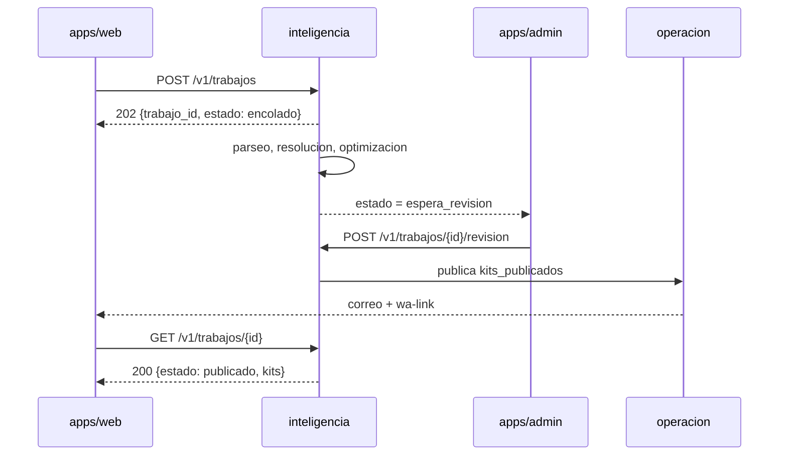

# Contrato de la API de Tukit

> **Superficie compartida.** Este documento y `manifiesto.toml` son lo único que varios
> equipos tocan a la vez. El manifiesto fija las fronteras de *datos*; este fija las
> fronteras de *conversación*. Cambiar cualquiera de los dos sin avisar rompe a alguien
> más, así que se cierran antes de repartir el trabajo y se versionan.

- **Versión:** 1.0
- **Prefijo:** `/v1`
- **Formato:** JSON UTF-8. Dinero en **pesos enteros** (nunca decimales flotantes).
- **Idioma de los identificadores:** español sin tildes, como el resto del código.

---

## 0. Por qué la API es asíncrona

El pipeline tarda minutos, no segundos, y eso es deliberado: `OP-03` del SRS dice que el
sistema "debe priorizar la precisión del emparejamiento y la mejor relación calidad-precio
del kit **por encima de la velocidad de generación**". El proxy actual del frontend ya
convive con eso con un tiempo de espera de 300 s y un comentario que lo explica.

Encima, el flujo de negocio **exige** una pausa humana: los kits pasan por revisión de
Admin Tukit (`AD-03`, `AD-04`) antes de llegar al acudiente (`AD-06`). Una API síncrona no
puede modelar una espera que incluye a una persona.

Por eso el recurso central no es "el kit" sino **el trabajo**: se crea, se consulta, y
cuando termina se avisa por los canales que el acudiente dejó.



---

## 1. Tipos compartidos

### 1.1 `TipoItem`

Extiende el `TipoItem` que el frontend ya tiene (`util | texto | uniforme | otro`). Los
tres valores nuevos existen porque hay ítems de la lista que **no son productos
comprables**, y forzarles un emparejamiento sería un defecto, no cobertura.

| Valor | Qué es | Qué hace el pipeline |
|---|---|---|
| `util` | Papelería comprable | Busca producto, ofrece 3 niveles |
| `texto` | Texto escolar | **No busca**: resuelve por `version_vigente` a un ISBN |
| `licencia_digital` | Licencia con pago externo | No entra al carrito; expone `url_externa` |
| `no_comprar` | "El disponible en casa" | Cantidad cero, con la instrucción visible |
| `diferido` | "Se solicitará más adelante" | Queda pendiente; reabre el trabajo al publicarse |
| `uniforme` | Uniforme | Fuera de alcance de v1, declarado |
| `otro` | No clasificable | Va a revisión humana |

Los cuatro que no son `util` ni `texto` **no cuentan** para la métrica de "catálogo sin
huecos": esa se mide solo sobre `util`.

### 1.2 `EstadoResolucion`

Conserva los tres que el frontend ya conoce y agrega el que faltaba:

| Valor | Significado |
|---|---|
| `RESUELTO_AUTO` | Confianza sobre el umbral; hay producto elegido |
| `AMBIGUO` | Zona gris; hay candidatos pero ninguno domina. Va a revisión |
| `SIN_MATCH` | No hay candidato admisible |
| `HUECO_CATALOGO` | **Nuevo.** Se entendió qué pide y el catálogo no lo tiene |

La diferencia entre `SIN_MATCH` y `HUECO_CATALOGO` es la que hoy no existe y es la que
permite decir *"no tengo block carta"* en vez de ofrecer origami con confianza. `SIN_MATCH`
es "no te entendí"; `HUECO_CATALOGO` es "te entendí y no lo tengo", y solo el segundo se
puede responder con una alternativa o una disculpa útil.

### 1.3 `PerfilKit`

`Ahorrador | Fan | Premium`, tal como los nombra `OP-01` y `UI-02` del SRS.

**No confundir con el `nivel` de un producto** (`economico | confiable | premium`). Son
ejes distintos que comparten la palabra "premium": el nivel describe un producto, el perfil
describe una ponderación de objetivos sobre el kit completo. Un kit `Ahorrador` puede
contener un producto `premium` si resultó más barato por empaque.

### 1.4 `Dinero`

Entero en pesos colombianos. Nunca flotante, nunca string. `null` significa "no se conoce
el precio", que es distinto de `0`.

---

## 2. Crear un trabajo

`POST /v1/trabajos` → `202 Accepted`

La petición es **por hogar, no por hijo**. Es la decisión de diseño que hace posible la
consolidación entre hermanos y el reparto de empaques: si cada hijo se pidiera aparte, el
optimizador no podría ver que dos niños necesitan un borrador cada uno y que una caja de
diez sale mejor.

Dos formas de entrar, las dos del SRS:

```jsonc
// (a) El colegio ya publicó la lista: AD-06
{
  "contacto":  { "correo": "papa@ejemplo.com", "celular": "+573001234567" },
  "hijos": [
    { "referencia": "hijo-1", "colegio_id": "2.4", "grado": "Cuarto" },
    { "referencia": "hijo-2", "colegio_id": "2.4", "grado": "Septimo" }
  ],
  "preferencias": { /* ver §3 */ }
}
```

```jsonc
// (b) El acudiente sube la lista: multipart/form-data
//     campo `hijos` con el JSON de arriba y un `archivo` por hijo
//     Formatos y límites: los que ya valida el frontend
//     (.pdf .jpg .jpeg .png .webp, 10 MB)
```

Respuesta:

```json
{
  "trabajo_id": "3f9a...",
  "estado": "encolado",
  "estimado_segundos": 180,
  "consultar_en": "/v1/trabajos/3f9a..."
}
```

`contacto` es obligatorio: es lo que permite avisar cuando el trabajo termine, y sin él la
asincronía no tiene salida. Se guarda en `identidad` y la notificación lo referencia **por
identificador, nunca copiando el correo**, según la nota del manifiesto sobre la deuda
heredada en `operacion.notificacion`.

---

## 3. Preferencias: lo que el acudiente declara, no lo que inferimos

```jsonc
{
  "pesos": {                      // suma 1.0; de la P21 de la encuesta
    "precio":         0.35,
    "marca_exigida":  0.30,
    "calidad":        0.25,
    "personaje":      0.10
  },
  "presupuesto_por_hijo": 700000, // restricción DURA, no una pista
  "disposicion_sobreprecio": 0.05,
  "personaje_por_hijo": { "hijo-1": ["spiderman"] },
  "dolor_declarado": "libros"     // solo decide el titular de la UI
}
```

Tres reglas que este bloque impone y conviene no relajar:

1. **No se pide el estrato y no se persiste.** En las 60 respuestas de la encuesta, 41 son
   estrato 4: no tiene varianza suficiente para segmentar, y sí es dato sensible del hogar
   de un menor. Como además la correlación intuitiva no existe —el segmento que más gasta
   es el *menos* dispuesto a pagar sobreprecio— quitarlo no cuesta precisión.
2. **`presupuesto_por_hijo` es una cota, no un gusto.** Es el uso más valioso de la
   encuesta: convierte una opinión en una restricción que el optimizador puede imponer.
3. **Los pesos son datos personales derivados.** Se persisten cifrados en `kit.perfil` y
   `kit.pesos_usados`, y entran al derecho al olvido. El manifiesto ya documenta que el
   servicio anterior los dejaba en claro y los excluía del borrado.

Si el bloque viene vacío se usan los valores por defecto medidos: precio 0.35, marca
exigida 0.30, calidad 0.25, personaje 0.10, que es el orden que dio la P21 normalizado.

---

## 4. Consultar un trabajo

`GET /v1/trabajos/{id}` → `200 OK`

```jsonc
{
  "trabajo_id": "3f9a...",
  "estado": "publicado",
  // encolado | procesando | espera_revision | publicado | fallido
  "etapas": [
    { "nombre": "percepcion",   "estado": "ok", "ms": 4210 },
    { "nombre": "normalizacion","estado": "ok", "ms": 890  },
    { "nombre": "resolucion",   "estado": "ok", "ms": 12400 },
    { "nombre": "optimizacion", "estado": "ok", "ms": 6100 }
  ],
  "kits": [ /* §5 */ ],
  "recomendado": { /* §6 */ },
  "degradaciones": [ /* §8 */ ]
}
```

Mientras `estado` no sea `publicado`, `kits` va vacío. El acudiente **nunca ve un kit sin
revisar**: esa es la razón de ser de `espera_revision` y de `AD-06`.

---

## 5. Los tres kits

Son tres puntos del frente de Pareto que produce el optimizador, no tres consultas
distintas. `OP-04` pide poder parametrizar los pesos, y eso es exactamente lo que los
separa.

```jsonc
{
  "perfil": "Ahorrador",
  "total": 412000,
  "objetivos": { "costo": 412000, "fidelidad": 0.61, "disponibilidad": 0.94 },
  "lineas": [
    {
      "item_id": "h1-007",
      "hijo": "hijo-1",
      "descripcion": "Caja de lapices x12",
      "tipo": "util",
      "estado_resolucion": "RESUELTO_AUTO",

      // El corazón del arreglo de unidades. Tres números distintos que el
      // sistema anterior colapsaba en uno, y de ahí salía sumar 12 cajas
      // cuando la lista pedía 12 lápices.
      "cantidad_pedida":      12,        // en unidad base
      "unidad_base":          "unidad",
      "unidades_por_empaque": 12,
      "unidades_a_comprar":   1,         // techo(12 / 12)

      "producto_elegido": {
        "sku": "TK-C002-PRE",
        "nombre": "Caja De Lapiz Kores Jumbo HB #2 X12 Negro",
        "marca": "Kores",
        "nivel": "premium",
        "personaje": null,
        "imagen_url": "https://...",
        "confianza": 0.91,
        "ofertas": [
          { "tienda": "panamericana", "precio": 18900, "vigente_hasta": "2026-09-28T00:00:00Z" },
          { "tienda": "suescun",      "precio": 17400, "vigente_hasta": "2026-09-24T00:00:00Z" }
        ]
      },
      "alternativas": [ /* hasta 2 más, mismo concepto, otros niveles */ ],
      "subtotal_linea": 17400
    }
  ],
  "consolidaciones": [
    {
      "concepto": "C005 borrador",
      "hijos": ["hijo-1", "hijo-2"],
      "demanda_base": 2,
      "producto": "TK-C005-ECO-CAJA",
      "unidades_a_comprar": 1,
      "ahorro": 1200,
      "explicacion": "Una caja de 10 sale más barata que dos borradores sueltos."
    }
  ]
}
```

### 5.1 Líneas que no son productos

```jsonc
{ "item_id": "h1-021", "tipo": "licencia_digital",
  "descripcion": "Plan lector virtual RAZ-PLUS",
  "url_externa": "https://pagoslearning.com/",
  "nota": "Se adquiere directamente con QUOVIX. No va en el carrito.",
  "subtotal_linea": null }

{ "item_id": "h1-022", "tipo": "no_comprar",
  "descripcion": "Diccionario: el disponible en casa",
  "unidades_a_comprar": 0,
  "nota": "El colegio indica usar el que ya tienes." }

{ "item_id": "h2-004", "tipo": "texto",
  "descripcion": "Don Quijote de la Mancha. Ed Enlace. (primer periodo)",
  "estado_resolucion": "RESUELTO_AUTO",
  "edicion": { "isbn13": "9789580000000", "titulo": "Don Quijote de la Mancha",
               "editorial": "Enlace", "anio_edicion": 2023 },
  "no_consolidable": true,
  "motivo_no_consolidable": "Dos ediciones del mismo título no son sustituibles." }
```

`no_consolidable` es la **regla inversa** de la consolidación entre hermanos: los
borradores se juntan y los textos nunca, y el sistema dice por qué. Sale del mismo dato
—`version_vigente` guarda histórico— y de la misma razón que documenta el modelo editorial.

### 5.2 Huecos

```jsonc
{ "item_id": "h1-013", "tipo": "util",
  "descripcion": "Block oficio",
  "estado_resolucion": "HUECO_CATALOGO",
  "concepto": "C003 block",
  "atributo_faltante": { "tamano": "oficio" },
  "mensaje": "Entendimos que pides un block tamaño oficio y hoy no lo tenemos.",
  "sustitutos": [ /* del grafo de sustituibilidad, si los hay */ ],
  "subtotal_linea": null }
```

---

## 6. La recomendación

Se muestran los tres (`OP-01` lo exige) y se marca **uno**, con la razón en lenguaje llano.
Nunca se ocultan los otros dos.

```jsonc
{
  "perfil": "Ahorrador",
  "razon": "Elegiste precio como lo más importante y el kit queda en $412.000, dentro de tu presupuesto.",
  "dentro_de_presupuesto": true,
  "pesos_usados": { "precio": 0.35, "marca_exigida": 0.30, "calidad": 0.25, "personaje": 0.10 }
}
```

Recomendar es **escalarizar el frente de Pareto** con los pesos de ese acudiente: los tres
kits son óptimos y cuál conviene depende de preferencias que no están en el catálogo. La
regla, derivada de la encuesta:

- **Por defecto `Ahorrador`.** 42 de 60 encuestados pagan como máximo 5 % más y 15 exigen
  precio igual o menor.
- **`Premium`** solo si el acudiente pone calidad primero **y** declara ≥10 %.
- **`Fan`** solo con `personaje_por_hijo` explícito. El personaje quedó último en la P21
  (1,87 contra 2,85 del precio), y tiene sentido: el que paga es el papá y el que quiere el
  personaje es el hijo.
- Si el recomendado excede `presupuesto_por_hijo`, se cae al siguiente punto del frente y
  `razon` lo dice.

---

## 7. Revisión humana (apps/admin)

| Endpoint | Requisito |
|---|---|
| `GET /v1/admin/cola` | `AD-02`, `AD-03` |
| `GET /v1/admin/trabajos/{id}` | `AD-03` |
| `POST /v1/admin/trabajos/{id}/lineas/{item_id}/validar` | `AD-04` |
| `POST /v1/admin/trabajos/{id}/lineas/{item_id}/sin-coincidencia` | `AD-04` |
| `POST /v1/admin/productos` | `AD-07` — alta manual con precio e imagen |
| `POST /v1/admin/productos/{sku}/no-disponible` | `AD-05` |
| `POST /v1/admin/trabajos/{id}/revision` | `AD-06` — publica al acudiente |

La cola se alimenta de `PE-04`: "marcar para revisión de Admin Tukit los ítems con
confianza de extracción por debajo del umbral configurable τ". Toda transición queda en
`operacion.registro_auditoria` con quién y cuándo, que es lo que `AD-25` y `AD-26` exigen.

`POST .../revision` acepta `{ "decision": "aprobar" | "devolver", "nota": "..." }`. Aprobar
publica y dispara la notificación; devolver reabre el trabajo sin avisar al acudiente.

---

## 8. Degradación: degradar, nunca tumbar

Toda dependencia tiene una ruta declarada. Ningún fallo externo devuelve `500` si existe
una respuesta parcial honesta.

| Dependencia | Falla | Qué pasa |
|---|---|---|
| Gemini (percepción) | Sin respuesta | `502` con mensaje accionable; el trabajo queda `fallido` y reintentable |
| Embeddings | No disponible | Solo canal léxico, y **toda** línea baja a `AMBIGUO` |
| Reranker | No disponible | Se ordena por el canal vectorial, que mide mejor que la fusión |
| Precio vencido | `vigente_hasta` pasado | La línea no entra al total y se marca para revisión |
| Pasarela | Sin respuesta | La orden queda `pendiente_pago`; nunca se confirma sin confirmación |

Las degradaciones se reportan, no se esconden:

```jsonc
"degradaciones": [
  { "dependencia": "reranker", "efecto": "orden por similitud vectorial", "lineas_afectadas": 7 }
]
```

---

## 9. Pago (comercio)

| Endpoint | Requisito |
|---|---|
| `POST /v1/ordenes` | `FU-01` — congela precios y crea la orden |
| `POST /v1/ordenes/{id}/pago` | `FU-03` — inicia el pago con Wompi |
| `POST /v1/webhooks/wompi` | Confirmación asíncrona, idempotente |
| `GET /v1/ordenes/{id}` | `AD-33`, seguimiento |
| `POST /v1/ordenes/{id}/retracto` | `FU-04` |

Tres invariantes que no se negocian:

1. **Re-verificación antes de cobrar** (`UI-05`, `SC-05`): se vuelven a leer precio y
   disponibilidad; si cambiaron, la orden no se cierra y el acudiente decide.
2. **El precio no se mueve después de confirmar** (`FU-06`). Lo confirma la entrevista:
   *"te lo tengo en este tiempo a este precio, sí o no"*.
3. **No se guardan medios de pago** (`SG-03`): solo identificador de transacción y estado.
   La captura ocurre en el dominio de la pasarela.

El webhook es idempotente contra `comercio.evento_pasarela_procesado`: una pasarela
reintenta, y cobrar dos veces por un reintento sería el peor defecto posible en esta ruta.

**Nota de trazabilidad:** `FU-03` dice hoy "PSE y ePayco" y la implementación usa **Wompi**,
que entrega PSE, Nequi y tarjeta en una sola integración. El cambio va con ADR y con la
actualización de `FU-03` en el SRS. La integración vive tras un puerto `PasarelaPago` con
adaptador falso, porque `[D4]` marca el registro empresarial como dependencia bloqueante y
las pruebas no pueden depender de él.

---

## 10. Notificación (operacion)

Puerto `Notificador` con dos adaptadores en v1:

- **Correo** (`FU-02`), que ya es requisito.
- **wa-link**: `https://wa.me/<numero>?text=<mensaje con turno>`. Es la vía **reactiva**,
  la que el acudiente inicia.

El SRS difiere a v2+ "la integración con WhatsApp Business para notificaciones
**proactivas** y no solo reactivas", así que empujar mensajes queda fuera de v1 por
decisión ya tomada, no por omisión. El puerto existe para que la Cloud API oficial entre
después sin tocar el dominio.

El contenido **no repite el correo ni el celular**: los referencia por identificador. Es la
deuda que el manifiesto documenta en `operacion.notificacion`, donde el servicio anterior
persistía el correo real del acudiente y el derecho al olvido no lo borraba.

---

## 11. Errores

```json
{ "error": "presupuesto_invalido",
  "mensaje": "El presupuesto por hijo debe ser un entero positivo en pesos.",
  "campo": "preferencias.presupuesto_por_hijo" }
```

`400` entrada inválida · `404` no existe · `409` estado incompatible (por ejemplo, revisar
un trabajo ya publicado) · `422` entrada válida que el dominio rechaza · `502` dependencia
externa caída · `503` servicio no disponible.

Nunca se devuelve al cliente lo que el cliente acaba de enviar en un mensaje de error: el
manejador de validación del sistema anterior devolvía la contraseña recibida, y es uno de
los defectos ya documentados.
