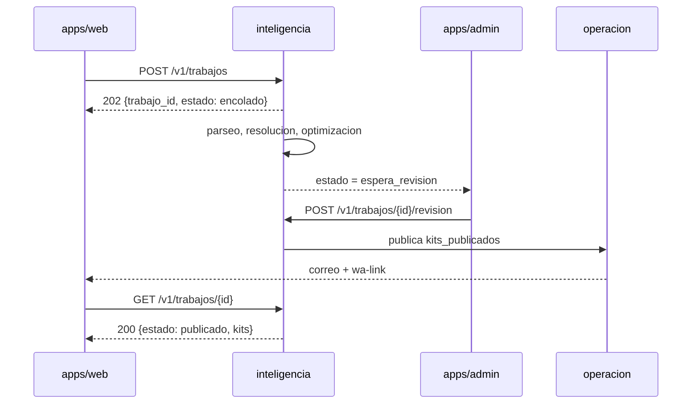

# Contrato de la API de Tukit

> **Superficie compartida.** Este documento y `manifiesto.toml` son lo único que varios
> equipos tocan a la vez. El manifiesto fija las fronteras de *datos*; este fija las
> fronteras de *conversación*. Cambiar cualquiera de los dos sin avisar rompe a alguien
> más, así que se cierran antes de repartir el trabajo y se versionan.

- **Versión:** 1.6
- **Prefijo:** `/v1`
- **URL base:** `http://127.0.0.1:8010` en desarrollo. Ver §12.1.
- **Formato:** JSON UTF-8. Dinero en **pesos enteros** (nunca decimales flotantes).
- **Idioma de los identificadores:** español sin tildes, como el resto del código.

### Qué cambió en 1.6

El acudiente puede deshacer desde su panel: cancelar una solicitud y quitar o cambiar de colegio
a un hijo (ADR 0031).

| Cambio | Dónde | Por qué |
|---|---|---|
| `POST /v1/trabajos/{id}/cancelar` (con sesión): el trabajo pasa a `cancelado`, terminal. No se cancela un kit comprado (`409 kit_comprado`), uno con pago pendiente (`409 pedido_pendiente`) ni uno en `procesando` (`409 en_proceso`); otra cuenta, `403 solicitud_ajena` | §4 | Antes una solicitud no se podía deshacer |
| `POST /v1/mis-solicitudes/listas/{tarea_id}/cancelar` (con sesión): la lista subida deja de ser del acudiente, sin borrarse | §4 | La lista es del colegio y sirve a otros |
| `EstadoTrabajo` suma `cancelado`; "Mis solicitudes" no lo devuelve y la lista `recibida` trae `tarea_id` | §4 | Para poder cancelarla |
| `DELETE /v1/cuenta/matriculas/{matricula_id}` (204) y `PUT` con `{colegio_id, grado, apodo?}`: quitar cierra el vínculo sin borrar; cambiar retira la matrícula y crea la nueva con el mismo apodo | §12.4 | Corregir el colegio o quitar a un hijo desde el panel |
| `GET /v1/cuenta/matriculas` trae `matricula_id` | §12.4 | Para pedir el cambio |

### Qué cambió en 1.5

Ya no se arman siempre tres kits: se arman los que el acudiente pidió (ADR 0030).

| Cambio | Dónde | Por qué |
|---|---|---|
| Siempre `Ahorrador` y `Premium`; `Fan` solo con `personaje_por_hijo`; `A tu Medida` solo con `prioridad: "equilibrio"` o un tope | §5 | Un kit que nadie pidió es ruido para el papá y trabajo para el revisor |
| `PerfilKit` suma `"A tu Medida"`: la mejor marca que cabe en el tope o, sin tope, en la mitad de camino entre Ahorrador y Premium | §1.3, §6 | El punto medio tenía que ser un kit propio, no un Premium ajustado |
| El Premium ya no se ajusta al presupuesto: siempre es la mejor marca | §6 | Ese lugar lo ocupa ahora `A tu Medida` |
| Preferencias suma `prioridad` (`precio`, `equilibrio`, `calidad`) | §3 | Es lo que decide si se arma `A tu Medida` |
| Los canónicos de una lista son Ahorrador y Premium; en la ruta rápida el Fan se arma para quien pide un personaje (el Ahorrador canónico con el personaje en las anclas) y `A tu Medida` no sale de la caché | §5 | Ambos dependen de cada acudiente |

### Qué cambió en 1.4

El acudiente puede cambiar productos de su kit y, en la ruta rápida, ver y pagar cualquiera de
los tres kits. Las decisiones están en el ADR 0028 (`arquitectura/adr/`).

| Cambio | Dónde | Por qué |
|---|---|---|
| `PUT /v1/trabajos/{id}/kits/{perfil}/lineas/{item_id}/producto` | §5.3 | El acudiente cambia un producto por el sugerido o una de sus alternativas |
| `GET /v1/trabajos/{id}` aplica los cambios del acudiente y trae `cambios` | §4, §5.3 | El kit que ve y el que paga son el que él armó |
| La línea cambiada trae `cambiado_por_acudiente` y `sku_sugerido` | §5.3 | Para decirle qué cambió y ofrecerle volver al sugerido |
| La ruta rápida (`parent_apply`) devuelve los tres kits, con el elegido como `recomendado` | §4, §6 | Antes solo veía el que eligió al empezar y no podía comparar ni cambiarse |

### Qué cambió en 1.3

Ningún campo cambia de forma; cambia qué kit se marca y qué lleva el Premium cuando hay
presupuesto. Sale del benchmark Laya vs NSGA-II.

| Cambio | Dónde | Por qué |
|---|---|---|
| Con `presupuesto_por_hijo` se recomienda la mejor marca que cabe, y el Premium que no cabe se ajusta al mejor punto del frente dentro del tope | §6 | El kit recomendado con presupuesto lograba el 40 % de la calidad posible y el frente ya traía uno del 94 % |
| Si el recomendado no cabe, se cae a la mejor marca que cabe, no al más barato | §6 | Es lo que §6 prometía ("el siguiente punto del frente") y el código no hacía |
| `disposicion_sobreprecio` ya no estira el tope | §6 | Quien escribía "máximo $350.000" podía recibir un kit de $385.000 |

### Qué cambió en 1.2

El §9 pasa de declarado a implementado. Lo que estaba escrito era el diseño al que había que
llegar; al llegar con Wompi de verdad (sandbox, llaves reales) aparecieron tres cosas que el
diseño no podía saber, y se documentan donde muerden.

| Cambio | Dónde | Por qué |
|---|---|---|
| §9 implementado: orden, pago, sincronización, webhook, cancelación y "mis pedidos" | §9 | `comercio` existe y la puerta lo rutea; las rutas ya no responden `501` |
| El pago se abre con el **widget** de Wompi y `POST /pago` devuelve sus datos firmados | §9.1 | El checkout alojado por URL responde 403 si el retorno es `localhost`. ADR 0021 |
| `POST /v1/pagos/{transaccion_id}/sincronizar` | §9.2 | Sin URL pública el webhook no llega, y el pedido se quedaba sin confirmar. ADR 0022 |
| La clave de idempotencia es `<transacción>:<ESTADO>`, no el id del evento | §9.2 | Wompi no manda id de evento, y `PENDING` → `APPROVED` chocaba en el candado |
| `POST /v1/ordenes/{id}/cancelar`, que consulta a Wompi antes | §9.3 | Cancelar con un PSE en curso cobraría sin entregar. ADR 0023 |
| Un pedido se paga durante 24 horas; uno pendiente por kit | §9.4 | Cada clic en Pagar creaba un pedido, y uno viejo se cobraría a un precio viejo |
| `comercio` en la tabla de puertos | §12.1 | Faltaba |

### Qué cambió en 1.1

La 1.0 especificaba el pipeline y no el catálogo, y eso dejaba al frontend sin
poder pintar una sola pantalla antes de que existiera un trabajo. La 1.1 agrega
la **superficie de lectura** (§12) y corrige tres cosas que al implementar
resultaron incompletas o incoherentes con los modelos.

| Cambio | Dónde | Por qué |
|---|---|---|
| Nueva sección 12: catálogo, listas, colegios, emparejamiento | §12 | No existía superficie de navegación. El catálogo estaba en la base y no lo exponía nadie |
| `501 no_implementado` como código de error | §11, §12.1 | `/v1/ordenes` está especificado y no tiene servicio detrás. Un `404` haría buscar un error en el cliente que no está ahí |
| `GET /v1/trabajos/{id}` devuelve también `origen`, `hijos`, `error`, `mensaje`, `creado_en`, `nota_revision`; cada etapa lleva `detalle` | §4 | El frontend no podía distinguir "sin lista publicada" de "el catálogo se cayó" sin ellos |
| `POST /v1/trabajos/{id}/reintentar` | §4.1 | §8 promete que un trabajo fallido es reintentable y no había endpoint que lo hiciera |
| Las líneas del kit traen `hijo`, `orden` y `alternativas` siempre (lista vacía si no hay) | §5 | Agrupar por hijo era imposible sin `hijo`, y un campo que a veces no viene obliga a defenderse en cada punto de uso |
| El total de un trabajo es por **hogar**, no por hijo, y `presupuesto_por_hijo` se compara contra el total del kit | §6 | Se declara porque con un solo hijo son lo mismo y la diferencia solo aparece con dos. Se revisa cuando el optimizador reparta por hijo |
| La entrada (b) por archivo (`multipart/form-data`) queda **declarada y no implementada** | §2 | Requiere `GEMINI_API_KEY` y render de PDF. Hoy solo funciona la entrada (a), por colegio y grado |
| §9 (pago) queda **declarada y no implementada** | §9 | El servicio `comercio` todavía no existe |

---

## 0. Por qué la API es asíncrona

El pipeline tarda minutos, no segundos. `OP-03` del SRS lo acota en cinco minutos de
extremo a extremo en el peor caso, y exige **progreso visible por etapa** mientras dura el
procesamiento. Una API síncrona no puede ofrecer ese progreso, y por eso el recurso central
no es el kit sino el trabajo. El tiempo de cada etapa lo acotan `DP-04` (percepción),
`DP-03` (optimización) y `DP-06` (camino corto sobre lista validada), y el
`estimado_segundos` que se le anuncia al acudiente debe ser el del camino que su trabajo va
a tomar, no uno único para los dos.

Encima, el flujo de negocio **exige** una pausa humana: los kits pasan por revisión de
Admin Tukit (`AD-01`, `AD-02`, `AD-03`) antes de llegar al acudiente (`AD-06`). Una API
síncrona no puede modelar una espera que incluye a una persona.

Por eso el recurso central no es "el kit" sino **el trabajo**: se crea, se consulta, y
cuando termina se avisa por los canales que el acudiente dejó.



---

## 1. Tipos compartidos

### 1.1 `TipoItem`

Extiende el `TipoItem` que el frontend ya tiene (`util | texto | uniforme | otro`). Los
tres valores nuevos existen porque hay ítems de la lista que **no son productos
comprables**, y forzarles un emparejamiento sería un defecto, no cobertura.

| Valor | Qué es | Qué hace el pipeline |
|---|---|---|
| `util` | Papelería comprable | Busca producto, ofrece 3 niveles |
| `texto` | Texto escolar con edición obligatoria | **No busca**: resuelve por `version_vigente` a un ISBN |
| `libro_libre` | Libro sin editorial exigida | **Sí busca**, y optimiza por precio |
| `licencia_digital` | Licencia con pago externo | No entra al carrito; expone `url_externa` |
| `no_comprar` | "El disponible en casa" | Cantidad cero, con la instrucción visible |
| `diferido` | "Se solicitará más adelante" | Queda pendiente; reabre el trabajo al publicarse |
| `uniforme` | Uniforme | Fuera de alcance de v1, declarado |
| `otro` | No clasificable | Va a revisión humana |

Todo lo que no sea `util`, `texto` o `libro_libre` **no cuenta** para la métrica de
"catálogo sin huecos": esa se mide solo sobre lo comprable.

### 1.1.1 `ModoAdquisicion`: quién puede vender el ítem

Ortogonal a `TipoItem`, y es la diferencia entre un catálogo que promete y uno que cumple.
Salió de leer los 14 PDF originales: **hay textos que Tukit no puede surtir, y no por falta
de proveedor sino porque el colegio los cerró**.

| Valor | Señal en la lista | ¿Tukit lo surte? |
|---|---|---|
| `mercado_abierto` | Sin restricción declarada | Sí |
| `libro_libre` | "Cualquier editorial" | Sí, y es donde más aporta |
| `venta_directa_editorial` | "Venta directa a las familias", "tienda virtual de la editorial" | No |
| `edicion_exclusiva` | "Edición exclusiva para la institución" | No |
| `plataforma` | "Link de pago", "código de acceso" | No |
| `diferido` | "Se solicitarán acordes a las necesidades de la clase" | Todavía no |

Dos casos reales que fijan los extremos. Osito de Miel: *"el jardín ofrece las instalaciones
a las diferentes editoriales para que les hagan la venta directa a las familias sábado 24
enero... las editoriales reciben dinero en efectivo"*. Y en la otra punta, *"La casa de los
espíritus. Autor: Isabella Allende. Cualquier editorial"*, donde la restricción se **invierte**:
no hay una sola edición válida sino muchas, y el sistema puede escoger la más barata.

Que el caso `libro_libre` no estuviera modelado era un hueco caro: es el segmento de libros
donde Tukit agrega más valor, porque es el único donde tiene margen para optimizar.

### 1.2 `EstadoResolucion`

Conserva los tres que el frontend ya conoce y agrega el que faltaba:

| Valor | Significado |
|---|---|
| `RESUELTO_AUTO` | Confianza sobre el umbral; hay producto elegido |
| `AMBIGUO` | Zona gris; hay candidatos pero ninguno domina. Va a revisión |
| `SIN_MATCH` | No hay candidato admisible |
| `HUECO_CATALOGO` | **Nuevo.** Se entendió qué pide y el catálogo no lo tiene |

La diferencia entre `SIN_MATCH` y `HUECO_CATALOGO` es la que hoy no existe y es la que
permite decir *"no tengo block carta"* en vez de ofrecer origami con confianza. `SIN_MATCH`
es "no te entendí"; `HUECO_CATALOGO` es "te entendí y no lo tengo", y solo el segundo se
puede responder con una alternativa o una disculpa útil.

### 1.3 `PerfilKit`

`Ahorrador | Fan | A tu Medida | Premium`. Los tres primeros los nombran `OP-01` y `UI-02` del
SRS; `A tu Medida` llega en 1.5. Ahorrador y Premium salen siempre; Fan y A tu Medida solo si el
acudiente los pide (§5, ADR 0030).

**No confundir con el `nivel` de un producto** (`economico | confiable | premium`). Son
ejes distintos que comparten la palabra "premium": el nivel describe un producto, el perfil
describe una ponderación de objetivos sobre el kit completo. Un kit `Ahorrador` puede
contener un producto `premium` si resultó más barato por empaque.

### 1.4 `Dinero`

Entero en pesos colombianos. Nunca flotante, nunca string. `null` significa "no se conoce
el precio", que es distinto de `0`.

---

## 2. Crear un trabajo

`POST /v1/trabajos` → `202 Accepted`

La petición es **por hogar, no por hijo**. Es la decisión de diseño que hace posible la
consolidación entre hermanos y el reparto de empaques: si cada hijo se pidiera aparte, el
optimizador no podría ver que dos niños necesitan un borrador cada uno y que una caja de
diez sale mejor.

Dos formas de entrar, las dos del SRS:

```jsonc
// (a) El colegio ya publicó la lista: CO-01, o reconstruida por NR-07 y distinguida por NR-08
{
  "contacto":  { "correo": "papa@ejemplo.com", "celular": "+573001234567" },
  "hijos": [
    { "referencia": "hijo-1", "colegio_id": "2.4", "grado": "Cuarto" },
    { "referencia": "hijo-2", "colegio_id": "2.4", "grado": "Septimo" }
  ],
  "preferencias": { /* ver §3 */ }
}
```

```jsonc
// (b) El acudiente sube la lista: multipart/form-data
//     campo `hijos` con el JSON de arriba y un `archivo` por hijo
//     Formatos y límites: los que ya valida el frontend
//     (.pdf .jpg .jpeg .png .webp, 10 MB)
```

> **Estado en 1.1: (a) funciona, (b) todavía no.** El endpoint solo acepta JSON; mandarle
> `multipart` devuelve `400 entrada_invalida`. La etapa de percepción existe y está probada
> (`tukit_inteligencia.percepcion`, con las reglas de §2.1 ya impuestas), pero conectarla
> pide `GEMINI_API_KEY` y el render de PDF, y ninguna de las dos es una decisión de
> contrato. La ruta (a) cubre los 17 colegios del corpus con sus 175 listas cargadas, así
> que el frontend puede construirse entero contra ella.

### 2.1 Un archivo es la lista de UN grado, y eso se verifica

**Regla de negocio, no límite técnico.** El archivo tiene que ser la lista del grado de ese
hijo. Si el acudiente sube el PDF completo del colegio —que trae los trece grados— el
sistema **no lo procesa**: se lo dice y le pide las páginas de su grado.

No se procesa "lo que se pueda" porque un kit armado con los útiles de otro grado es peor
que no tener kit: el acudiente no tiene cómo notar el error hasta que llega el pedido. Esto
no es hipotético, los archivos del corpus son así: el de CACS tiene **39 páginas** y el de
San Pedro **22**; los catorce suman 199.

El aviso es explícito antes de subir, porque una restricción que solo aparece como error
después de esperar es una restricción mal puesta.

```jsonc
// 422
{ "error": "lista_de_varios_grados",
  "mensaje": "Este archivo tiene la lista de 13 grados. Sube solo las páginas del grado de tu hijo.",
  "grados_detectados": ["Jardin", "Transicion", "Primero", "..."],
  "paginas": 39 }
```

**Cómo se detecta.** La señal buena es **cuántos grados distintos aparece**, que es lo que
de verdad importa, y la reporta el mismo modelo de la etapa de percepción que ya se llama.
El número de páginas es solo una guarda barata previa, porque como criterio falla en los dos
sentidos: hay listas de un grado que ocupan seis páginas y listas de tres grados que caben
en dos.

Esto además cierra un defecto de producción real: la etapa de percepción tenía un tope de
cinco páginas que **truncaba en silencio**, sin avisar ni marcar el kit como parcial. Leer
cinco páginas de un PDF de 39 y devolver un kit con toda confianza es el peor
comportamiento posible de los tres (procesar todo, rechazar, o truncar callado).

### 2.2 La otra entrada depende de que el mapeo colegio–lista sea correcto

Cuando el acudiente elige colegio y grado en vez de subir archivo, el sistema le muestra la
`version_lista_oficial` vigente de ese `(sede, grado, anio_lectivo)`. Ahí el acudiente **no
puede detectar el error**: confía en que la lista que le mostramos es la de su colegio.

Por eso la ambigüedad que quedó abierta en la extracción del corpus —dos PDF que comparten
plantilla y no se pudieron separar con confianza, con 115 renglones en juego— deja de ser
una imprecisión de datos y pasa a ser **un bloqueante de corrección de esta ruta**. Una
lista atribuida al colegio equivocado es exactamente el fallo que esta entrada no puede
tener.

Respuesta:

```json
{
  "trabajo_id": "3f9a...",
  "estado": "encolado",
  "estimado_segundos": 180,
  "consultar_en": "/v1/trabajos/3f9a..."
}
```

`contacto` es obligatorio: es lo que permite avisar cuando el trabajo termine, y sin él la
asincronía no tiene salida. Se guarda en `identidad` y la notificación lo referencia **por
identificador, nunca copiando el correo**, según la nota del manifiesto sobre la deuda
heredada en `operacion.notificacion`.

---

## 3. Preferencias: lo que el acudiente declara, no lo que inferimos

```jsonc
{
  "pesos": {                      // suma 1.0; de la P21 de la encuesta
    "precio":         0.35,
    "marca_exigida":  0.30,
    "calidad":        0.25,
    "personaje":      0.10
  },
  "presupuesto_por_hijo": 700000, // restricción DURA, no una pista
  "disposicion_sobreprecio": 0.05,
  "personaje_por_hijo": { "hijo-1": ["spiderman"] },
  "dolor_declarado": "libros"     // solo decide el titular de la UI
}
```

Tres reglas que este bloque impone y conviene no relajar:

1. **No se pide el estrato y no se persiste.** En las 60 respuestas de la encuesta, 41 son
   estrato 4: no tiene varianza suficiente para segmentar, y sí es dato sensible del hogar
   de un menor. Como además la correlación intuitiva no existe —el segmento que más gasta
   es el *menos* dispuesto a pagar sobreprecio— quitarlo no cuesta precisión.
2. **`presupuesto_por_hijo` es una cota, no un gusto.** Es el uso más valioso de la
   encuesta: convierte una opinión en una restricción que el optimizador puede imponer.
3. **Los pesos son datos personales derivados.** Se persisten cifrados en `kit.perfil` y
   `kit.pesos_usados`, y entran al derecho al olvido. El manifiesto ya documenta que el
   servicio anterior los dejaba en claro y los excluía del borrado.

Si el bloque viene vacío se usan los valores por defecto medidos: precio 0.35, marca
exigida 0.30, calidad 0.25, personaje 0.10, que es el orden que dio la P21 normalizado.

---

## 4. Consultar un trabajo

`GET /v1/trabajos/{id}` → `200 OK`

```jsonc
{
  "trabajo_id": "3f9a...",
  "estado": "publicado",
  // encolado | procesando | espera_revision | publicado | fallido
  "etapas": [
    { "nombre": "percepcion",   "estado": "ok", "ms": 4210 },
    { "nombre": "normalizacion","estado": "ok", "ms": 890  },
    { "nombre": "resolucion",   "estado": "ok", "ms": 12400 },
    { "nombre": "optimizacion", "estado": "ok", "ms": 6100 }
  ],
  "kits": [ /* §5 */ ],
  "recomendado": { /* §6 */ },
  "degradaciones": [ /* §8 */ ]
}
```

Mientras `estado` no sea `publicado`, `kits` va vacío. El acudiente **nunca ve un kit sin
revisar**: esa es la razón de ser de `espera_revision` y de `AD-06`.

La respuesta real trae además `origen`, `hijos`, `error`, `mensaje`, `creado_en`,
`terminado_en`, `nota_revision` y un `detalle` por etapa. Ver §12.6, con un cuerpo
completo tal como responde hoy.

### 4.1 Reintentar

`POST /v1/trabajos/{id}/reintentar` → `200 OK`

Existe porque §8 promete que un trabajo `fallido` es reintentable, y una promesa sin
endpoint no se puede cumplir. Vuelve a encolar sin que el acudiente tenga que rehacer nada:
el trabajo guardó su entrada y sus etapas.

Solo desde `fallido` o `encolado`. Desde cualquier otro estado es `409 estado_incompatible`,
porque reprocesar un trabajo que ya está publicado reescribiría kits que el acudiente ya
vio.

---

## 5. Los kits

Son puntos del frente de Pareto que produce el optimizador, no consultas distintas. `OP-04`
pide poder parametrizar los pesos, y eso es exactamente lo que los separa. Desde 1.5 no son
siempre tres (ADR 0030): `Ahorrador` y `Premium` salen siempre, `Fan` solo si el acudiente
pidió un personaje y `A tu Medida` solo si eligió el punto medio o declaró un tope. Los
canónicos de una lista (sin preferencias) son dos.

```jsonc
{
  "perfil": "Ahorrador",
  "total": 412000,
  "objetivos": { "costo": 412000, "fidelidad": 0.61, "disponibilidad": 0.94 },
  "lineas": [
    {
      "item_id": "h1-007",
      "hijo": "hijo-1",
      "descripcion": "Caja de lapices x12",
      "tipo": "util",
      "estado_resolucion": "RESUELTO_AUTO",

      // El corazón del arreglo de unidades. Tres números distintos que el
      // sistema anterior colapsaba en uno, y de ahí salía sumar 12 cajas
      // cuando la lista pedía 12 lápices.
      "cantidad_pedida":      12,        // en unidad base
      "unidad_base":          "unidad",
      "unidades_por_empaque": 12,
      "unidades_a_comprar":   1,         // techo(12 / 12)

      "producto_elegido": {
        "sku": "TK-C002-PRE",
        "nombre": "Caja De Lapiz Kores Jumbo HB #2 X12 Negro",
        "marca": "Kores",
        "nivel": "premium",
        "personaje": null,
        "imagen_url": "https://...",
        "confianza": 0.91,
        "ofertas": [
          { "tienda": "panamericana", "precio": 18900, "vigente_hasta": "2026-09-28T00:00:00Z" },
          { "tienda": "suescun",      "precio": 17400, "vigente_hasta": "2026-09-24T00:00:00Z" }
        ]
      },
      "alternativas": [ /* hasta 2 más, mismo concepto, otros niveles */ ],
      "subtotal_linea": 17400
    }
  ],
  "consolidaciones": [
    {
      "concepto": "C005 borrador",
      "hijos": ["hijo-1", "hijo-2"],
      "demanda_base": 2,
      "producto": "TK-C005-ECO-CAJA",
      "unidades_a_comprar": 1,
      "ahorro": 1200,
      "explicacion": "Una caja de 10 sale más barata que dos borradores sueltos."
    }
  ]
}
```

### 5.1 Líneas que no son productos

```jsonc
{ "item_id": "h1-021", "tipo": "licencia_digital",
  "descripcion": "Plan lector virtual RAZ-PLUS",
  "url_externa": "https://pagoslearning.com/",
  "nota": "Se adquiere directamente con QUOVIX. No va en el carrito.",
  "subtotal_linea": null }

{ "item_id": "h1-022", "tipo": "no_comprar",
  "descripcion": "Diccionario: el disponible en casa",
  "unidades_a_comprar": 0,
  "nota": "El colegio indica usar el que ya tienes." }

{ "item_id": "h2-004", "tipo": "texto",
  "descripcion": "Don Quijote de la Mancha. Ed Enlace. (primer periodo)",
  "estado_resolucion": "RESUELTO_AUTO",
  "edicion": { "isbn13": "9789580000000", "titulo": "Don Quijote de la Mancha",
               "editorial": "Enlace", "anio_edicion": 2023 },
  "no_consolidable": true,
  "motivo_no_consolidable": "Dos ediciones del mismo título no son sustituibles." }
```

`no_consolidable` es la **regla inversa** de la consolidación entre hermanos: los
borradores se juntan y los textos nunca, y el sistema dice por qué. Sale del mismo dato
—`version_vigente` guarda histórico— y de la misma razón que documenta el modelo editorial.

### 5.1.1 Líneas informativas: lo que el colegio pide y Tukit no puede vender

```jsonc
{ "item_id": "h1-030", "tipo": "texto",
  "descripcion": "Sistema Flex TAC-Lenguaje 1. Ed. Libros y libros",
  "modo_adquisicion": "edicion_exclusiva",
  "informativa": true,
  "instruccion_colegio": "Edición exclusiva para la institución. Se adquiere directamente con la editorial.",
  "precio": null,
  "subtotal_linea": null }
```

`informativa: true` significa **se muestra, no se cobra**. La línea aparece en el kit con la
instrucción textual del colegio, y queda fuera del carrito, del total y del conteo de
cobertura.

Se muestran en vez de ocultarse porque el acudiente necesita saber que esos ítems existen y
cómo conseguirlos: el dolor que la encuesta mide es *recorrer papelerías y perder tiempo*,
y una lista incompleta reproduce ese dolor aunque el carrito se vea más limpio. Decir "esto
lo vende la editorial el 24 de enero en el colegio" es útil; callarlo es dejar al papá con
un hueco que descubre tarde.

Y no se cobran porque prometer lo que no se puede entregar es el modo de falla más caro del
negocio. `FU-08` congela el precio al confirmar, así que una línea que Tukit no controla no
puede entrar al total.

**El total de cada kit incluye solo líneas con `informativa: false`.** El frontend muestra
el conteo aparte: *"3 ítems los gestiona directamente el colegio"*.

### 5.2 Huecos

```jsonc
{ "item_id": "h1-013", "tipo": "util",
  "descripcion": "Block oficio",
  "estado_resolucion": "HUECO_CATALOGO",
  "concepto": "C003 block",
  "atributo_faltante": { "tamano": "oficio" },
  "mensaje": "Entendimos que pides un block tamaño oficio y hoy no lo tenemos.",
  "sustitutos": [ /* del grafo de sustituibilidad, si los hay */ ],
  "subtotal_linea": null }
```

---

### 5.3 El acudiente cambia un producto de su kit

`PUT /v1/trabajos/{id}/kits/{perfil}/lineas/{item_id}/producto` → `200 OK`

```jsonc
// petición
{ "sku": "TK-C001-PRE" }
// respuesta
{ "trabajo_id": "3f9a...", "perfil": "Ahorrador", "item_id": "h1-007", "sku": "TK-C001-PRE" }
```

- Solo se acepta el producto sugerido de esa línea o una de sus `alternativas`. Cualquier otro
  sku responde `422 producto_no_permitido`: el acudiente elige entre lo que una persona revisó.
- El cambio se guarda en el trabajo del acudiente, **nunca** en las líneas del kit, que pueden ser
  el kit canónico de su grado (ADR 0028). `GET /v1/trabajos/{id}` lo aplica al leer, recalcula
  el total y lo devuelve en `cambios` (`{perfil: {item_id: producto}}`). El pago lee ese mismo kit.
- La línea cambiada trae `cambiado_por_acudiente: true` y `sku_sugerido`. El sugerido queda entre
  las `alternativas`; elegirlo de nuevo borra el cambio.
- Si el trabajo tiene dueño, va con su sesión (`Authorization: Bearer`): otra sesión o ninguna
  responde `403 solicitud_ajena`. Un trabajo sin dueño (ruta rápida sin cuenta) no la pide.
- Otros errores: `409 kit_no_publicado`, `409 linea_sin_producto`, `409 linea_consolidada` (se
  compra junto con la de un hermano), `409 producto_sin_precio`, `404 linea_no_existe`.

## 6. La recomendación

Se muestran los tres (`OP-01` lo exige) y se marca **uno**, con la razón en lenguaje llano.
Nunca se ocultan los otros dos.

```jsonc
{
  "perfil": "Ahorrador",
  "razon": "Elegiste precio como lo más importante y el kit queda en $412.000, dentro de tu presupuesto.",
  "dentro_de_presupuesto": true,   // null si no declaró presupuesto; solo false es pasarse
  "pesos_usados": { "precio": 0.35, "marca_exigida": 0.30, "calidad": 0.25, "personaje": 0.10 }
}
```

Recomendar es **escalarizar el frente de Pareto** con los pesos de ese acudiente: los tres
kits son óptimos y cuál conviene depende de preferencias que no están en el catálogo. La
regla, derivada de la encuesta:

- **`Fan`** solo con `personaje_por_hijo` explícito. El personaje quedó último en la P21
  (1,87 contra 2,85 del precio), y tiene sentido: el que paga es el papá y el que quiere el
  personaje es el hijo.
- **`A tu Medida`** si el acudiente eligió el punto medio (`prioridad: "equilibrio"`) o
  declaró un tope. Es el punto del frente con mayor fidelidad cuyo costo cabe en el tope; sin
  tope, el tope implícito es la mitad de camino entre el total del Ahorrador y el del Premium.
  El tope es `presupuesto_por_hijo` tal cual: `disposicion_sobreprecio` no lo estira, porque
  dice cuánto más pagaría por marca sin tope, no cuánto se puede pasar del tope que él mismo
  puso. Si no hay un kit distinto que armar (el tope alcanza para el Premium entero, o no
  alcanza para subir ninguna marca), no se arma y `razon` dice por qué se marca el otro (ADR 0030).
- **Por defecto `Ahorrador`.** 42 de 60 encuestados pagan como máximo 5 % más y 15 exigen
  precio igual o menor.
- **`Premium`** solo si el acudiente pone calidad primero **y** declara ≥10 %.
- Si el recomendado excede el tope, se cae al kit de mejor marca que sí cabe (no al más
  barato) y `razon` lo dice. Si ninguno cabe, se marca el más barato y `razon` dice cuánto
  cuesta: "Ningún kit cabe en tu tope de $400.000: el más barato que se puede armar con esta
  lista cuesta $443.255".

El benchmark Laya vs NSGA-II (rama `bench/laya-vs-nsga`) midió por qué: caer al kit más
barato lograba el 40 % de la calidad posible con presupuesto, mientras el frente ya traía
un kit que cabía y lograba el 94 %. Con esta regla, en las 174 listas del benchmark, el kit
recomendado cabe siempre e iguala la mejor marca posible dentro del tope.

---

## 7. Revisión humana (apps/admin)

| Endpoint | Requisito |
|---|---|
| `GET /v1/admin/cola` | `AD-01`, `AD-03` |
| `GET /v1/admin/trabajos/{id}` | `AD-04` |
| `POST /v1/admin/trabajos/{id}/lineas/{item_id}/validar` | `AD-02` |
| `POST /v1/admin/trabajos/{id}/lineas/{item_id}/sin-coincidencia` | `AD-02` |
| `POST /v1/admin/productos` | `AD-07` — alta manual con precio e imagen |
| `POST /v1/admin/productos/{sku}/no-disponible` | `AD-05` |
| `POST /v1/admin/trabajos/{id}/revision` | `AD-06` — publica al acudiente |

La cola se alimenta de `PE-04`: "marcar para revisión de Admin Tukit los ítems con
confianza de extracción por debajo del umbral configurable τ". Toda transición queda en
`operacion.registro_auditoria` con quién y cuándo, que es lo que exigen el criterio de
`AD-02`, `ML-06`, `SG-02` y el criterio de `AD-06`.

`POST .../revision` acepta `{ "decision": "aprobar" | "devolver", "nota": "..." }`. Aprobar
publica y dispara la notificación; devolver reabre el trabajo sin avisar al acudiente.

---

## 8. Degradación: degradar, nunca tumbar

Toda dependencia tiene una ruta declarada. Ningún fallo externo devuelve `500` si existe
una respuesta parcial honesta.

| Dependencia | Falla | Qué pasa |
|---|---|---|
| Gemini (percepción) | Sin respuesta | `502` con mensaje accionable; el trabajo queda `fallido` y reintentable |
| Gemini (percepción) | Salida truncada | Se marca la página como incompleta y va a revisión. **Nunca se recorta en silencio** |
| Embeddings | No disponible | Solo canal léxico, y **toda** línea baja a `AMBIGUO` |
| Reranker | No disponible | Se ordena por el canal vectorial, que mide mejor que la fusión |
| Precio vencido | `vigente_hasta` pasado | La línea no entra al total y se marca para revisión |
| Pasarela | Sin respuesta | La orden queda `pendiente_pago`; nunca se confirma sin confirmación |

Las degradaciones se reportan, no se esconden:

```jsonc
"degradaciones": [
  { "dependencia": "reranker", "efecto": "orden por similitud vectorial", "lineas_afectadas": 7 }
]
```

---

## 9. Pago (comercio)

> **Estado en 1.2: implementado contra Wompi sandbox.** Las rutas tienen servicio detrás
> (`comercio`, puerto 8014) y la puerta las rutea; ya no responden `501`. Solo existe el modo de
> **pruebas**: con `WOMPI_MODO=sandbox` el servicio no arranca si alguna llave no es de prueba, y
> con `WOMPI_MODO=falso` (por omisión) una pasarela simulada permite caminar todo el flujo sin
> red. Producción no está en este contrato. Las decisiones están en los ADR 0021 a 0023
> (`arquitectura/adr/`).

| Endpoint | Requisito | Qué hace |
|---|---|---|
| `POST /v1/trabajos/{id}/ordenar` | `FU-01`, `FU-03` | La entrada del navegador (la sirve `inteligencia`): arma la orden desde el kit elegido e inicia el pago |
| `POST /v1/ordenes` | `FU-01` | Re-verifica precios, congela y reserva. Un pendiente idéntico del mismo kit se reutiliza (§9.4) |
| `POST /v1/ordenes/{id}/pago` | `FU-03` | Un intento de pago nuevo: devuelve los datos firmados del widget de Wompi |
| `POST /v1/pagos/{transaccion_id}/sincronizar` | `FU-03` | Pregunta a Wompi por la transacción y la aplica (§9.2) |
| `POST /v1/webhooks/wompi` | `FU-03` | La misma aplicación, por el aviso firmado de Wompi |
| `POST /v1/ordenes/{id}/cancelar` | `FU-01` | Cancela un pendiente, solo si Wompi no tiene un pago aprobado o en curso (§9.3) |
| `GET /v1/ordenes/{id}` | `FU-01` + `UM-03` | Seguimiento: el pedido con líneas, último pago y envío |
| `GET /v1/comercio/mis-pedidos?usuario_id=` | `UM-03` | Los pedidos de un acudiente, para su panel |
| `POST /v1/ordenes/{id}/retracto` | `FU-04` | Registra la devolución y cancela si la transición lo permite |

Tres invariantes que no se negocian, y siguen siendo los de 1.1:

1. **Re-verificación antes de cobrar** (`UI-05`, `SC-05`): `POST /v1/ordenes` vuelve a leer el
   precio de cada línea en `catalogo`; si cambió, `422 precio_cambiado` y la orden no se cierra.
   Con `catalogo` caído, `503 catalogo_no_disponible`: no se cobra a ciegas.
2. **El precio no se mueve después de confirmar** (`FU-08`, ADR 0012), con un límite nuevo: un
   pedido se puede pagar durante **24 horas**. Después se cobraría un precio viejo, y el acudiente
   vuelve a armar el kit, donde el precio se re-verifica (§9.4).
3. **No se guardan medios de pago** (`SG-03`). La tarjeta, la cuenta y el celular se digitan en el
   widget de Wompi y Tukit nunca los ve. Se persisten la referencia, el id de transacción, el
   estado, el monto y el medio (`tarjeta`, `pse`, `nequi`) que Wompi reporta.

### 9.1 Iniciar un pago: el widget

`POST /v1/ordenes/{id}/pago` crea un **intento** (un pedido puede tener varios: uno rechazado se
reintenta) con su propia referencia, `tukit-<pago_id>`. No llama a Wompi: devuelve lo que el
navegador le pasa a `new WidgetCheckout({...})`, ya firmado.

```json
// POST /v1/ordenes/{id}/pago
{ "correo_cliente": "ana@ejemplo.com", "metodo": "pse",
  "url_redireccion": "http://localhost:3000/pago/resultado" }
```

```jsonc
// 201
{ "pago_id": "…", "referencia_wompi": "tukit-…", "transaccion_wompi": null,
  "estado": "iniciado",
  "url_redireccion": null,          // solo la pasarela simulada redirige
  "widget": {
    "publicKey": "pub_test_…", "currency": "COP", "amountInCents": 105603000,
    "reference": "tukit-…",
    "signature": { "integrity": "<sha256(referencia + centavos + COP + secreto)>" },
    "customerData": { "email": "ana@ejemplo.com" },
    "redirectUrl": "http://localhost:3000/pago/resultado" } }
```

La firma de integridad se calcula aquí porque necesita el secreto, que nunca sale del servidor.
`redirectUrl` existe por PSE, que se lleva la pestaña al banco y vuelve por ahí con `?id=`.
El navegador abre el widget **con `bootstrapTransport: "postmessage"`**: por omisión el widget
mete la configuración en la URL de su iframe, y el CDN de Wompi responde 403 cuando ahí aparece
un retorno a `localhost` (ADR 0021). Con `WOMPI_MODO=falso`, `widget` es `null` y
`url_redireccion` apunta a `/pago/simulado`.

Errores: `404 pedido_no_existe` · `409 pedido_no_pagable` (ya no está pendiente) ·
`409 pedido_vencido` (más de 24 horas) · `422 metodo_invalido`.

### 9.2 Confirmar un pago: sincronización y webhook

El navegador nunca confirma un pago. Al terminar, el widget (tarjeta, Nequi) o el retorno de PSE
entregan el id de la transacción, y la página de resultado pide:

```jsonc
// POST /v1/pagos/{transaccion_id}/sincronizar   → 200
{ "pedido_id": "…", "total": 1056030, "estado_pago": "aprobado",
  "estado_pedido": "pagado", "trabajo_id": "…" }
```

`comercio` consulta `GET /v1/transactions/{id}` en Wompi y aplica la respuesta con **el mismo
aplicador que el webhook** (ADR 0022). Eso hace que funcione en `localhost` sin que Wompi pueda
alcanzar el webhook, y que llegar por los dos caminos no aplique dos veces:

- La idempotencia es contra `evento_pasarela_procesado` con la clave `<transacción>:<ESTADO>`:
  `PENDING` y `APPROVED` de la misma transacción son eventos distintos; un reenvío del mismo
  estado es `repetido`.
- Un pago `aprobado` o `reembolsado` **no retrocede**, y un `PENDING` tardío no revive uno
  `rechazado`.
- Un monto distinto del congelado **no aprueba**: el pago queda `rechazado`.
- En la primera aprobación el pedido pasa a `pagado` y `pedido_pagado` se escribe en la bandeja
  de salida en la misma transacción (§10).
- La consulta exige moneda `COP` y, si Wompi dice de qué comercio es, que sea el nuestro.

`estado_pago` es `iniciado` mientras el banco no responde: la página de resultado vuelve a
preguntar cada 3 s, hasta 20 veces. Errores: `404 transaccion_no_existe` (Wompi no la conoce) ·
`404 pago_no_existe` (la conoce, pero no es de un pago de Tukit) · `502 pasarela_no_disponible`
(se reintenta igual que un `iniciado`).

El webhook responde `200` siempre que el cuerpo sea legible, para que Wompi no reintente en bucle
un evento que nunca se va a aceptar: `{"estado": "ignorado", "motivo": "firma_invalida"}` si la
firma no cuadra, `repetido` si ya se aplicó.

### 9.3 Cancelar

`POST /v1/ordenes/{id}/cancelar` cancela un pedido `pendiente_pago` y libera su reserva de
inventario. Antes **busca en Wompi, con la llave privada, cada intento que siga `iniciado`**,
porque un PSE puede estar en curso o ya aprobado sin que Tukit lo sepa (ADR 0023):

| Lo que encuentra | Respuesta |
|---|---|
| Nada, o solo rechazos | `200` con el pedido `cancelado` y la reserva `liberada` |
| Un pago aprobado | Lo aplica y no cancela: `409 pedido_ya_pagado` |
| Un pago en curso | No cancela: `409 pago_en_curso` |
| Wompi no responde | No cancela: `502 pasarela_no_disponible` |
| El pedido ya no está pendiente | `409 pedido_no_cancelable` |

Si aun así llega una aprobación para un pedido cancelado, el pedido no se mueve (`cancelado` es
terminal), el pago queda `aprobado` y se escribe una **`incidencia`** en la bandeja de salida con
`motivo: "pago_tras_cancelacion"`: el acudiente recibe el aviso y operación ve el caso en su
tablero.

### 9.4 Vigencia y un pedido por kit

- **Vigencia.** Un pedido se puede pagar durante 24 horas desde su `creado_en`; no hay columna
  nueva. Vencido, `POST /pago` responde `409 pedido_vencido`. Se puede cancelar, para liberar lo
  reservado.
- **Un pendiente por kit.** `POST /v1/ordenes` con `trabajo_id`: si el acudiente ya tiene un
  pendiente **idéntico y vigente** para ese kit (mismos productos, cantidades, precios y entrega),
  responde ese mismo pedido y el pago nuevo es otro intento sobre él. Si cambió algo, los
  pendientes anteriores se cancelan con la consulta de §9.3; uno con pago en curso o aprobado, o
  con Wompi caído, se deja como está. Las órdenes sin `trabajo_id` no se deduplican.

### 9.5 El lado del navegador

`apps/web` no habla con estas rutas directamente: lo hace a través de sus rutas de servidor, con
la sesión de la cookie.

| Ruta de `apps/web` | Llama a | Qué agrega |
|---|---|---|
| `POST /api/trabajos/{id}/ordenar` | `POST /v1/trabajos/{id}/ordenar` | — |
| `POST /api/pagos/{transaccion_id}/sincronizar` | §9.2 | — |
| `GET /api/pedidos/{id}` | `GET /v1/comercio/pedidos/{id}` | El detalle para la pantalla de resultado |
| `POST /api/pedidos/{id}/pagar` | §9.1 | Exige sesión (`401`), que el pedido sea del acudiente (un ajeno es `404`), que siga pendiente y vigente; el correo sale de la sesión |
| `POST /api/pedidos/{id}/cancelar` | §9.3 | Las mismas comprobaciones, menos la vigencia |

**Nota de trazabilidad:** `FU-03` nombra **Wompi**, que entrega PSE, Nequi y tarjeta en una sola
integración. La integración vive tras el puerto `PasarelaPago` (`comercio/pasarela.py`), con el
adaptador `WompiSandbox` y uno falso para las pruebas y el desarrollo sin red.

---

## 10. Notificación (operacion)

> **Estado en 1.1: media implementada, y la mitad que falta es la que entrega.** Al aprobar
> un trabajo, `inteligencia` escribe el evento `kits_publicados` en su bandeja de salida,
> en la MISMA transacción que la publicación. Pero **no hay repartidor** que la lea ni
> servicio `operacion` que la consuma, así que hoy no sale ni correo ni wa-link. Es
> exactamente la deuda que el manifiesto documenta del sistema anterior (la mitad
> transaccional escrita y la de entrega ausente), con la diferencia de que esta vez está
> anotada donde se va a leer. El frontend no puede contar con el aviso: tiene que sondear
> `GET /v1/trabajos/{id}`.

Puerto `Notificador` (`FU-10`) con dos adaptadores en v1:

- **Correo** (`FU-02`), que ya es requisito.
- **wa-link** (`FU-11`): `https://wa.me/<numero>?text=<mensaje con turno>`. Es la vía
  **reactiva**, la que el acudiente inicia. `FU-11` gobierna el número de solicitud que va
  en el enlace y la caducidad del aviso.

El SRS difiere a v2+ "la integración con WhatsApp Business para notificaciones
**proactivas** y no solo reactivas", así que empujar mensajes queda fuera de v1 por
decisión ya tomada, no por omisión. El puerto existe para que la Cloud API oficial entre
después sin tocar el dominio.

El contenido **no repite el correo ni el celular**: los referencia por identificador. Es la
deuda que el manifiesto documenta en `operacion.notificacion`, donde el servicio anterior
persistía el correo real del acudiente y el derecho al olvido no lo borraba.

---

## 11. Errores

```json
{ "error": "presupuesto_invalido",
  "mensaje": "El presupuesto por hijo debe ser un entero positivo en pesos.",
  "campo": "preferencias.presupuesto_por_hijo" }
```

`400` entrada inválida · `404` no existe · `409` estado incompatible (por ejemplo, revisar
un trabajo ya publicado) · `422` entrada válida que el dominio rechaza · `501` ruta
especificada en este contrato sin servicio detrás todavía · `502` dependencia externa
caída · `503` servicio no disponible.

`501` se agregó en 1.1 y la distinción con `404` no es formalismo. Un `404` dice "te
equivocaste de URL" y manda a revisar el cliente; un `501` dice "la URL es la correcta y el
backend todavía no la sirve" y manda a esperar. Confundirlas cuesta una tarde buscando un
error que no está. El cuerpo trae la sección de este documento donde la ruta se especifica:

```json
{ "error": "no_implementado",
  "mensaje": "/v1/ordenes esta en el contrato (seccion 9) y todavia no hay servicio detras. No cambies el cliente: la URL es la correcta.",
  "seccion_contrato": "9" }
```

Desde 1.2 `/v1/ordenes` sí tiene servicio detrás; el ejemplo queda porque muestra la forma del
cuerpo, que es la misma para cualquier ruta declarada sin servicio.

Nunca se devuelve al cliente lo que el cliente acaba de enviar en un mensaje de error: el
manejador de validación del sistema anterior devolvía la contraseña recibida, y es uno de
los defectos ya documentados. El manejador de errores de validación de los tres servicios
reescribe la respuesta por omisión del framework, que incluye el valor recibido en `input`,
y deja solo `{error, mensaje, campo}`.

---

## 12. La superficie de lectura (nueva en 1.1)

Hasta la 1.0 este contrato especificaba el pipeline y nada más, y esa omisión bloqueaba al
frontend en la primera pantalla: el catálogo existía en la base, con 100 conceptos y 347
productos con precio, y no lo exponía nadie. Sin esto no hay nada que pintar hasta que un
acudiente crea un trabajo, que es justo al revés de como se usa el producto.

Toda esta sección es de **solo lectura**. La única ruta que no es `GET` es
`POST /v1/catalogo/emparejar`, y tampoco escribe: es `POST` porque recibe una lista de
renglones en el cuerpo. Lo que escribe catálogo pasa por la cola de propuestas y por la
mano de una persona, porque una búsqueda por texto trae productos reales que no son lo
pedido (pedir `punzon punta metalica` devuelve correctores de punta fina).

### 12.1 Dónde vive todo esto

El backend son **cuatro procesos**. El frontend habla con uno solo.

| Proceso | Puerto | Qué atiende |
|---|---|---|
| **gateway** | **8010** | **La URL base. Es la única que el frontend debe conocer** |
| identidad | 8011 | `/v1/colegios`, `/v1/grados`, `/v1/contactos` |
| catalogo | 8012 | `/v1/catalogo/*`, `/v1/listas*` |
| inteligencia | 8013 | `/v1/trabajos*`, `/v1/admin/*` |
| comercio | 8014 | `/v1/ordenes*`, `/v1/pagos*`, `/v1/webhooks/wompi`, `/v1/comercio/*` |

```
TUKIT_API_URL=http://127.0.0.1:8010
```

> **Frontend:** `TUKIT_API_URL` es obligatoria y apunta al gateway (`:8010` en local). No
> hay valor por defecto: si falta, la app falla de entrada a proposito. `apps/web/.env.ejemplo`
> y `apps/admin/.env.ejemplo` ya la traen con el valor correcto.

El bloque empieza en 8010 y no en 8000 ni en 8080 por una razón aburrida y real: los dos
son el puerto por omisión de medio mundo (uvicorn, `http.server`, Django, cualquier
servidor de desarrollo de Java o Node) y en la máquina donde esto se escribió los dos
estaban tomados por proyectos ajenos. Los cuatro seguidos desde 8010 se recuerdan igual de
fácil y no chocan. Se cambian con `make arriba PUERTO_GATEWAY=9000`.

La puerta **rutea por prefijo declarado**, no con comodín. Una ruta que no esté en su mapa
devuelve `404 ruta_desconocida` con la lista de las que sí existen, en vez de reenviarla a
un servicio al azar. Las que este contrato define y todavía no tiene nadie detrás
devuelven `501 no_implementado` (§11).

`GET /v1/servicios` dice si los tres de atrás responden. Existe porque `GET /salud` en la
puerta contesta `ok` con los tres caídos, y esa es la clase de sonda que hace perder una
tarde.

```bash
curl http://127.0.0.1:8010/v1/servicios
```
```json
{"servicios": {
   "catalogo":     {"url": "http://127.0.0.1:8012", "arriba": true},
   "identidad":    {"url": "http://127.0.0.1:8011", "arriba": true},
   "inteligencia": {"url": "http://127.0.0.1:8013", "arriba": true}},
 "todos_arriba": true}
```

**CORS.** Los tres servicios y la puerta permiten `http://localhost:3000` y
`http://127.0.0.1:3000` sin configurar nada. Se sobreescribe con `TUKIT_CORS_ORIGENES`,
separando con comas. Los orígenes de desarrollo no se heredan en producción.

**Documentación viva.** Cada servicio publica su OpenAPI: `http://127.0.0.1:8012/docs`,
`:8013/docs`, `:8011/docs`. Este documento manda; el OpenAPI sirve para generar tipos.

### 12.2 Paginación, y el mismo sobre para todo

Toda colección responde igual, para que el componente de paginación se escriba una vez:

```jsonc
{ "total": 100, "pagina": 1, "por_pagina": 50, "conceptos": [ /* ... */ ] }
```

`pagina` empieza en 1. `por_pagina` va de 1 a **200**; pedir más es `400`, no una lista
recortada en silencio. `total` viene siempre, también cuando cabe en una página, porque
"cuántos hay" es la pregunta que decide si se pinta el paginador.

### 12.3 Catálogo

#### `GET /v1/catalogo/categorias`

Las 49 categorías con cuántos conceptos tiene cada una. Es lo que alimenta la navegación
lateral sin tener que traer los 100 conceptos para contarlos.

```json
{"total": 49, "categorias": [{"categoria": "Borradores", "conceptos": 1}]}
```

#### `GET /v1/catalogo/conceptos`

Un **concepto** es la necesidad abstracta que el colegio pide (`cuaderno`), no un producto
comercial. Es la capa que el sistema anterior no tenía y por la que la variabilidad
terminológica colombiana (`esfero` = `bolígrafo`) no tenía dónde vivir.

| Parámetro | Qué hace |
|---|---|
| `categoria` | Exacta, de `/v1/catalogo/categorias` |
| `tipo_item` | `util`, `texto`, `libro_libre`, `licencia_digital`, `no_comprar`, `diferido`, `uniforme`, `otro` |
| `busqueda` | Texto en el nombre canónico |
| `con_producto` | `true` solo los surtidos, `false` solo los huecos |
| `pagina`, `por_pagina` | §12.2 |

El orden por omisión es **por demanda medida** (`frecuencia_demanda`, de las 3.610 líneas
del corpus) y no alfabético: el orden de una pantalla de catálogo tiene que ser el de lo
que los colegios de verdad piden, y alfabético pondría `abaco` antes que `cuaderno`.

```bash
curl 'http://127.0.0.1:8010/v1/catalogo/conceptos?categoria=Borradores&por_pagina=1'
```
```json
{"total": 1, "pagina": 1, "por_pagina": 1,
 "conceptos": [{
   "codigo": "C005",
   "nombre": "borrador",
   "categoria": "Borradores",
   "tipo_item": "util",
   "sinonimos": ["borrador", "borrador nata", "borrador miga pan", "goma limpiatipo", "borrador nata grande"],
   "admite_personaje": false,
   "atributos_discriminantes": ["tipo"],
   "atributos_descriptivos": [],
   "frecuencia_demanda": 153,
   "productos": 3,
   "niveles_disponibles": 3}]}
```

**`atributos_discriminantes` y `atributos_descriptivos` son cosas distintas y se pintan
distinto.** El discriminante **filtra**: si el renglón dice `block oficio` y ningún block
declara `tamano: oficio`, no se ofrece otro. El descriptivo solo le cuenta al acudiente qué
está comprando y no descarta a nadie. De 155 pares concepto-atributo declarados
obligatorios, solo 81 los pide alguna lista; usarlos todos como restricción dura descartaba
candidatos válidos.

`niveles_disponibles` es cuántos de los tres niveles tiene el concepto. Un concepto con
menos de tres no puede ofrecer una opción distinta en cada kit, y eso el frontend lo puede
avisar antes de que el acudiente se extrañe.

#### `GET /v1/catalogo/conceptos/{codigo}`

El concepto con sus productos, ordenados `economico → confiable → premium` y no como los
devuelve la base (alfabético, que da `confiable` primero). `404 concepto_no_existe`.

#### `GET /v1/catalogo/productos`

| Parámetro | Qué hace |
|---|---|
| `concepto` | Código de concepto (`C005`) |
| `nivel` | `economico`, `confiable`, `premium`. Un valor inventado es `400`, no una lista vacía |
| `personaje` | Nombre exacto, sin distinguir mayúsculas |
| `con_personaje` | `true` solo los que tienen, `false` solo los que no |
| `busqueda` | Texto en el nombre o la marca |
| `con_precio` | `true` solo los que tienen precio vigente |

`nivel` y `personaje` son **ejes ortogonales**: un cuaderno de Spiderman también tiene nivel
de calidad de marca. La taxonomía anterior ponía `licencia` al lado de los tres niveles, y
bajo ella un cuaderno con personaje perdía su nivel y el optimizador se quedaba sin puntaje
con que compararlo.

#### `GET /v1/catalogo/productos/{sku}`

El producto con **todas** sus ofertas. Comparar precio entre tiendas es el núcleo de la
propuesta de valor y era literalmente inexpresable en el esquema anterior, donde `precio` y
`proveedor` eran columnas del producto.

```bash
curl http://127.0.0.1:8010/v1/catalogo/productos/TK-C005-ECO
```
```json
{"sku": "TK-C005-ECO",
 "nombre": "Set Borrador X3 Negro Eterna",
 "marca": "ETERNA",
 "nivel": "economico",
 "personaje": null,
 "imagen_url": "https://exitocol.vteximg.com.br/arquivos/ids/32010789/image-...jpg",
 "descripcion": null,
 "unidad_base": "unidad",
 "unidades_por_empaque": 3,
 "atributos": {},
 "quality_score": 0.4,
 "concepto": {"codigo": "C005", "nombre": "borrador"},
 "precio_desde": 4400,
 "tiendas": 1,
 "ofertas": [
   {"tienda": "exito", "tienda_nombre": "Éxito", "tipo_tienda": "minorista",
    "url": "https://www.exito.com/set-borrador-x3-negro-eterna-124157264/p",
    "disponible": true,
    "precio": 4400,
    "vigente_desde": "2026-09-02T05:00:00+00:00",
    "vigente_hasta": null,
    "fuente_precio": "scraper",
    "metodo_vinculacion": "ean",
    "confianza_vinculacion": 1.0}]}
```

Tres campos que conviene no malinterpretar:

- **`disponible` tiene tres valores, no dos.** `null` significa "la fuente no reporta
  existencias", que no es lo mismo que "no hay". El canal mayorista nunca las reporta, y
  pintar `null` como agotado escondería ofertas legítimas por una observación que nunca se
  hizo.
- **`precio` es `null` cuando no se conoce, y eso no es cero.** Una oferta sin precio no se
  puede comparar, pero tampoco se esconde: existe y el acudiente puede ir a mirarla. Van al
  final del orden.
- **`unidades_por_empaque` es de a cuántas viene**, y `unidad_base` en qué se cuentan. Con
  los dos, el frontend dice "una caja de 3" donde la base dice "3". Sin ellos sale el error
  del carrito que sumaba doce cajas cuando la lista pedía doce lápices.

Las ofertas vienen **ordenadas por precio**, las que lo tienen primero.

#### `GET /v1/catalogo/tiendas`

```json
{"total": 7, "tiendas": [{"slug": "exito", "nombre": "Éxito", "tipo": "minorista",
                          "url_base": "https://www.exito.com", "ofertas": 177}]}
```

#### `POST /v1/catalogo/emparejar`

Empareja renglones de texto libre contra el catálogo. **No escribe nada.** Es el mismo
código que usa la etapa de resolución del pipeline, expuesto por HTTP porque
`inteligencia` no puede leer la base de `catalogo` ni importar su paquete (invariantes 1 y
3 del manifiesto). El frontend lo puede usar para una vista previa mientras el acudiente
escribe.

```bash
curl -X POST http://127.0.0.1:8010/v1/catalogo/emparejar \
  -H 'Content-Type: application/json' \
  -d '{"renglones": ["2 cuadernos cuadriculados grandes", "block oficio"]}'
```
```jsonc
{"total": 2, "emparejamientos": [
  {"texto": "2 cuadernos cuadriculados grandes",
   "texto_corregido": "2 cuadernos cuadriculados grandes",
   "estado": "reconocido",
   "concepto_codigo": "C001", "concepto_nombre": "cuaderno",
   "parecido": 1.0,
   "atributos_impuestos": {"rayado": "cuadriculado", "materias": 1},
   "motivo": "",
   "opciones": [
     {"sku": "TK-C001-ECO-CARS", "nombre": "Cuaderno Cars Mediano Cuadriculado 100 hojas...",
      "nivel": "economico", "personaje": "cars", "marca": "CUADERNOS NORMA",
      "atributos": {"hojas": 100, "rayado": "cuadriculado", "materias": 1},
      "precio_cop": 15900, "cumple": true,
      "imagen_url": "https://...", "unidad_base": "unidad", "unidades_por_empaque": 1,
      "producto_id": "…uuid…"}]},

  {"texto": "block oficio",
   "estado": "abstencion",
   "concepto_codigo": "C003", "concepto_nombre": "block",
   "parecido": 0.867,
   "atributos_impuestos": {"tamano": "oficio"},
   "motivo": "El renglon pide block con tamano=oficio y ninguno de los 5 productos lo declara. No ofrezco otro.",
   "opciones": []}]}
```

`estado` es el vocabulario **del catálogo**, no el `EstadoResolucion` de §1.2:

| `estado` | Significado | Equivale a |
|---|---|---|
| `reconocido` | Hay concepto y hay productos que cumplen | `RESUELTO_AUTO` si `parecido ≥ τ`, si no `AMBIGUO` |
| `abstencion` | Se entendió el concepto y ningún producto declara el atributo exigido | `HUECO_CATALOGO` |
| `hueco_catalogo` | Se entendió el concepto y no hay ningún producto | `HUECO_CATALOGO` |
| `sin_match` | No se entendió qué pide | `SIN_MATCH` |

La diferencia entre `abstencion` y `sin_match` es la que permite decir *"no tengo block
oficio"* en vez de ofrecer origami con confianza. `abstencion` no es un fallo: es el
sistema negándose a inventar.

`texto_corregido` trae la corrección ortográfica contra el léxico del catálogo. Osito
imprime `SHSRPIE` y `TAOLLA` y el modelo las copia; sin este paso el catálogo diría que no
las reconoce teniendo marcador y toalla.

Como mucho **500 renglones** por petición (`422 demasiados_renglones`). Una lista de un
grado no tiene 500.

### 12.4 Colegios, sedes y grados (servicio `identidad`)

Los colegios **no** viven en `catalogo`: la tenencia es de `identidad` (ADR 0013), y
`lista_oficial.colegio_id` es una referencia lógica declarada en el manifiesto. Por eso
`/v1/listas` devuelve `colegio_id` y no el nombre: el nombre se resuelve contra
`/v1/colegios`, que el frontend puede cargar una vez.

```bash
curl http://127.0.0.1:8010/v1/colegios
```
```json
{"total": 17, "colegios": [{"colegio_id": "618e926b-77e1-55d7-8c26-4615830500f6",
                            "nombre": "Colegio 1.1", "sedes": 1}]}
```

- `GET /v1/colegios?busqueda=...`
- `GET /v1/colegios/{colegio_id}` → con sus sedes. `404 colegio_no_existe`
- `GET /v1/grados` → los 15 grados **en orden escolar**, de `Parvulos` a `Once`. Es una
  constante y no una consulta a propósito: derivarla de las listas cargadas haría que un
  colegio sin lista publicada desapareciera del desplegable.

#### `POST /v1/contactos`

Convierte un correo en un identificador, y es lo que hace cumplible la regla de §2: el
trabajo referencia al acudiente **por identificador y nunca copiando el correo**, para que
el derecho al olvido lo alcance en un solo sitio. Idempotente por correo.

```json
// 201
{"usuario_id": "…uuid…", "creado": true}
```

El frontend normalmente **no** necesita llamarlo: `POST /v1/trabajos` lo hace por dentro con
el bloque `contacto`. Está expuesto por si hace falta registrar antes.

**Lo que NO hay en identidad, y la ausencia es deliberada:** ninguna ruta devuelve un
estudiante, un nombre de menor ni una matrícula. Esa superficie necesita autenticación y
control por clasificación de dato, y abrirla sin eso sería el defecto que documenta el
Anexo M. Hay una prueba que lee el OpenAPI publicado y falla si aparece alguna.

### 12.5 Listas oficiales

#### `GET /v1/listas`

| Parámetro | Qué hace |
|---|---|
| `colegio_id` | UUID, de `/v1/colegios` |
| `grado` | Tal como lo nombra el colegio (`Cuarto`) |
| `anio_lectivo` | Entero. Hoy todo es 2026 |

```bash
curl 'http://127.0.0.1:8010/v1/listas?grado=Cuarto&por_pagina=1'
```
```json
{"total": 13, "pagina": 1, "por_pagina": 1,
 "listas": [{"lista_id": "ebfb1673-3ddb-5333-bfe0-46084a97e335",
             "colegio_id": "17127bcf-9134-58a4-aae4-6a2bc6f7bf32",
             "sede_id": "c259b3dc-2d55-5674-9626-94c5c921783b",
             "grado": "Cuarto", "anio_lectivo": 2026,
             "version_id": "28b17ec3-f5c8-5971-a6cb-a3159b0c83e3", "version": 1,
             "publicada_en": "2026-09-22T17:08:30.226216+00:00",
             "revisada": false,
             "items": 55}]}
```

`revisada: false` **no es un defecto ni un aviso para el acudiente.** Es la puerta que
habilita salir a una tienda por lo que la lista pide y el catálogo no tiene; una vez
revisada se cierra y no se vuelve a abrir. Hoy las 175 están sin revisar. No lo pintes como
error.

#### `GET /v1/listas/{lista_id}`

Los renglones de la versión vigente, ya resueltos a concepto.

```jsonc
{"lista_id": "…", "colegio_id": "…", "sede_id": "…",
 "grado": "Cuarto", "anio_lectivo": 2026,
 "version_id": "…", "version": 1, "revisada": false,
 "total_items": 55,
 "items": [
   {"item_id": "…", "orden": 1,
    "texto_original": "cuaderno grande cuadriculado cosido de 100 hojas.",
    "cantidad": 7, "unidad": null,
    "tipo_item": "util",            // ya resuelto: el del renglón, o el de su concepto
    "tipo_item_declarado": null,    // lo que el renglón declaró, que puede ser null
    "modo_adquisicion": "mercado_abierto",
    "surtible": true,
    "instruccion_colegio": null, "url_externa": null,
    "atributos": {}, "requiere_revision": false,
    "concepto": {"codigo": "C001", "nombre": "cuaderno"}}]}
```

Dos campos para el mismo dato, y no sobra ninguno. **`tipo_item` viene resuelto**: si el
renglón no declara tipo, hereda el de su concepto. `tipo_item_declarado` dice si el valor
salió del renglón o del concepto, que es lo que necesita quien está curando. La regla
resuelta va en la respuesta para que el cliente no la reimplemente: `null` significa "lo
que diga el concepto", **no** `util`.

`concepto: null` y `requiere_revision: true` van juntos y son honestos: 891 de los 4.719
renglones del corpus (18,9 %) no los cubre todavía el vocabulario de 100 conceptos. Un
renglón sin concepto queda visible como no resuelto en vez de forzarse al más parecido.

`surtible: false` significa que Tukit no lo puede poner en el carrito (§1.1.1). Esos
renglones **siempre** traen `instruccion_colegio`: una línea que dice "esto no te lo
vendemos" sin decir dónde conseguirlo deja al acudiente peor que antes.


### 12.6 El ciclo completo, con lo que de verdad responde hoy

Lo que sigue son las tres llamadas que llevan de "no hay nada" a "los kits en pantalla",
ejecutadas contra el backend sembrado.

**(1) Crear el trabajo.** Entrada (a) de §2: el colegio ya publicó la lista.

```bash
curl -X POST http://127.0.0.1:8010/v1/trabajos \
  -H 'Content-Type: application/json' \
  -d '{"contacto": {"correo": "papa@ejemplo.com"},
       "hijos": [{"referencia": "hijo-1",
                  "colegio_id": "17127bcf-9134-58a4-aae4-6a2bc6f7bf32",
                  "grado": "Cuarto"}],
       "preferencias": {"presupuesto_por_hijo": 700000}}'
```
```json
{"trabajo_id": "d1aac882-7119-48ea-87a7-34bb9f64c21d",
 "estado": "encolado",
 "estimado_segundos": 180,
 "consultar_en": "/v1/trabajos/d1aac882-7119-48ea-87a7-34bb9f64c21d",
 "degradaciones": []}
```

**(2) Consultar hasta que cambie de estado.** Con el camino de hoy (lista oficial ya
cargada, sin llamar a ningún modelo) tarda **menos de un segundo**, no los 180 que estima.
El estimado se deja alto porque la entrada por archivo sí llamará a Gemini.

```bash
curl http://127.0.0.1:8010/v1/trabajos/d1aac882-7119-48ea-87a7-34bb9f64c21d
```
```jsonc
{"estado": "espera_revision",
 "origen": "colegio_grado",
 "hijos": [{"referencia": "hijo-1", "colegio_id": "…", "grado": "Cuarto", "anio_lectivo": null}],
 "etapas": [
   {"nombre": "percepcion",    "estado": "ok", "ms": 30,
    "detalle": {"listas": [{"hijo": "hijo-1", "grado": "Cuarto", "items": 55, "lista_id": "…"}],
                "sin_lista": []}},
   {"nombre": "normalizacion", "estado": "ok", "ms": 0,   "detalle": {"renglones": 55}},
   {"nombre": "resolucion",    "estado": "ok", "ms": 596, "detalle": {"emparejados": 36, "a_revision": 13}},
   {"nombre": "optimizacion",  "estado": "ok", "ms": 1,   "detalle": {"kits": 3, "recomendado": "Ahorrador"}}],
 "kits": [],
 "recomendado": null,
 "degradaciones": [],
 "error": null, "mensaje": null,
 "creado_en": "2026-09-22T17:14:02.118Z", "terminado_en": null, "nota_revision": null}
```

**`kits` va vacío hasta que el estado sea `publicado`. No es un error.** Es la razón de ser
de `espera_revision` y de `AD-06`: el acudiente nunca ve un kit sin revisar. La barra de
progreso se pinta con `etapas`, que existen desde el momento de crear (las cuatro en
`pendiente`) para que la espera tenga forma.

`detalle` por etapa es nuevo en 1.1 y es lo que permite decirle algo útil al acudiente:
`percepcion.detalle.sin_lista` nombra a los hijos para los que no había lista publicada, y
`resolucion.detalle.a_revision` dice cuántas líneas dudosas hay.

**(3) Aprobar, que hoy es una llamada manual.**

```bash
curl -X POST http://127.0.0.1:8010/v1/admin/trabajos/{id}/revision \
  -H 'Content-Type: application/json' -d '{"decision": "aprobar"}'
```

> **Atajo de desarrollo.** Con `TUKIT_AUTOPUBLICAR=1` el trabajo pasa directo a
> `publicado` y este paso no hace falta. El servicio lo anuncia a gritos al arrancar,
> porque una válvula silenciosa acaba puesta en producción. **Por omisión está apagada** y
> el contrato es el que manda: sin revisión humana no hay publicación.

Y ahí sí, los kits. La petición declaró un tope de $700.000, así que además del Ahorrador y
el Premium se arma `A tu Medida` y es el marcado (§6). Sin personaje no hay `Fan`:

```jsonc
{"estado": "publicado",
 "kits": [ /* ordenados por total, de menor a mayor */
   {"perfil": "Ahorrador",
    "total": 462395,
    "objetivos": {"costo": 462395, "fidelidad": 0.535, "disponibilidad": 0.628},
    "informativas": 5,
    "consolidaciones": [],
    "lineas": [ /* ver 12.7 */ ]},
   {"perfil": "A tu Medida", "total": 695000 /* ilustrativo: la mejor marca que no pasa del tope */,
    "objetivos": {…}, "lineas": […]},
   {"perfil": "Premium", "total": 864943, "objetivos": {…}, "lineas": […]}],
 "recomendado": {"perfil": "A tu Medida",
                 "razon": "Es la mejor marca que cabe en tu tope de $700.000.",
                 "dentro_de_presupuesto": true}}
```

`informativas` es nuevo en 1.1: cuántas líneas del kit se muestran y no se cobran. Es el
número del aviso que pide §5.1.1 (*"5 ítems los gestiona directamente el colegio"*), y
tenerlo ya contado ahorra recorrer las líneas.

### 12.7 Las dos formas de una línea de kit

**Con producto**, que es la normal:

```json
{"item_id": "e95f4365-c6df-454f-96fa-17b77d689e13",
 "hijo": "hijo-1", "orden": 1,
 "descripcion": "cuaderno grande cuadriculado cosido de 100 hojas.",
 "tipo": "util",
 "estado_resolucion": "RESUELTO_AUTO",
 "cantidad_pedida": 7,
 "unidad_base": "unidad",
 "unidades_por_empaque": 1,
 "unidades_a_comprar": 7,
 "informativa": false,
 "subtotal_linea": 111300,
 "mensaje": null,
 "producto_elegido": {"sku": "TK-C001-ECO-CARS",
                      "nombre": "Cuaderno Cars Mediano Cuadriculado 100 hojas Cosido CUADERNOS NORMA",
                      "marca": "CUADERNOS NORMA",
                      "nivel": "economico",
                      "personaje": "cars",
                      "imagen_url": "https://…",
                      "precio": 15900},
 "alternativas": []}
```

**Informativa**, que se muestra y no se cobra:

```json
{"item_id": "2ffc28d8-a3e2-4a72-9038-ee39a6d506c0",
 "hijo": "hijo-1", "orden": 12,
 "descripcion": "Plan lector virtual RAZ-PLUS",
 "tipo": "licencia_digital",
 "estado_resolucion": "RESUELTO_AUTO",
 "cantidad_pedida": 1,
 "unidades_a_comprar": 0,
 "informativa": true,
 "subtotal_linea": null,
 "instruccion_colegio": "El colegio indica que se adquiere por plataforma externa. Sigue el enlace o las instrucciones que el colegio publico en su lista.",
 "alternativas": []}
```

Cinco reglas sobre estas líneas que el frontend necesita tener claras:

1. **`subtotal_linea = precio × unidades_a_comprar`**, no `× cantidad_pedida`. Siete
   cuadernos sueltos a 15.900 son 111.300; doce lápices en caja de doce son **una** caja.
   `unidades_a_comprar = techo(cantidad_pedida / unidades_por_empaque)`.
2. **El total del kit suma solo las líneas con `informativa: false`.** Prometer lo que no
   se puede entregar es el modo de falla más caro del negocio.
3. **`producto_elegido` no está cuando no hay producto.** Se omite la clave entera, no
   viene en `null`. Pasa con `SIN_MATCH`, con `HUECO_CATALOGO` y con toda línea informativa.
4. **`alternativas` viene siempre**, lista vacía si no hay. Hasta dos productos más del
   mismo concepto, en otros niveles, con `sku`, `nombre`, `nivel`, `precio_cop` e
   `imagen_url`.
5. **Una línea informativa puede tener `tipo: "util"`.** El tipo dice qué clase de cosa es
   y el modo de adquisición dice quién puede venderla; un útil que el colegio cerró a una
   plataforma es papel comprable que Tukit no surte. Decide `informativa`, no `tipo`.

Cuando la línea es un texto escolar de mercado abierto sale con
`estado_resolucion: "SIN_MATCH"` y `unidades_a_comprar: 0`: la resolución por ISBN contra
`edicion_libro` todavía no está conectada, y decirlo es mejor que ofrecer una edición al
azar. Se ve, no se cobra y se explica.

### 12.8 La cola de revisión (`apps/admin`)

| Endpoint | Qué hace |
|---|---|
| `GET /v1/admin/cola` | Trabajos en `espera_revision`, del más viejo al más nuevo, con `lineas_a_revisar` |
| `GET /v1/admin/trabajos/{id}` | El mismo lector del acudiente **con los kits forzados**: Admin tiene que ver lo que todavía no se publica |
| `POST /v1/admin/trabajos/{id}/lineas/{item_id}/validar` | `{"sku": "…", "motivo": "…", "actor": "…uuid…"}`. Deja la línea en `RESUELTO_AUTO` |
| `POST /v1/admin/trabajos/{id}/lineas/{item_id}/sin-coincidencia` | Deja la línea en **`HUECO_CATALOGO`**, no en `SIN_MATCH` |
| `POST /v1/admin/trabajos/{id}/revision` | `{"decision": "aprobar"\|"devolver", "nota": "…"}` |

`sin-coincidencia` marca `HUECO_CATALOGO` a propósito. Si una persona miró la línea,
entendió qué pedía y concluyó que no lo tenemos, eso ya no es "no te entendí". Solo el
hueco se puede responder con una alternativa y solo el hueco alimenta la métrica de qué le
falta al catálogo.

`actor` es opcional hoy porque no hay autenticación; cuando la haya saldrá del token. Toda
decisión queda en `transicion_resolucion` con quién y cuándo (`AD-25`, `AD-26`).

`devolver` reabre el trabajo y lo vuelve a procesar **sin avisarle al acudiente**. Aprobar
un trabajo ya publicado es `409 estado_incompatible`: no es idempotente, es un segundo
aviso.

### 12.9 Lo que está declarado y todavía no funciona

Sin rodeos, porque el frontend necesita saber contra qué puede programar hoy.

| Qué | Estado | Qué pasa si lo llamas |
|---|---|---|
| §12.3, §12.4, §12.5 completas | **Funcionan** con datos reales | 100 conceptos, 347 productos con precio, 7 tiendas, 17 colegios, 175 listas, 4.719 renglones |
| `POST /v1/trabajos` entrada (a), colegio y grado | **Funciona** | Los kits del §5, con lista verificada sin volver a percibir. Pasan por revisión humana salvo la ruta rápida (`aplicar-canonico`) |
| Entrada (b), un archivo | **Funciona por otra ruta** | `POST /v1/trabajos` sigue siendo solo JSON (`multipart` es `400`). Los PDF entran por `POST /v1/listas/subir` (`multipart`), van a la cola de revisión de listas y al aprobarse arman el kit. Necesita `GEMINI_API_KEY` |
| Optimizador | **NSGA-II** (pymoo), con enumeración exacta en listas chicas | Frente de 4 objetivos (costo, fidelidad, disponibilidad, personaje), sembrado con la heurística y la escalera de costo marginal. `Ahorrador` y `Premium` siempre; `Fan` y `A tu Medida` a pedido (ADR 0029, 0030) |
| Consolidación entre hermanos | **Funciona**, probada | Solo se dispara cuando a dos hijos les toca el mismo sku y el empaque alcanza |
| Notificación (§10) | **Funciona por correo** | El repartidor de `operacion` recoge `kits_publicados` y `pedido_pagado` de las bandejas y envía el correo (por consola si no hay SMTP). El wa-link se genera pero no se envía solo |
| Pago (§9) | **Funciona contra Wompi sandbox** | Widget, sincronización, webhook y cancelación. Sin llaves (`WOMPI_MODO=falso`) una pasarela simulada camina el mismo flujo. No hay modo de producción |
| Autenticación | **Funciona** (sesiones de `identidad`, `Authorization: Bearer`) | La exigen la cuenta del acudiente, "Mis solicitudes", cancelar, editar hijos y cambiar productos de un kit con dueño, y el admin. La superficie de lectura (catálogo, colegios, `GET /v1/trabajos/{id}`) sigue abierta |
| Cifrado de `pesos_usados` | **Puerto sí, cifrado no** | Pasa por el puerto `Cifrador`; sin `TUKIT_LLAVE_CIFRADO` el adaptador guarda en claro y lo dice al arrancar |
| Ejecución de fondo | **Tarea en proceso** | Si el servicio se reinicia con un trabajo en vuelo, queda en `procesando`. Se rescata con `POST /v1/trabajos/{id}/reintentar` |
