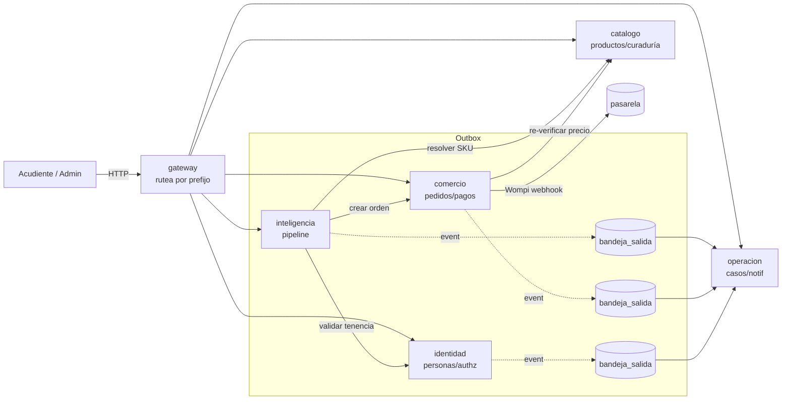
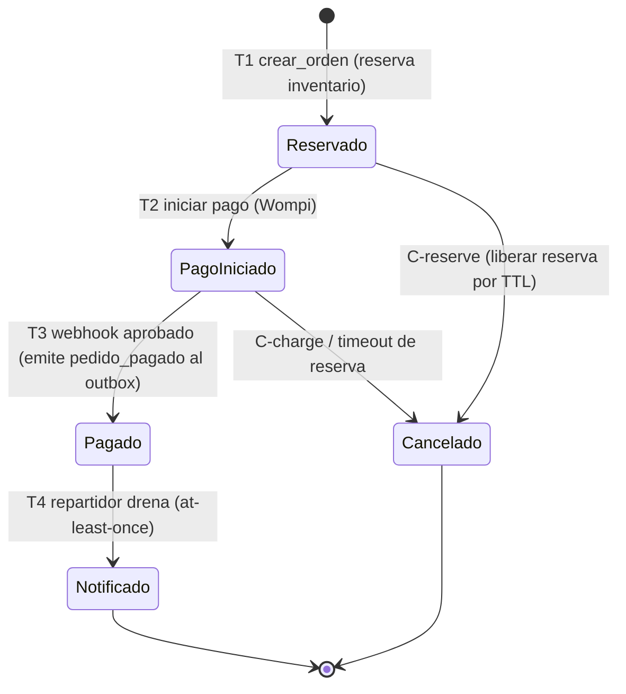

# Revisión de arquitectura de Tukit — diagnóstico y diseño objetivo

> **Estado de implementación (2026-09-29).** El backbone del diseño objetivo ya está **construido**
> sobre esta base, TDD y con la red verde en cada paso:
> - **B.1** Capas internas (dominio/routers/repositorios) — **HECHO** (era el punto de partida).
> - **B.2** Resiliencia (ADR 0020) — **HECHO**: `tukit_comun.resiliencia` (breaker **propio** por
>   destino + retry `tenacity` solo-GET), pools httpx por destino.
> - **B.3** Backbone de eventos (ADR 0022/0023/0024) — **HECHO**: drenador compartido
>   `tukit_comun.bandeja.drenar` (reemplaza la lógica triplicada), `Sink` intercambiable con
>   `BrokerSink` (RabbitMQ vía `aio-pika`, no-op sin `RABBITMQ_URL`), pipeline durable de
>   inteligencia (`trabajador.py` con SKIP LOCKED, ya no `asyncio.create_task`), y la compensación
>   C1 de la saga (barredor de reservas vencidas por TTL, `comercio/barredor.py`).
> - **B.4** Observabilidad (ADR 0021) — **HECHO**: logs estructurados atados al correlation-ID
>   (`tukit_comun.registro`), OTel no-op sin endpoint (`tukit_comun.telemetria`, extra `otel`),
>   correlation-ID persistido en el outbox y re-vinculado al drenar, y `/health/live` + `/health/ready`
>   (el gateway consulta readiness). **Falta** aún **B.5** (tiempo real) y **B.6** (frontend escalable).
>
> La suite de regresión creció a **1198 tests** (más 1 *skip*); mypy corre estricto sobre
> `tukit_comun.*` (`make tipos`, verde). El conteo de 1007 que aparece abajo era el del diagnóstico
> original y se conserva como foto de ese momento.

> **Dos partes.** La **Parte A (as-is)** es el diagnóstico verificado del sistema tal como está
> hoy: qué fronteras se respetan, qué comunicación ya trae lo caro de hacer bien, y dónde está la
> deuda real. La **Parte B (to-be)** es el diseño objetivo al que este documento eleva la
> arquitectura —capas internas limpias, resiliencia, observabilidad, saga con broker, tiempo real y
> frontend escalable— con un orden de migración guiado por pruebas que **no pierde funcionalidad**.
>
> El diseño no es aspiracional: cada decisión queda registrada como un ADR en el registro del
> repositorio de arquitectura (`../../Arquitectura/adr/`, decisiones **0019–0026**, continuando el
> registro que el acta de OE2 dejó en 0018), y cada refactor está atado a la red de regresión (los
> **1007** tests de Python del monorepo, verde en cada paso).
>
> **Documentos que gobiernan:** `arquitectura/manifiesto.toml` (fuente de verdad de las fronteras
> de datos, la leen las pruebas) y `arquitectura/CONTRATO_API.md` (fronteras de conversación). El
> LOCK de fronteras es el manifiesto, verificado por `arquitectura/test_fronteras.py`.
>
> **Alcance.** El manifiesto declara **siete** componentes (`identidad`, `catalogo`,
> `inteligencia`, `comercio`, `operacion`, `ingesta`, `gateway`); `servicios/` tiene hoy código para
> **seis**. `ingesta` está declarado con `base_datos = ""` y `tablas = []`
> (`manifiesto.toml:178-190`) y todavía no tiene directorio de código: las pruebas de frontera lo
> saltan a propósito (`test_fronteras.py:400`). Es un desplegable planeado. Todo lo que sigue se
> refiere a los seis que existen.

---

# PARTE A — Diagnóstico (as-is)

## A.1 Resumen ejecutivo

Las **fronteras entre servicios están sanas y demostradas**: una base por servicio, ningún import
cruzado, referencias entre dominios declaradas. No es un diagrama: está codificado en
`manifiesto.toml` y verificado en continuo por cinco funciones de aptitud (`test_fronteras.py`) que
a su vez tienen su propia meta-prueba de que de verdad detectan
(`test_fronteras_se_activan.py`). La comunicación entre servicios ya trae buena parte de lo caro:
timeouts por llamador, patrón *outbox* con `FOR UPDATE SKIP LOCKED`, degradación honesta (devolver
`None` o un rechazo de negocio en vez de un 500), una puerta que rutea por prefijo declarado con
disciplina 404/501/503, y **correlation-ID de punta a punta** (contextvar + middleware +
propagación saliente, ya en producción — §A.6).

La deuda estructural real es **una y está contenida**: los archivos de rutas están gordos. Un solo
manejador de FastAPI mezcla las tres capas —HTTP/validación, reglas de dominio y persistencia (SQL
crudo)— en la misma función. No es un problema de fronteras *entre* servicios (esas están bien); es
un problema de fronteras **dentro** de cada servicio. Se ve en el tamaño: `catalogo/admin_http.py`
= 1.984 líneas, `inteligencia/trabajos.py` = 1.826, `catalogo/admin.py` = 1.656,
`inteligencia/api.py` = 1.076.

A esa deuda de capas, este documento añade el listón que faltaba para un sistema que es **tesis de
grado y startup real** a la vez: resiliencia (circuit breakers, bulkheads, reintentos disciplinados),
observabilidad (trazas OTel + logs estructurados atados al correlation-ID que ya existe), un backbone
de eventos (outbox → broker), una saga explícita con compensaciones, ejecución de pipeline durable, y
un frontend con límites de carga/error y componentes descompuestos. La Parte B lo detalla.

## A.2 Los tests — la premisa refutada

La premisa a refutar fue *"un chorrero de tests inútiles"*. La evidencia dice lo contrario.

**Cuántos hay.** El monorepo colecta **1007 pruebas** de Python, repartidas en **50 archivos**
`test_*.py`:

| Ubicación | Archivos `test_*.py` | Qué asegura |
|---|---:|---|
| `arquitectura/` | 2 | Funciones de aptitud (fronteras entre servicios) + su meta-prueba |
| `servicios/catalogo/tests` | 20 | Catálogo, curaduría, cargadores, emparejamiento, embeddings, sustituibilidad |
| `servicios/inteligencia/tests` | 11 | Optimizador, trabajos, parseo, percepción, poller, onboarding |
| `servicios/identidad/tests` | 8 | Autorización, privacidad/derecho al olvido, sesiones, poller |
| `servicios/comercio/tests` | 4 | Checkout, precio congelado, estado de pedido, pasarela |
| `servicios/operacion/tests` | 4 | Repartidor (outbox), notificación sin contacto, API |
| `servicios/gateway/tests` | 1 | Ruteo por prefijo |
| **Total** | **50** | |

Que no son "inútiles" se ve en **qué afirman**. Las de `arquitectura/` atrapan el defecto que
originó el rediseño (dos servicios declarando el maestro del mismo catálogo,
`test_fronteras.py:156`). Las de dominio afirman reglas del contrato: que el subtotal de una línea
es `precio × unidades_a_comprar` y no `× cantidad_pedida` (`test_precio_congelado.py`), que un `422
precio_cambiado` frena la orden antes de cobrar (`test_checkout.py`), que el derecho al olvido
alcanza `kit.perfil`/`pesos_usados` (`test_privacidad.py`), que el emparejamiento se **abstiene** en
vez de inventar (`test_descubrir.py`).

**Higiene de la suite.** 0 `xfail` y solo 2 `skip`, ambos legítimos y en `test_fronteras.py`
(`:284`, la regla 3 no aplica a servicios sin base; `:400`, la prueba de lenguaje salta `ingesta`
mientras no tenga código). No son deuda escondida: son ramas de guarda que se apagan solas cuando el
componente exista.

### A.2.1 El test que fallaba era un falso positivo — YA CORREGIDO

Hasta esta pasada, correr `arquitectura/` daba `1 failed`:

```
FAILED test_fronteras.py::test_ningun_servicio_nombra_la_base_de_otro[inteligencia]
```

**Causa raíz.** La regla 3 ("una base por servicio") era la única de las cinco que **no** usaba
`ast`: leía cada línea de fuente cruda y marcaba `if base in linea`. La línea
`trabajos.py:1008` es un **docstring** que nombra el **paquete** hermano `tukit_operacion` —"El
repartidor de Operación (`tukit_operacion.repartidor`) lo drena y avisa"—, una referencia correcta
y deseable a quién drena la bandeja de salida. Pero por la convención `tukit_<servicio>`, ese nombre
de paquete coincide con el nombre de la **base** de operacion (`base_datos = "tukit_operacion"`), y
el detector de subcadena confundía la prosa con una conexión.

**Por qué era seguro cambiarlo.** `bd.py` deja explícito que *"el servicio no escribe el nombre de
su base como literal"* (`crear_motor` la deriva del entorno, `bd.py:118-128`). Luego una conexión a
una base ajena solo puede aparecer como un **literal de cadena** real (una URL incrustada), nunca
como prosa en un docstring o comentario. Ese es el discriminador exacto.

**El arreglo (hecho, TDD).** `test_ningun_servicio_nombra_la_base_de_otro` ahora parsea el AST y
busca el nombre de la base ajena solo en los **literales de cadena que no son docstrings**
(`_cadenas_no_docstring`, `test_fronteras.py`). Los comentarios ni siquiera están en el AST, así que
caen solos; una URL de conexión incrustada sigue siendo atrapada. Se añadieron tres meta-pruebas en
`test_fronteras_se_activan.py` que fijan el comportamiento: detecta la base en una cadena de
conexión, **no** la marca en el docstring del paquete hermano (reproduce `trabajos.py:1008`), y
**no** la marca en un comentario. Resultado: `arquitectura/` pasa de `1 failed, 54 passed` a **58
passed, 0 failed, 1 skipped**.

### A.2.2 Los tests de TypeScript no corren en CI (deuda de tubería)

Hay dos pruebas de TS: `libs/ts/tukit-contrato/test/atributos.test.ts` (su `package.json` sí define
`test`) y `apps/admin/test/atributos-editor.test.ts` (el `package.json` de `apps/admin` **no** tiene
script `test`). Y el `package.json` **raíz** agrega `lint` y `typecheck` sobre los workspaces pero
**no un `test` agregado**. En la práctica **ninguna de las 2 pruebas de TS corre en un pipeline**.
Es higiene barata (Parte B, §B.7), no un problema de arquitectura.

## A.3 "Archivos gordos" — confirmado, con matices

La queja es **cierta**, pero "no hay capas" es falso. Los servicios ya tienen parte de la separación
hecha, y bien:

- **`modelos/` en todos.** El ORM está partido por sub-dominio: `catalogo/modelos/` =
  `catalogo.py`, `editorial.py`, `listas.py`, `oferta.py`, `propuesta.py`, `base.py`;
  `comercio/modelos/` = `pedidos.py`, `inventario.py`, `pagos.py`, `entrega.py`, `proveedores.py`,
  `eventos.py`. Igual en el resto. La persistencia declarativa ya está separada del transporte.
- **`remoto.py` — el adaptador de salida HTTP.** `comercio`, `inteligencia` y `operacion` aíslan sus
  llamadas salientes en un `remoto.py` limpio: una clase por servicio-destino, sustituible en
  pruebas. `comercio/remoto.py` = 69 líneas ("re-verifica el precio con Catálogo");
  `inteligencia/remoto.py` = 292 líneas (clientes a Identidad, Catálogo, Comercio). **Corrección al
  diagnóstico previo:** `catalogo` **no** tiene `remoto.py` —no hace llamadas salientes—; solo lo
  tienen `comercio`, `inteligencia` y `operacion`.
- **Los *workers* están limpios y aparte.** `comercio/pasarela.py` (adaptador de pasarela),
  `operacion/repartidor.py`, los `poller.py` de `identidad` e `inteligencia` (drenadores de la
  bandeja), `operacion/notificador.py`. Ninguno mezcla HTTP con su trabajo.

El **matiz**: la deuda vive **dentro de los archivos de rutas**. La capa que falta no es "modelos"
ni "adaptadores de salida" —esas existen— sino la de **dominio** (reglas libres de HTTP) y la de
**repositorio** de la propia base. Hoy un solo manejador de FastAPI hace las tres cosas.

### A.3.1 Un caso concreto: `comercio.crear_orden` (`api.py:357-457`)

`POST /v1/ordenes` es el ejemplo limpio: en ~100 líneas se ven las tres capas trenzadas.

```python
@app.post("/v1/ordenes", ...)                                    # (a) HTTP
async def crear_orden(solicitud: SolicitudOrden) -> dict[str, Any]:
    usuario_id = _uuid_o_422(solicitud.usuario_id, "usuario_id")            # (a) validación
    ...
    for linea in solicitud.lineas:                                          # (b) DOMINIO:
        resuelto = await app.state.catalogo.resolver(linea.sku)             #     re-verificar
        precio_actual = resuelto[1] if resuelto else None                   #     precio,
        if resuelto is None or precio_actual != linea.precio_unitario:      #     invariante §9.1
            cambios.append({...})
    if cambios:
        raise ErrorDominio("precio_cambiado", ..., estado=422, campo="lineas")
    async with app.state.motor.sesion() as db:                             # (c) PERSISTENCIA:
        conexion = await db.connection()                                    #     SQL crudo,
        await conexion.execute(insert(PEDIDO).values(...))                  #     4 inserts
        for linea in solicitud.lineas:                                      #     (pedido, línea,
            await conexion.execute(insert(LINEA_PEDIDO).values(...))        #      reserva, envío)
            await conexion.execute(insert(RESERVA).values(...))
        await conexion.execute(insert(ENVIO).values(...))
        return await _pedido_completo(conexion, fila)                       # (a) serializar
```

La invariante que importa —"si el precio cambió, no cierres" (`FU-08`)— es una regla **pura** que
hoy solo se puede probar *end to end* (falsear el cliente de Catálogo, montar el motor, ejercer
HTTP), cuando debería probarse con una lista de líneas y un diccionario de precios. Ese es el costo
de la mezcla, y es el mismo en `catalogo/admin_http.py` y `inteligencia/trabajos.py`.

## A.4 Comunicación entre servicios — lo que YA está (verificado en código)

- **Timeouts por llamador.** Cada adaptador fija su propio `ESPERA_SEGUNDOS`, no un global:
  `gateway/api.py` = 300 s (pipeline de minutos detrás), `inteligencia/remoto.py` = 60 s,
  `comercio/remoto.py` = 30 s, `comercio/pasarela.py` = 30 s, `operacion/remoto.py` = 30 s. El
  ayudante `cliente_efimero(cliente, espera)` (`tukit_comun/http.py:106-137`) centraliza solo el
  **ciclo de vida** del cliente httpx.
- **Patrón *outbox* con `FOR UPDATE SKIP LOCKED`.** Cada servicio tiene su `bandeja_salida` local
  (única tabla replicada, `manifiesto.toml:36`) y el evento se escribe en la MISMA transacción que
  el cambio que lo origina (`inteligencia/trabajos.py:1005`, `_publicar_evento`). Los drenadores
  usan bloqueo sin espera: `operacion/repartidor.py`, `identidad/poller.py`, `inteligencia/poller.py`
  — todos `.with_for_update(skip_locked=True)`.
- **Degradación honesta.** Los `remoto.py` devuelven `None` cuando la dependencia opcional no
  responde (caída de Identidad degrada el trabajo, no lo tumba). El cliente de Comercio pasa los
  rechazos de negocio como `(estado, cuerpo)` y solo levanta en 5xx/red. En el cobro, Catálogo caído
  es `503`, nunca un cobro a ciegas (`comercio/remoto.py:56-66`).
- **Correlation-ID de punta a punta (YA implementado).** Ver §A.6.
- **Sondas.** `GET /salud` en cada servicio (`tukit_comun/http.py:226-228`) y `GET /v1/servicios` en
  la puerta, que pega al `/salud` de los de atrás.
- **Puerta con disciplina de códigos.** Ruteo por prefijo declarado: ruta desconocida →
  `404 ruta_desconocida`; ruta del contrato sin servicio → `501 no_implementado`; servicio caído →
  `503 servicio_no_disponible` (no 502: "no falló, no está").

## A.5 Lo que NO está (y este documento añade)

- **Reintentos / *backoff*** — no hay reintento automático de ninguna llamada saliente. → §B.2.
- **Circuit breakers / bulkheads** — no hay aislamiento de fallos. → §B.2.
- **Métricas / *tracing* distribuido** — no hay instrumentación de trazas ni exportador. → §B.4.
- **Broker de eventos** — el outbox se drena directo al notificador, sin backbone. → §B.3.
- **Saga explícita** — la coreografía orden→pago→despacho existe implícita, sin compensación de
  reserva. → §B.3.
- **Ejecución de pipeline durable** — `lanzar` es un `asyncio.create_task` en proceso; un reinicio
  deja el trabajo en `procesando` (lo dice su propio docstring, `trabajos.py:994-1000`). → §B.3.
- **Readiness distinta de liveness** — `/salud` dice "vivo", no "listo para servir". → §B.4.
- **Frontend: límites de carga/error, componentes descompuestos, tiempo real** — cero
  `loading.tsx`/`error.tsx`/`Suspense`; god components; polling en vez de push. → §B.5, §B.6.

## A.6 Correlation-ID — YA implementado (corrige el diagnóstico previo)

> Una revisión anterior de este documento describía el correlation-ID como "se implementa aparte, en
> curso, PR pendiente". **Eso ya no es cierto: está en el código y en producción.** Se documenta aquí
> como capacidad presente, base sobre la que se apoya la observabilidad de la Parte B.

- **Contextvar de módulo** — `CABECERA_CORRELACION = "x-correlation-id"` y
  `_correlacion: ContextVar[str | None]` (`tukit_comun/http.py:57-60`), leído por
  `id_de_correlacion()` (`:63-70`).
- **Middleware por petición** — `_correlacion_mw` (`:185-198`): lee `x-correlation-id` de la
  cabecera o acuña un `uuid4().hex`, lo fija en el contextvar durante la petición y lo **eco** de
  vuelta en la respuesta (`:192-198`).
- **Propagación saliente** — `cliente_efimero` añade `x-correlation-id` de forma aditiva a las
  llamadas salientes tomándolo del contextvar (`:127-128`). Una petición del acudiente que atraviesa
  gateway → inteligencia → catálogo/identidad/comercio arrastra el mismo id por toda la cadena.
- **Punto de acuñado de entrada** — la puerta, único punto por el que pasa todo el tráfico, no
  incluye `x-correlation-id` en `CABECERAS_SALTADAS`, así que viaja intacto.

Lo que **falta** sobre esta base (y §B.4 añade): (1) el id no está aún **atado a las líneas de log**
(hay que verlo en cada log estructurado), y (2) no cruza el **outbox** (un evento drenado pierde el
hilo de la petición que lo originó).

---

# PARTE B — Diseño objetivo (to-be)

> El listón: la mejor arquitectura, código limpio, excelentemente documentado. Cada sección tiene un
> ADR en `../../Arquitectura/adr/` (0019–0026). La regla que no se negocia: **sin perder funcionalidad** — los 1007
> tests son la red, verde en cada paso, y cada extracción se revierte si un test de integración se
> pone rojo.

## B.0 Mapa de servicios (as-is) y flujo del acudiente



Cada servicio tiene su base (una por servicio, `manifiesto.toml`); las flechas punteadas son eventos
por outbox, las sólidas son HTTP síncrono con degradación honesta.

## B.1 Capas internas por servicio — puertos y adaptadores ligero (ADR 0019) · TDD

**Por qué no MVC.** La API es *headless*: devuelve JSON, el frontend Next.js pinta. No hay Vista que
separar. Lo que falta es una capa de **dominio** libre de HTTP.

**Estructura objetivo (todos menos gateway):**

```
servicios/<svc>/tukit_<svc>/
├── api.py            # crear_app + include_router(...)  (queda delgado)
├── routers/          # adaptador de entrada: parsea → llama dominio → traduce a sobre de error. Sin reglas, sin SQL
├── dominio/          # PURO: dataclasses + funciones. Sin FastAPI/SQLAlchemy/httpx. Declara los Protocol (puertos)
├── repositorios/     # adaptador de salida a la propia base: el SQL, detrás del Protocol que el dominio pide
├── modelos/          # (EXISTE) ORM declarativo — reusar tal cual
└── remoto.py         # (EXISTE en comercio/inteligencia/operacion) — reusar; la resiliencia se añade aquí (§B.2)
```

- **`gateway/api.py` (264 LOC) se queda plano** — el manifiesto lo declara "sin dominio y sin base";
  meterle carpetas sería inventar capas para un componente que a propósito no tiene ninguna.
- **`ingesta`** nace con la forma objetivo cuando tenga código.

**Patrones a reusar (no reinventar):**

- **Puertos como `Protocol`** imitando `comercio/tukit_comercio/pasarela.py:84`
  (`class PasarelaPago(Protocol)`), que ya es ports-and-adapters de libro. El `Protocol` vive en
  `dominio/`; la clase concreta en `repositorios/`.
- **DI**: singletons (motor, clientes remotos, pasarela) siguen en `app.state` vía `_arrancar`
  (`comercio/api.py:74-80`). Repos por-petición con `Depends`: nuevo helper compartido
  `tukit_comun/dependencias.py::repo_dep(construir)` que abre `motor.sesion()` y construye el repo
  atado a la conexión. `MotorServicio.sesion()` ya hace commit/rollback (`bd.py:60-70`).
- **Pureza async**: el router hace los `await` (resuelve todos los SKU de una) y pasa **datos
  planos** al dominio. El dominio recibe `resueltos.get` (dict puro), no un cliente async — se evita
  todo hack de "correr async dentro de una lambda pura".

**Ejemplo de referencia — `comercio.crear_orden` refactorizado:**

```python
# dominio/ordenes.py — PURO, probable con assert (sin FastAPI ni Postgres)
@dataclass(frozen=True)
class CambioPrecio:
    sku: str
    precio_aprobado: int
    precio_actual: int | None

def reverificar_precios(
    lineas: list[LineaSolicitada],
    precio_vigente: Callable[[str], tuple[uuid.UUID, int | None] | None],
) -> tuple[dict[str, uuid.UUID], list[CambioPrecio]]:
    """Invariante FU-08 (§9): qué líneas cambiaron y cuáles quedan congelables."""
    ...

# routers/ordenes.py — delgado
@router.post("/v1/ordenes", status_code=201)
async def crear_orden(solicitud, repo: RepoPedidos = Depends(...)):
    resueltos = {l.sku: await app.state.catalogo.resolver(l.sku) for l in solicitud.lineas}  # await AQUÍ
    ids, cambios = reverificar_precios(solicitud.lineas, resueltos.get)  # dominio, puro
    if cambios:
        raise ErrorDominio("precio_cambiado", ..., estado=422, campo="lineas")
    return await repo.crear_pedido(solicitud, ids)  # repositorio

# repositorios/pedidos.py — el SQL, aislado (los 4 inserts, verbatim desde api.py:408-455)
class RepoPedidosSQL:
    async def crear_pedido(self, solicitud, ids) -> dict: ...
```

**Orden de migración (TDD por servicio):** (a) escribir tests de dominio puro **fallando** contra la
API deseada de `dominio/`, verlos fallar; (b) extraer dominio (verde); (c) extraer `repositorios/`
(SQL fuera del handler, comportamiento intacto); (d) adelgazar router; (e) **confirmar que los tests
de integración HTTP+DB pre-existentes siguen verdes**. Si uno se pone rojo, la extracción cambió
comportamiento → revertir.

| # | Servicio | LOC clave | Por qué en este orden |
|---|---|---:|---|
| 1 | `comercio` | `api.py` 682 | Referencia; invariante del dinero; red = 4 tests |
| 2 | `operacion` | `api.py` 323 | Casi delgado; valida la plantilla barato |
| 3 | `catalogo` | `admin_http.py` 1.984 · `admin.py` 1.656 · `descubrir.py` 1.338 | Mecánico; red = 20 tests; `admin_http.py` ya usa `APIRouter` |
| 4 | `identidad` | (autorización ya aislada) | Resto = router + repo |
| 5 | `inteligencia` | `trabajos.py` 1.826 · `api.py` 1.076 | **El más riesgoso**: orquestador con estado (ver abajo) |

**De-riesgo de `inteligencia`:** (i) cosechar lo ya-puro (`estado_desde_emparejamiento`,
`_normalizar`, optimizador) a `dominio/pipeline.py` con tests `assert`; (ii) máquina de estados como
**tabla pura** (`dominio/maquina.py`) testeando cada par `(estado, evento)`; (iii) introducir la
**cola durable (§B.3) ANTES** de adelgazar `procesar`, para que un crash sea retomable; (iv) tests
de caracterización golden-path (fast/slow) antes de extraer; (v) extraer repos por-transacción, uno
a uno, red verde tras cada uno.

## B.2 Resiliencia entre servicios (ADR 0020)

**Reusar lo que ya está bien:** timeouts por-llamador (no globalizar) y degradación honesta (cada
`remoto.py` declara su contrato: `None` para opcional, `(estado, cuerpo)` para rechazo de negocio,
`CatalogoCaido`→503 para el cobro).

- **`tukit_comun/resiliencia.py` (nuevo):** context manager
  `llamada_protegida(destino, *, reintentable=False)` que compone **circuit breaker + retry**.
  - **Circuit breaker = `Disyuntor` propio** (~40 líneas puras, `async with`, sin
    `purgatory-circuitbreaker` — se descartó porque arrastra `pkg_resources`/`setuptools`, ya
    deprecado; el estado del breaker es in-memory por proceso, con el almacén intercambiable a Redis
    para multi-réplica). **Uno por destino** (`catalogo`, `identidad`, `comercio`, `wompi`) — el
    mismo límite es la frontera del bulkhead. Umbrales generosos (abre a 5 fallos, prueba a 30 s).
    (ADR 0020) *(Implementado así; el ADR 0020 recoge la corrección.)*
  - **Retry (`tenacity`) SOLO en GET idempotentes** (`reintentable=True` permitido solo en lecturas:
    `ClienteCatalogo.emparejar/listas/lista/producto`). **POSTs NUNCA reintentan a nivel
    transporte** — un reintento ciego sobre `POST /v1/ordenes` es un doble cobro, el modo de falla
    más caro. Las escrituras se protegen con **idempotencia de aplicación** generalizando el patrón
    del webhook Wompi (`comercio.evento_pasarela_procesado`, `api.py:559-607`): `Idempotency-Key` /
    clave natural + tabla de dedup. Self-check: el helper **rechaza** un no-GET con
    `reintentable=True`. (ADR 0020)
- **Bulkheads = pools httpx por destino (ADR 0020):** un `httpx.AsyncClient` de vida larga por
  (servicio, destino) en `app.state.remotos`, con `httpx.Limits` explícito. `cliente_efimero` se
  conserva para el path inyectado (tests) y su propagación de correlation-ID; `remoto.py` pasa el
  cliente del pool a `cliente_efimero(self.cliente, …)`.

## B.3 Backbone de eventos: outbox como fuente de verdad + broker (ADR 0022 extiende 0007; saga 0023; pipeline durable 0024 concreta 0018)

El outbox transaccional es correcto e insustituible (el dual-write es el bug que arregla). Se
**mantiene** y se le **añade un broker real ahora** para push sub-segundo, fan-out multi-consumidor y
replay.

- **Drenador compartido `tukit_comun/bandeja.py` (nuevo):** `drenar(motor, manejar, *, limite)` con
  la reflexión de la tabla replicada + `FOR UPDATE SKIP LOCKED` + marcar-publicado/bump-intentos.
  Hoy esa lógica está triplicada (`operacion/repartidor.py`, `identidad/poller.py`,
  `inteligencia/poller.py`). Un solo lugar para el span OTel y el re-bind del correlation-ID (§B.4).
- **Sink intercambiable:** el drenador entrega a un `Sink(Protocol)`. `NotifierSink` (hoy) +
  **`BrokerSink`** — el drenador publica al broker; los consumidores consumen de colas/exchanges.
  **Recomendación: RabbitMQ** (`aio-pika`) sobre Kafka — routing por topic/DLQ encaja con la mezcla
  comando/evento de la saga a escala de 6 servicios; Kafka es log-replay pensado para millones/s que
  aquí no aplican — decisión ya tomada en la ADR 0007, que la ADR 0022 extiende definiendo cómo el
  outbox alimenta el broker. El outbox **nunca desaparece**: el broker es *upgrade de entrega*, no
  cambio de arquitectura.
- **Ejecución de pipeline durable (ADR 0024, concreta la 0018):** `inteligencia.lanzar`
  (`trabajos.py:993-1002`, `asyncio.create_task`) → escribir el job como `encolado` y drenarlo con el
  mismo `SKIP LOCKED` compartido, de modo que un crash a mitad de job deja una fila retomable por
  otro worker. Cierra el "se queda en procesando para siempre" que el propio docstring reconoce.

**Saga orden→pago→despacho (coreografía, ADR 0023):**



Funciones de transición **puras** en `dominio/saga.py`, reusando `transicion_valida`
(`comercio/api.py:35`) y `_pedido_tras_pago` (`api.py:524-533`, ya puro → mover a `dominio/pagos.py`).
Compensaciones: **C-reserve** (liberar `reserva_inventario` por TTL — *gap actual, añadir*),
**C-charge** (reembolso, ya en `retractar_orden` `api.py:650-659`), **T4** = at-least-once
(reintento, no compensación).

## B.4 Observabilidad (ADR 0021)

- **Logs estructurados atados al correlation-ID (ADR 0021):** `tukit_comun/registro.py` (nuevo) con
  un `logging.Filter` (stdlib, ~15 líneas, sin dependencia nueva) que lee `id_de_correlacion()`
  (`http.py:63`) e inyecta `correlacion` en cada línea JSON. `crear_app` llama
  `configurar_registro(titulo)`.
- **OpenTelemetry — trazas + métricas (ADR 0021):** instrumentar en el factory compartido `crear_app`
  (`FastAPIInstrumentor`, `HTTPXClientInstrumentor` → propaga `traceparent` W3C junto al
  correlation-ID) y `SQLAlchemyInstrumentor` en cada `_arrancar`. Exportador OTLP desde env
  (`OTEL_EXPORTER_OTLP_ENDPOINT`), **no-op si no está** (como `WOMPI_MODO=falso`). Nuevo
  `tukit_comun/telemetria.py`. Métricas de dominio: `tukit.ordenes.creadas`, `tukit.pagos.aprobados`,
  `tukit.trabajos.publicados`, gauge `tukit.breaker.abierto`.
- **Correlation-ID a través del outbox (ADR 0021):** persistir `correlacion_id` en el `carga` del
  evento (`_publicar_evento` + insert del webhook) y **re-bindearlo** en `tukit_comun/bandeja.py`
  antes de manejar cada evento. Cierra los dos huecos de §A.6.
- **Liveness vs readiness (ADR 0021):** conservar `/salud` (alias liveness); añadir en `crear_app`
  `GET /health/live` (loop vivo) y `GET /health/ready` (DB `SELECT 1` con `pool_pre_ping` ya activo
  `bd.py:126` + head de Alembic; 503 con qué falló). **Gateway `/v1/servicios` pasa a consultar
  `/health/ready`** — "todos_arriba" = "pueden servir".

## B.5 Tiempo real: SSE (progreso) + WebSocket (colaboración admin) — Opción B (ADR 0025)

**Backend:**
- **SSE progreso del acudiente:** `inteligencia` expone `GET /v1/trabajos/{id}/eventos`
  (`text/event-stream`), alimentado por las transiciones de estado del job; `id:` monotónico para
  `Last-Event-ID`; cierra en `publicado`/`fallido`. Emite el mismo shape `Trabajo` que el poll.
- **Gateway:** `reenviar` hace **passthrough en streaming** (`StreamingResponse`) cuando el upstream
  es `text/event-stream` — hoy `respuesta.content` bufferiza el cuerpo entero y un stream nunca haría
  flush. **WS NO pasa por el gateway HTTP**: el endpoint socket.io vive al lado, en su propio origen,
  y el admin conecta directo con su JWT (el gateway sigue "sin dominio, sin base").
- **WS colaboración admin (socket.io):** namespace `/revision`, sala por `trabajo:{id}` + sala
  `cola`; auth JWT-en-handshake; mensajes tipados (a `@tukit/contrato`): `presencia:entra/sale`,
  `bloqueo:pedir/soltar/negado` (lock advisory con TTL, liberado en `disconnect`),
  `invalidar:{queryKey}`. **Bloqueo de edición = advisory + backstop de concurrencia optimista**
  (version token en la mutación, porque es un camino de pérdida de datos). Adaptador Redis stubbeado
  detrás del in-memory.

**Frontend:**
- **`apps/web`**: hook `usarEventosTrabajo(trabajoId, alCambiar, alFallar)` con `EventSource` que
  reemplaza a `sondear()` en `PantallaEspera`; **conserva `sondear()`** (`api-navegador.ts:180-211`)
  como degradación cuando `EventSource.CLOSED`. Route handler que hace pipe del `ReadableStream` del
  gateway (URL del backend queda server-side).
- **`apps/admin`**: hook `usarPresencia(trabajoId)` con `socket.io-client`; `invalidar` →
  `queryClient.invalidateQueries`.

## B.6 Frontend escalable (React 19 / Next 16) · TDD donde hay lógica

- **Boundaries en cada segmento async** (hoy **cero**): `loading.tsx` + `error.tsx` (+ `not-found.tsx`)
  en `esperando/[trabajo_id]`, `onboarding/[version_id]`, admin `catalogo`, `logistica`, dashboard
  `/`, y `global-error.tsx` por app.
- **Streaming del dashboard** (`apps/admin/src/app/page.tsx`, hoy `Promise.allSettled` sobre 6+N
  fuentes bloqueando el primer byte): shell servidor + `<Suspense>` por sección; `SeccionCaida` se
  mueve al error de cada sección.
- **Descomponer god components** (regla: server por defecto, `"use client"` en la hoja):
  `EditorProducto.tsx` (549L, 21 `useState`) → `useReducer` + sub-editores + grilla de atributos
  compartida; `FormularioEmpezar.tsx` (835L) → shell servidor + `maquina-empezar.ts` (reducer de
  unión discriminada) + islas por paso + `enviar-solicitud.ts` **puro** (3 rutas
  fast-path/crear/subir); `LineaRevision`/`MatrizComparacion` → `RevisionProvider` (context) que mata
  el prop-drill de 4 niveles.
- **TanStack Query acotado** (no blanket): solo (a) clusters de mutación del admin —invalidan
  queryKeys en vez de `router.refresh()`/`recargar()`, con updates optimistas— y (b) la pantalla de
  job en vivo (SSE escribe con `setQueryData`, poll como `refetchInterval` fallback). El resto sigue
  RSC. **Sin Zustand/Redux.**
- **`libs/ts/tukit-ui` (nuevo, junto a `@tukit/contrato`):** mover `Revelar`, `SalirBoton`, variantes
  de botón, la grilla de atributos, plantillas de skeleton/boundary. Re-exporta
  `@tukit/contrato/tokens.css`. Solo lo realmente duplicado o requerido por los boundaries.

## B.7 Tests limpios y útiles + tipos estrictos (ADR 0026)

**Podar bajo-valor** (justificado en cada commit): `test_notificacion_sin_contacto.py` (tautología
de esquema), `test_embeddings.py::test_es_determinista`/`test_da_un_vector` (prueban el doble),
`test_embeddings.py::test_no_sale_a_la_red` (chequeo frágil de fuente → mover a lint),
`test_atributos_contrato.py::test_no_queda_rastro_del_campo_unico` (migración de una sola vez), smoke
tests que solo afirman `status==201` sin invariante.

**Conservar y fortalecer:** `test_precio_congelado`, `test_checkout`, `test_privacidad`,
`test_autorizacion`, `test_descubrir`, `test_pasarela`, `test_fronteras[_se_activan]`.

**Convertir integración→unidad** al extraer dominio: reglas que hoy exigen FastAPI+Postgres pasan a
tests `assert` puros sobre `dominio/` (`reverificar_precios`, la máquina del pipeline, la saga). Es
el payoff directo de §B.1.

**Tests nuevos TDD** para toda lógica nueva: helper de resiliencia (rechaza retry en no-GET),
`bandeja.drenar` (SKIP LOCKED + re-bind correlación), transiciones de saga, `maquina-empezar`,
`enviar-solicitud`, degradación del hook SSE, invalidación de mutación.

**Wiring de tests TS:** root `package.json` gana `"test": "npm run test --workspaces --if-present"` y
`"test:ci": "npm run typecheck && npm run lint && npm run test"`; `apps/admin` y `apps/web` ganan
script `test`. `node --test` para lógica pura; **Vitest + RTL** solo para componentes/hooks con DOM.

**Tipos:** `mypy --strict` incremental por paquete. `strict=false` global + overrides `strict=true`
primero para `tukit_comun.*`, luego por servicio a medida que se refactoriza (el `dominio/` puro tipa
limpio). Docstrings Google para la API pública nueva. `ruff` gana `D` por-paquete. `make tipos` verde
desde el día 1.

---

## Veredicto

Las fronteras que de verdad importan —las que separan seis desplegables sobre cinco bases— están
declaradas en `manifiesto.toml` y verificadas por funciones de aptitud que reproducen defectos reales
del sistema anterior; la única que fallaba era un falso positivo de detección, **ya corregido** con
AST + TDD (§A.2.1). La comunicación ya trae timeouts por llamador, outbox transaccional con
`SKIP LOCKED`, degradación honesta, una puerta disciplinada y **correlation-ID de punta a punta ya en
producción** (§A.6).

La deuda estructural está contenida a los archivos de rutas gordos, y la Parte B la paga con capas
limpias guiadas por pruebas (§B.1). Sobre esa base, el diseño objetivo eleva el sistema al listón de
tesis + startup: resiliencia (§B.2), backbone de eventos con broker y saga (§B.3), observabilidad
completa sobre el correlation-ID existente (§B.4), tiempo real (§B.5), frontend escalable (§B.6) y
una suite de tests podada y tipos estrictos (§B.7) — todo registrado en las ADR 0019–0026 (que
continúan el registro del acta de OE2 y extienden/concretan las decisiones 0007 y 0018) y todo **sin
perder funcionalidad**.
