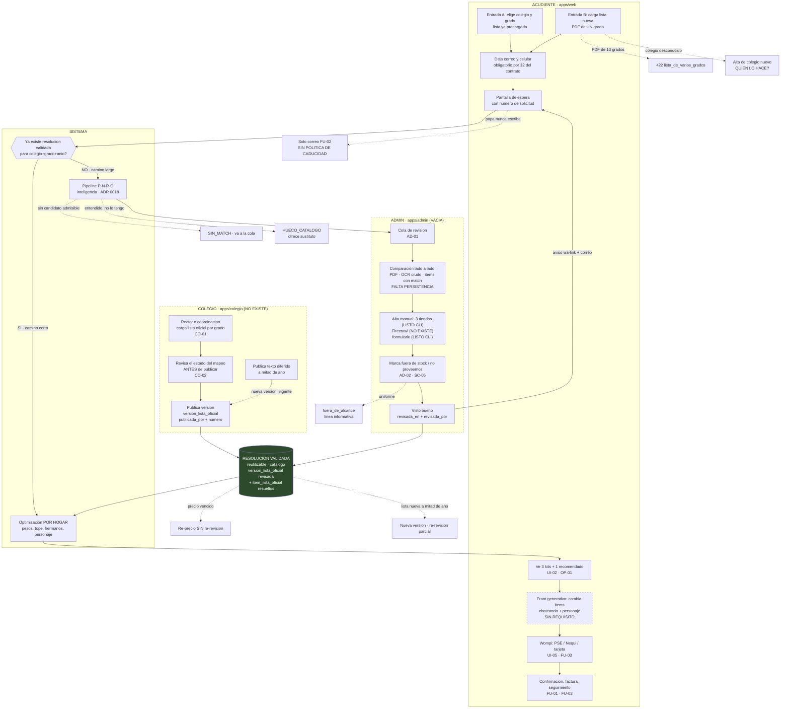

# Flujo de extremo a extremo por actor, y qué falta para cerrarlo

- **Tipo:** análisis y diseño. No hay código de producción en este documento.
- **Fecha del análisis:** 2026-09-22
- **Fuentes de verdad consultadas, con su estado en el momento de leerlas:**
  - `Arquitectura/ARQUITECTURA.md` v1.0 (lock del 2026-09-21) y `Arquitectura/adr/0001`–`0018`. **Manda sobre todo lo demás**, por su propia regla de §0.
  - `tukit/arquitectura/CONTRATO_API.md` **v1.0**, leído a las 10:36 del 2026-09-22. Se fecha porque está cambiando: hay un agente extendiéndolo a v1.1 con la lectura de catálogo. Todo lo que este documento afirme del contrato hay que releerlo contra la v1.1 antes de actuar.
  - `tukit/arquitectura/manifiesto.toml` (versión 3, 70 tablas) y `test_fronteras.py`.
  - `SRS_ISIS2610G19_v2.pdf`, extraído completo y verificado código por código.
  - El plan vigente `pipeline_end-to-end_monorepo_4a4ee99a.plan.md`.
  - El código real de `tukit/servicios/**`, `tukit-mvp-pipeline/` y `tukit-mvp-front/`.

> **Advertencia de concurrencia.** Mientras se escribió esto había dos agentes construyendo:
> uno sobre `servicios/**`, `infra/**` y el contrato; otro sobre `apps/**`. Las afirmaciones
> sobre el estado del código valen para el árbol tal como estaba a las 10:40 del 2026-09-22.
> Donde digo "no existe", verifiqué con una búsqueda concreta y la cito.

---

## 0. Los tres hallazgos que cambian el orden del trabajo

Antes del análisis largo, lo que un lector apurado necesita saber.

**Primero: el contrato de la API cita ocho requisitos del SRS que no existen.** Este conteo se
hizo contra el **PDF v2**, que define `AD-01`, `AD-02` y `AD-03` y nada más en el módulo de
administración; la línea base era el `.docx` v3. `CONTRATO_API.md` §7 amarra sus siete
endpoints de revisión a `AD-04`, `AD-05`, `AD-06` y `AD-07`, y §8–§9 citan `AD-25`, `AD-26`,
`AD-33` y `FU-06`. Esos ocho son los que no aparecen. `FU-04` sí existe desde el v3, y los tres
que el plan agrega —`PR-08`, `UM-03` y `AM-01`— también: no eran inexistentes, estaban fuera
del v2. Esto no es un detalle de formato: la superficie compartida del proyecto está trazada
contra requisitos imaginarios, y es un documento calificable. Se arregla en §5.1, y es barato arreglarlo porque
la **intención** sí tiene requisito; lo que está mal es el número.

**Segundo: el actor colegio está diseñado, y lo que falta es construirlo.** El SRS le dedica un
módulo entero (§3.7, Panel Colegio B2B) con `CO-01`, `CO-02` y `CO-03`, y lo declara actor en la
tabla de usuarios. El ADR 0008 le da aplicación propia. `ARQUITECTURA.md` §1 dice literalmente
que `apps/colegio/` **está pendiente de portar**. El modelo de datos que necesita —`lista_oficial`,
`version_lista_oficial` con `publicada_por`, el ciclo editorial completo— ya está escrito en
`servicios/catalogo/tukit_catalogo/modelos/`. Lo que no existe es ni una línea de código que
permita a un colegio hacer nada. Y **el plan vigente no lo menciona**: su reparto por
microservicio nombra `apps/web` y `apps/admin` y omite `apps/colegio`, con lo cual el plan se
desalinea del lock de arquitectura. Es un hallazgo de gobierno, no solo una tarea faltante.

**Tercero: el requisito de reutilizar la aprobación ya tiene la mitad de su modelo construido,
y nadie lo está usando para eso.** `version_lista_oficial.revisada_en` / `revisada_por`
(`modelos/listas.py:101-102`) es exactamente la puerta de "esto se revisa una vez y no se
vuelve a abrir", y `descubrir.py:411-425` la hace cumplir con una excepción dedicada. Pero hoy
esa puerta gobierna **el alta de productos en el catálogo**, no **la entrega de kits al
acudiente**. Extenderla es el trabajo de §4, y resulta ser mucho más barato de lo que parecía
porque la estructura ya está.

---

## 1. Estado real del código, medido

Conviene fijarlo antes de hablar de huecos, porque la distancia entre lo diseñado y lo
construido es grande y asimétrica.

| Componente | Archivos reales | Qué hay | Qué no hay |
|---|---:|---|---|
| `servicios/catalogo` | 45 | 19 tablas, 4 migraciones Alembic, cliente de 3 tiendas, curaduría, cola de propuestas, ciclo editorial | Sin API HTTP de producto |
| `servicios/identidad` | 16 | Tenencia, autorización con ámbito, privacidad | Sin roles ni permisos sembrados; sin API |
| `servicios/inteligencia` | 9 | `percepcion.py`, `gemini.py`, `parseo.py`, `paginas.py` (portados hoy) | Resolución, optimización, kits, trabajos durables |
| `servicios/comercio` | **0** | — | Todo |
| `servicios/operacion` | **0** | — | Todo |
| `servicios/ingesta` | **0** | — | Todo |
| `servicios/gateway` | **0** | — | Todo |
| `apps/web` | 33 | Copia del prototipo: `subir`, `revisar`, `dashboard` | Ver §1.2 |
| `apps/admin` | **0** | Carpeta creada, vacía | Todo |
| `apps/colegio` | **no existe** | — | Todo |

**Cuando se escribió esto no había ninguna API HTTP de dominio en todo `tukit/servicios/**`.**
Busqué `FastAPI`, `APIRouter`, `uvicorn` y `BaseHTTPRequestHandler`: la única mención de FastAPI
en el árbol era un comentario en `catalogo/tukit_catalogo/admin.py:14` que explica por qué **no**
se usa. Lo único que servía HTTP era ese mismo `admin.py`, un `ThreadingHTTPServer` sobre
`127.0.0.1:8000` para curaduría interna, con `GET /`, `GET /cola` y siete `POST` de alta y
resolución. Es un precursor honesto de `apps/admin`, no un backend. **Ya no es así:** existe
`servicios/catalogo/tukit_catalogo/api.py`, obra del agente de backend, que confirma la
advertencia de concurrencia de §8 de este mismo documento.

Esto importa para leer el contrato: `CONTRATO_API.md` describe una API **deseada**. El cliente
tipado que el agente de frontend está armando en `libs/ts/tukit-contrato/src/cliente-http.ts`
apunta a rutas `/v1/...` que hoy no responde nadie.

### 1.1 Las tres APIs de tiendas: existen, están en el monorepo, y están mejor de lo esperado

La usuaria las dio por sentadas. Lo son, y con precisión mayor a la que ella describió.

Viven en `servicios/catalogo/tukit_catalogo/tiendas.py`, que es **la única puerta del catálogo
hacia afuera** por diseño explícito del módulo. Son tres y no corren sobre la misma plataforma
(`tiendas.py:64-77`):

| Tienda | `slug` | Dominio | Plataforma | Cómo se busca |
|---|---|---|---|---|
| Éxito | `exito` | `www.exito.com` | VTEX | `/api/catalog_system/pub/products/search?ft=` |
| Panamericana | `panamericana` | `www.panamericana.com.co` | VTEX | ídem |
| Papelería Grancentral | `grancentral` | `pgrancentral.com` | Shopify | `/products.json` completo, filtrado en casa |

Las tres están sembradas en `datos/catalogo/tiendas.csv` con su UUID estable. VTEX expone
además ficha exacta por slug (`ficha()`), que es la que da precio e imagen fiables; la búsqueda
solo da candidatos. Esa distinción está separada en funciones distintas a propósito y el módulo
explica por qué. Todo lo descargado queda en `datos/catalogo/cache_tiendas/` (178 respuestas
versionadas), no por velocidad sino para que el catálogo sea reconstruible sin red.

**Y el alta manual del admin ya está construida, en CLI.** `descubrir.py` tiene los dos caminos
que la usuaria pidió:

- `--crear-util --concepto C048 --consulta "..."` (`descubrir.py:970-1102`) consulta las tres
  tiendas, aplica el filtro de "todas las palabras de la consulta en el nombre", lista candidatos
  numerados sin escribir nada, y con `--elegir N` encola el elegido. Dos pasos a propósito.
- `--crear-libro --isbn ... --titulo ... --precio ... --tienda ...` (`descubrir.py:871-968`) es el
  formulario manual puro, con validación del dígito de control del ISBN antes de tocar la base.

Ambos exigen una versión de lista **sin revisar** (`abrir_revision` → `exigir_sin_revisar`), y
ambos encolan en `propuesta_producto` en vez de escribir catálogo: nada entra sin que una
persona apruebe (`--aprobar ID --nivel ...`), y ahí sí nace el producto canónico con su oferta y
su primer precio, en una sola transacción (`resolver`, `descubrir.py:621-782`).

La conclusión operativa es buena: **de las tres fuentes que la usuaria quiere para el alta
manual, dos están construidas y probadas.** Lo que falta no es la lógica sino la pantalla y el
endpoint que la expongan.

### 1.2 Firecrawl: no está integrado. Es trabajo nuevo.

Aquí hay que corregir una impresión. Firecrawl aparece en el repo, pero **no como integración**.

Lo que hay es: una constante `AGENTE_FIRECRAWL` en `cargador.py:325`, que es un UUID de
procedencia —"esta fila la trajo un raspado, no la curó una persona"— y sirve para que
`volcar.py:73-86` excluya del corpus versionado lo que nadie miró; y un `datos/catalogo/libros_firecrawl.csv`
con **19 filas** de libros y diccionarios (ISBN, editorial, nivel, tienda, precio, imagen, URL,
`observado_en: 2026-09-21`), que el cargador sintetiza en cada carga.

No hay SDK, ni cliente HTTP, ni clave de API, ni dependencia declarada en ningún `pyproject.toml`.
Ese CSV se produjo **fuera del sistema**, a mano, en una sesión de raspado, y entró como dato.
Así que la tercera fuente del alta manual —"Firecrawl para raspar"— es **trabajo nuevo completo**,
y además hay que decidir dónde vive: por el reparto de `ARQUITECTURA.md` §1 le toca a `ingesta`,
que es quien habla con el mundo exterior, y `catalogo` nunca sale a la red por su cuenta. Que hoy
`tiendas.py` esté dentro de `catalogo` es una excepción tolerada del andamiaje, no el destino.

### 1.3 Los prototipos: el que funciona no guarda lo que la pantalla de revisión necesita

`tukit-mvp-pipeline/` sí funciona de punta a punta: `api/main.py` expone `POST /pipeline/procesar-lista`,
y el orquestador encadena percepción con Gemini (`stage1_percepcion.py`), recuperación híbrida
contra Postgres con pgvector y trigramas (`stage2_busqueda.py`), resolución con τ y estados
`RESUELTO_AUTO | AMBIGUO | SIN_MATCH` (`stage3_resolucion.py`) y ensamblado del kit
(`stage4_kit.py`).

Pero hay dos ausencias que pegan directo en la pantalla que la usuaria describió:

- **El PDF original no se guarda.** `api/main.py:25` hace `await file.read()` en memoria, se
  convierte a PNG para Gemini, y los bytes se descartan. El front solo conserva nombre y tamaño
  en `sessionStorage`.
- **La salida cruda del OCR no se persiste.** `stage1_percepcion.py:159-178` llama a Gemini,
  parsea el JSON y devuelve la lista estructurada; el texto crudo se descarta. No hay columna
  ni archivo donde quede.

La pantalla de comparación lado a lado que la usuaria quiere —PDF original, salida cruda de
Gemini, ítems con match— **no tiene hoy dos de sus tres paneles**, y no por falta de UI sino por
falta de persistencia aguas arriba. Eso mueve el trabajo de `apps/admin` hacia `inteligencia`, y
conviene saberlo antes de empezar por la pantalla.

Del lado del front: `tukit/apps/web/src` es **byte por byte idéntico** a `tukit-mvp-front/src`
(`diff -rq` sin diferencias). La ruta `/revisar` es revisión **del padre**, no del admin: lista
plana de tarjetas con el producto elegido y candidatos expandibles, sin PDF y sin OCR. No hay
captura de correo ni de celular en ninguna pantalla. No hay chat, personaje, gamificación, pago
ni seguimiento real.

---

## 2. El flujo completo, por actor

### 2.1 Diagrama

### 2.2 El acudiente

Las dos entradas están en `CONTRATO_API.md` §2 y las dos exigen `contacto` con correo y celular,
porque sin él la asincronía no tiene salida. El contrato hace bien en poner esa obligación en el
esquema y no en la UI.

La entrada B tiene una guarda de negocio que vale la pena conservar: **un archivo es la lista de
un grado**, y si trae trece el sistema devuelve `422 lista_de_varios_grados` con los grados
detectados en vez de procesar lo que pueda (§2.1 del contrato). Eso cierra un defecto real del
prototipo, que truncaba a cinco páginas en silencio. El corpus lo justifica: el PDF de CACS tiene
39 páginas y los catorce suman 199.

Lo que falta en la ruta del acudiente, en orden de gravedad: la captura de contacto no existe en
ninguna pantalla; no hay pantalla de espera ni número de solicitud; la selección de colegio y
grado es mock (`mock-data.ts`); y el aviso no existe porque `operacion` está vacío.

### 2.3 El admin

El SRS le da tres requisitos y los tres están bien puestos:

- `AD-01` — "mostrar los mapeos de útiles pendientes de validación: lista de origen, grado, e
  ítems con estado `COINCIDENCIA_PARCIAL` o `SIN_COINCIDENCIA`". Es la cola.
- `AD-02` — "corregir un mapeo de útiles: seleccionar un producto diferente del catálogo o marcar
  el ítem como no disponible", con criterio "el admin puede corregir mapeos **y publicar la lista
  al padre**". Es corrección más publicación, en un solo requisito.
- `AD-03` — autenticación con roles Admin Colegio y Admin Tukit separados.

Y `PE-04` alimenta la cola: "los ítems con baja confianza de extracción se marcan para revisión
por el Admin Tukit antes de ser normalizados".

La pantalla de comparación lado a lado que la usuaria describió es más ambiciosa que `AD-01`, y
razonablemente: `AD-01` pide una lista de pendientes, ella quiere PDF, OCR crudo y matches
juntos. Es una buena idea y no tiene requisito. Ver §5.1.

El alta manual —agregar precio, imagen y producto cuando no hay match— **no tiene requisito en
el SRS**. `AD-02` cubre *elegir otro producto del catálogo*; crear uno que no existe es otra
cosa. Es el hueco de requisito más consecuente del módulo admin, porque es funcionalidad ya
construida en CLI que se va a exponer en pantalla.

Marcar fuera de stock sí tiene amarre doble: `AD-02` ("marcar el ítem como no disponible") y
`SC-05` ("identificar y excluir de los kits generados los productos marcados como sin stock").
Marcar "aún no proveemos" —los uniformes— no tiene requisito propio, pero el contrato ya lo
modela como `tipo_item: uniforme` con línea informativa, y `parseo.py` ya devuelve el texto
"Aún no lo proveemos. El colegio indica cómo conseguirlo."

### 2.4 El colegio

Este es el actor que hay que corregir respecto de la sospecha inicial. **No está ausente del
diseño: está ausente del código.** Y la distancia entre las dos cosas es precisamente el hallazgo.

Lo que **sí** existe, verificado:

| Capa | Evidencia |
|---|---|
| Requisitos | SRS §3.7 completo: `CO-01` cargar y publicar lista por grado (PDF, DOCX o texto); `CO-02` ver el estado del mapeo y **aprobarlo antes de que llegue a los padres**; `CO-03` sin acceso a datos financieros |
| Actor declarado | Tabla 4 del SRS: "Admin Colegio · Carga lista oficial · Solo lista y métricas de su colegio" |
| Decisión de arquitectura | ADR 0008: tres SPA, y `colegio` es una de las tres porque "es un aliado externo con su propia identidad visual y su propio respaldo institucional, que es justamente el diferenciador del producto" |
| Lock | `ARQUITECTURA.md` §1: "Hoy el andamiaje del monorepo tiene creadas `apps/web/` y `apps/admin/`; **`apps/colegio/` está pendiente de portar**" |
| Contexto C4 | `ARQUITECTURA.md` §8.1: `colegio -->|"publica lista oficial, política editorial"| core` |
| Reparto de datos | ADR 0012 §4: MS-Instituciones se disuelve; `identidad` se queda con colegio, sede y matrícula; `catalogo` con las listas oficiales, porque "una lista oficial es la demanda y el catálogo es la oferta" |
| Tenencia | ADR 0013: matrícula como ancla, roles con ámbito. ADR 0016: clave de ámbito (`colegio_id`, `sede_id`) denormalizada a las tablas protegidas, política local deny-by-default |
| Modelo de datos | `modelos/listas.py`: `lista_oficial(colegio_id, sede_id, grado, anio_lectivo)`, `version_lista_oficial(numero, publicada_en, publicada_por, vigente, revisada_en, revisada_por)`, `item_lista_oficial` con 14 columnas, `tarea_importacion` con etapas reanudables |
| Ciclo editorial | `modelos/editorial.py`: `configuracion_colegio_editorial` con `dias_ventana_decision` (3 por defecto) y `politica_silencio`; `propuesta_version` con `vence_en`, `resuelta_por` y estados `pendiente / aceptada / rechazada / vencida` |
| Permiso | `identidad/tests/test_autorizacion.py:38-50` usa el rol `rector` con el permiso `lista_oficial:publicar` |

Lo que **no** existe, también verificado:

1. **`apps/colegio/` no existe como carpeta.** `ls tukit/apps/` devuelve `admin` y `web`.
2. **Nadie instancia `ListaOficial` ni `VersionListaOficial` fuera de tests.** Busqué las dos
   clases en todo `tukit/`: solo aparecen en `modelos/listas.py` (definición) y en
   `servicios/catalogo/tests/test_catalogo.py`. Cero en `cargador.py`, `admin.py`, `descubrir.py`,
   `consulta.py` y `vista.py`.
3. **Las listas hoy no entran por ninguna parte productiva.** El corpus vive en
   `Arquitectura/Corpus_ItemLista_v2.csv`, fuera del monorepo, y se usa para generar semillas del
   contrato TypeScript. `datos/catalogo/` no tiene ningún archivo de lista oficial.
4. **El rol `rector` y el permiso `lista_oficial:publicar` no están sembrados.** No hay
   `bulk_insert` de roles ni permisos en las migraciones de `identidad`; existen solo como datos
   de prueba.
5. **`propuesta_version` no tiene ningún código de aplicación.** Solo `tests/test_editorial.py`.
   El ciclo donde la editorial propone y el colegio decide en tres días está modelado y no se
   puede ejecutar.
6. **Los textos diferidos no tienen mecanismo de reapertura.** `parseo.py` los detecta y los
   marca (`tipo_item: diferido`, nota "El colegio lo pedirá más adelante"), y el texto real está
   en el corpus: `alamei.pdf.txt` y `bahiasolano.pdf.txt` dicen "durante el año se incluirán
   algunos textos de literatura infantil... serán solicitados con anterioridad". `CONTRATO_API.md`
   §1.1 promete que un `diferido` "reabre el trabajo al publicarse". **No hay cola, ni evento, ni
   job que haga eso.** Busqué `reabrir` en `servicios/`: el único resultado es un comentario de
   `descubrir.py:1110` explicando por qué algo *no* se reabre.

**Veredicto sobre el colegio:** el rol está diseñado con más cuidado que casi cualquier otra
parte del sistema —tiene requisitos, ADR, entrada en el lock, modelo de datos, política editorial
con ventana de decisión y hasta un permiso nombrado— y tiene **cero líneas de código de
aplicación**. Es el hueco más grande del proyecto medido como distancia entre diseño y
construcción, y es el único actor cuyo panel completo está por hacer.

### 2.5 Los caminos que no son el feliz

| Situación | Qué debe pasar | Estado |
|---|---|---|
| PDF con los 13 grados | `422 lista_de_varios_grados` con los grados detectados y el conteo de páginas | Diseñado en contrato §2.1; `paginas.py` existe en `inteligencia`; sin endpoint |
| Lista que no mapea a ningún colegio conocido | Alta del colegio nuevo, y de ahí una `lista_oficial` nueva | **Sin diseñar.** Nadie puede crear un colegio hoy. Ver §6, decisión abierta 5 |
| Ítem sin match | `SIN_MATCH` → cola de admin | Contrato §1.2; prototipo lo produce; sin cola real |
| Se entendió y no lo tenemos | `HUECO_CATALOGO` con sustitutos del grafo curado | Modelado; `sustituibilidad_concepto` existe en el manifiesto; el estado no existe en el prototipo (que solo tiene tres) |
| Producto fuera de stock | Excluir del kit (`SC-05`); admin puede marcarlo (`AD-02`) | `producto_canonico.activo` existe; `comercio.inventario` no existe |
| Categoría que no proveemos (uniformes) | Línea informativa, fuera del carrito y del total | Modelado en contrato §5.1.1 y en `parseo.py`; sin UI |
| Precio vencido | La línea no entra al total y va a revisión | Contrato §8; `precio_oferta` ya tiene `vigente_desde` **y** `vigente_hasta` (`modelos/oferta.py:174`), con la restricción `precio_vigencia_coherente` y el índice único parcial `uq_precio_vigente_por_oferta`. Lo que faltaba era la **política**, que la línea base fija en `SC-06` |
| El papá nunca escribe por WhatsApp | El correo (`FU-02`) queda como canal de respaldo | **Sin política de caducidad.** Ver §6, decisión abierta 2 |
| El colegio publica lista nueva a mitad de año | Nueva `version_lista_oficial` con `numero+1` y `vigente=true`; la anterior deja de serlo | El índice único parcial `uq_version_lista_vigente` ya lo garantiza. Lo que falta es el efecto sobre los kits ya entregados. Ver §4.4 |
| Llegan los textos diferidos | Reabrir el trabajo del acudiente | **Sin mecanismo.** Ver §4.4 |

---

## 3. Desalineamientos entre el plan vigente y el lock de arquitectura

`ARQUITECTURA.md` §0 dice que manda sobre todo, incluido el código. Contrastar el plan contra él
da cuatro hallazgos.

**1. El plan omite `apps/colegio`.** Su sección "Reparto por microservicio" lista `apps/web` y
`apps/admin` y no menciona la tercera aplicación. Como el lock dice que está pendiente de portar
y el SRS le da tres requisitos, la omisión del plan es un desalineamiento real: se está
planificando un producto de dos actores para una arquitectura de tres. Es el hallazgo de gobierno
más limpio de reportar.

**2. El plan trata el ADR 0018 como una tarea al final.** La tarea `durabilidad` está de penúltima
en la lista, descrita como "trabajos durables sobre `trabajo_pipeline`/`etapa_trabajo`
reanudables por `(trabajo_id, etapa, intento)` con máquina HITL auditada". Pero el ADR 0018 dice
que la espera humana es **un estado de primera clase** (`en_revision`) del que solo se sale por
una decisión registrada, y el contrato entero está construido sobre que el recurso central es el
trabajo asíncrono. Si la revisión del admin se construye antes que la máquina de estados, se
construye sobre banderas booleanas y hay que rehacerla. No es que el orden esté mal por pureza;
es que la cola de revisión **es** la máquina de estados.

**3. El diagrama C4 nivel 2 del propio lock omite `colegio`.** `ARQUITECTURA.md` §8.2 declara
`subgraph clientes` con `web` y `adminapp`, y nada más, mientras §1 dice que son tres
aplicaciones. Es una inconsistencia interna del documento que manda, y como los diagramas de ese
bloque son "la fuente versionada única" que se exporta al SAD y a la memoria, se propaga. Va a la
lista de deuda de coherencia de §7.1 del lock.

**4. El trazado del plan al SRS se sostiene mejor de lo que este análisis creyó.** `PR-08`,
`UM-03` y `AM-01` existen los tres en el `.docx` v3; se dieron por inexistentes por haberlos
buscado en el PDF v2. En el caso de `PR-08` **el plan tenía razón**: existe, es del proveedor y
habla de facturación, así que "'Factura' solo aparece en `PR-08`, que es la del *proveedor*" es
una lectura correcta y el hueco era del tamaño que el plan decía. En la línea base vigente ese
hueco está cerrado por `FU-09`, con la dependencia `[D5]` que exige NIT y habilitación ante la
DIAN.

---

## 4. El artefacto aprobado reutilizable

Esta es la sección con más consecuencia del documento, porque es un cambio de modelo.

El requisito, en palabras de la usuaria: *"de la pantalla de revisión de admin, si se aprueba ya
debería entrar como parte del primer flujo, del papá que selecciona solo colegio y grado. Que no
tiene que ponerse a revisar again algo que ya fue validado."*

### 4.1 Qué entidad es, y dónde vive

El artefacto reutilizable **no es el trabajo**. Un `trabajo_pipeline` es la ejecución del pipeline
para un hogar concreto: tiene `usuario_id`, tiene los hijos de ese hogar, y su salida —los kits—
depende de los pesos y el presupuesto de ese papá. Reutilizar un trabajo entre hogares sería
reutilizar el objeto equivocado.

Lo reutilizable es **la resolución validada de la lista oficial** de un `(colegio, sede, grado,
anio_lectivo)`. Y resulta que ya tiene forma en el modelo, en `catalogo`, porque el ADR 0012 §4
puso ahí las listas oficiales con el argumento exacto que se necesita: *"una lista oficial es la
demanda y el catálogo es la oferta"*. La demanda de un grado es la misma para todos los papás de
ese grado; lo que cambia por hogar es cómo se satisface.

Concretamente, el artefacto es el par:

- **`version_lista_oficial`** con `revisada_en` y `revisada_por` no nulos. Esa es la firma de
  aprobación, y ya existe (`modelos/listas.py:101-102`).
- **Sus `item_lista_oficial`**, cada uno con `concepto_id` resuelto —o con un `tipo_item` que
  explique por qué no necesita concepto—, más `cantidad`, `unidad`, `modo_adquisicion`,
  `atributos` e `instruccion_colegio`.

Y el modelo **ya impide que se apruebe algo a medias**: el CHECK
`item_sin_concepto_va_a_revision` (`listas.py:203-205`) exige `concepto_id IS NOT NULL OR
requiere_revision`, y `cerrar()` (`descubrir.py:1105-1153`) se niega a marcar la versión como
revisada si quedan propuestas pendientes, con el argumento de que cerrar con renglones sin
resolver "dejaría el renglón mudo en todos los kits futuros de ese grado". Esa frase, escrita
para el alta de productos, describe exactamente el requisito nuevo.

**Lo que hay que añadir es poco y es específico.** El `item_lista_oficial` resuelve a
*concepto*, no a *producto*. Del concepto al producto se llega por el catálogo
(`producto_canonico.concepto_id` + `nivel`), que es lo correcto: fijar el SKU en la lista sería
congelar la oferta dentro de la demanda, justo lo que el ADR 0012 separa. Pero hay decisiones del
admin que no caben ni en el concepto ni en el catálogo global:

- "Para *esta* línea de *este* colegio, el producto es *este* SKU y no el que el nivel elegiría"
  —el caso del libro con edición exigida, y el del alta manual—.
- "Para *esta* línea, no proveemos" —el uniforme de ese colegio—, que sí cabe:
  `item_lista_oficial.tipo_item` admite nulo con la semántica "lo que diga el concepto", y
  ponerlo a `uniforme` afecta solo a ese colegio. El docstring lo dice: *"'Diccionario: el
  disponible en casa' no vuelve el diccionario incomprable para los diecisiete, solo para ese
  colegio"*.

Así que el hueco concreto es **una tabla de anclaje de línea a producto**, de bajo volumen, en
`catalogo`, del estilo `resolucion_item_lista(item_lista_id, nivel, producto_canonico_id,
fijada_por, fijada_en, motivo)`. Nótese que añadir una tabla obliga a subir
`meta.total_tablas_esperado` de 70 a 71 en el manifiesto y a declarar `fijada_por → identidad.usuario`
en `[[referencias_cruzadas]]`, o falla `test_fronteras.py`.

### 4.2 Qué se reutiliza y qué no

La línea es nítida si se pregunta "¿esto depende del hogar?".

| Se reutiliza (por lista) | No se reutiliza (por hogar) |
|---|---|
| Percepción: el OCR de ese PDF | Qué hijos hay y en qué grados |
| Parseo: renglón → concepto, cantidad, unidad, tipo, modo de adquisición | Los pesos declarados (precio, marca, calidad, personaje) |
| Resolución: concepto → producto por nivel, y los pines manuales del admin | El tope de presupuesto por hijo |
| La clasificación de lo no comprable: licencia, en casa, diferido, uniforme, edición exclusiva | La consolidación entre hermanos y el reparto de empaques |
| Las instrucciones textuales del colegio | El personaje que quiere cada niño |
| El juicio humano sobre si el mapeo está bien | Los tres kits y cuál se recomienda |

Dicho en términos del pipeline: **percepción, normalización y resolución se reutilizan;
optimización no**. Eso encaja limpio con el ADR 0018, porque son exactamente sus cuatro etapas,
y significa que un trabajo que entra por "elijo colegio y grado" sobre una lista ya validada
**arranca en la etapa de optimización** con sus tres primeras etapas marcadas como satisfechas
desde el artefacto compartido. La clave `(trabajo_id, etapa, intento)` del ADR 0018 ya sabe
saltar etapas completadas; lo nuevo es que la evidencia de completitud venga de otra tabla.

Eso también responde qué pasa con la latencia y con `OP-03`. El camino corto no necesita Gemini
ni recuperación híbrida: es una lectura y una optimización. Debería medirse en segundos, no en
minutos, y ahí el `estimado_segundos: 180` del contrato §2 debería ser distinto por camino.

La relación con `version_vigente` del módulo editorial es de composición, no de competencia:
para las líneas de `tipo_item: texto`, la resolución no es un match sino un lookup de
`version_vigente(colegio, area, grado, anio)` → `edicion_libro.isbn13`. Ese lookup ya es por
colegio y por año, así que **ya es un artefacto compartido por construcción**. El artefacto
reutilizable de la lista y el ciclo editorial resuelven la misma necesidad por dos caminos
distintos, uno para útiles y otro para textos, y conviene que el modelo lo diga en vez de
duplicarlo.

### 4.3 Efecto de red, y qué pasa con la lista que sube el papá

Aquí hay algo que conviene hacer explícito porque es un argumento de negocio, no solo de diseño.

`descubrir.py` ya describe el catálogo como **un caché progresivo**: *"La primera lista de un
colegio nuevo consulta tiendas por sus renglones raros; al aprobarlos quedan en catálogo, y la
siguiente lista —de ese colegio o de otro— los encuentra en casa. Las listas ya revisadas no
consultan nada, nunca."* El requisito de la usuaria extiende ese mismo principio del **producto**
a la **lista**: la primera vez que alguien pide el grado cuarto del Agustiniano cuesta una
revisión humana; la segunda vez cuesta cero.

De ahí salen dos reglas y una pregunta.

**Regla: un papá que sube el PDF de un colegio ya validado debe recibir lo aprobado, no entrar a
la cola.** Reconocerlo exige comparar el archivo contra las versiones vigentes. El modelo ya
tiene la columna para hacerlo barato: `version_lista_oficial.hash_origen`. Un acierto de hash es
identidad exacta y resuelve el caso común —el papá descarga el mismo PDF del sitio del colegio—.
Cuando el hash no acierta pero la lista es la misma (una foto, un recorte), hace falta un
segundo criterio, y ahí lo honesto es no adivinar: proponerle al papá "creemos que esta es la
lista de Cuarto del Agustiniano, ¿es correcto?" y dejar que él confirme. Es el único actor que
puede saberlo sin costo, y es una confirmación de un clic, no una revisión.

**Regla: la lista de un colegio desconocido, una vez revisada, se vuelve activo para los
siguientes.** Ese es el efecto de red. Su consecuencia operativa es que **la entrada B es el
motor de crecimiento del catálogo de listas**, y por lo tanto el costo de revisión decrece con el
uso. Eso es bueno para el negocio y es medible: proporción de trabajos que toman el camino corto.

**La pregunta:** una lista que subió un papá y que un admin validó, ¿queda publicada como lista
oficial de ese colegio y grado, o queda como un activo interno que solo sirve para no repetir
trabajo? No es lo mismo. Atribuirle a un colegio una lista que Tukit nunca recibió de él es
exactamente el fallo que `CONTRATO_API.md` §2.2 marca como bloqueante de corrección: *"Ahí el
acudiente no puede detectar el error: confía en que la lista que le mostramos es la de su
colegio."* Va a §6 como decisión abierta.

### 4.4 Invalidación: qué rompe una aprobación

Esta es la parte donde equivocarse es caro en las dos direcciones. Re-revisar de más mata la
eficiencia que se acaba de ganar; de menos, se le manda al papá un precio que ya no existe.

La salida es **separar por capas**, y el modelo ya está estratificado para eso:

| Capa | Qué guarda | Qué la invalida | ¿Re-revisión humana? |
|---|---|---|---|
| **Demanda** — `item_lista_oficial` | Renglón → concepto, cantidad, tipo | El colegio publica una versión nueva de la lista | **Sí**, y solo de los renglones que cambiaron |
| **Anclaje** — resolución validada | Línea → producto por nivel | El producto anclado se desactiva o desaparece del catálogo | **Sí**, pero de esa línea sola |
| **Oferta** — `oferta_tienda` | Qué tienda lo vende | La oferta se cae | No: se recae a otra tienda del mismo producto |
| **Precio** — `precio_oferta` | Cuánto cuesta hoy | `vigente_hasta` pasado | **No.** Se re-precia, no se re-revisa |
| **Disponibilidad** — `comercio.inventario` | Si hay | Se agota | **No.** `SC-05` lo excluye del kit |

La regla que se deriva: **la revisión humana valida el significado, no el precio.** Que un lápiz
cueste 1.800 en vez de 1.700 no cambia que el renglón "1 lápiz negro" significa el concepto
lápiz. Por eso el precio vencido baja la línea del total y la marca (contrato §8) sin reabrir la
puerta de `revisada_en`. Y por eso la ventana de validez de precio es **prerrequisito** de la
reutilización: la columna `vigente_hasta` ya existe y lo que faltaba era su política, que
`SC-06` fija. Sin esa ventana no hay forma de
distinguir un precio que sigue bueno de uno viejo, y entonces toca re-revisar todo o no
re-revisar nada.

Los dos casos duros:

**Lista nueva a mitad de año.** El modelo lo resuelve sin inventar nada: se crea una
`version_lista_oficial` con `numero + 1`, `vigente = true` y `revisada_en = null`, y el índice
único parcial `uq_version_lista_vigente` (`listas.py:107-113`) fuerza a que la anterior deje de
ser vigente. La puerta se reabre para la versión nueva, no para la vieja, que es la semántica
correcta: la versión vieja sigue revisada y sigue siendo la verdad de lo que ya se compró contra
ella. El docstring de la tabla dice justo eso: *"un acudiente que ya compró necesita saber contra
qué versión compró"*. Lo que falta es la **comparación entre versiones**, para no re-revisar los
40 renglones idénticos y revisar solo los 3 que cambiaron. Sin eso, publicar una corrección de
una línea cuesta una revisión completa, y nadie la va a hacer.

**Textos diferidos.** Es el caso que el contrato promete y nadie implementa. Un renglón
`tipo_item: diferido` es una obligación futura conocida: el colegio ya dijo que va a pedir algo,
solo no dijo qué. Cuando lo dice, hay tres opciones y hay que elegir una (§6, decisión 6). Lo
que sí se puede afirmar es que **no debería reabrir el kit ya comprado**: el papá ya pagó lo que
había. Lo natural es que genere un trabajo nuevo, pequeño, de un solo ítem, contra los hogares
que compraron esa versión —y eso necesita saber quién compró contra qué versión, que es
exactamente para lo que el versionado existe—.

### 4.5 Cómo se conecta con el portal del colegio

Vista desde el colegio, la convergencia es la misma y tiene un requisito que la respalda:
`CO-02` dice que el Panel Colegio "debe mostrar el estado del mapeo de su lista de útiles
**antes de publicarla al padre**", con criterio "puede ver el estado del mapeo y **aprobarlo**
antes de que llegue a los padres".

Eso significa que el SRS ya previó **dos puertas humanas sobre el mismo artefacto**: el admin de
Tukit valida que el catálogo pueda responder la lista (`AD-01`, `AD-02`), y el colegio valida que
la lista se interpretó como él la escribió (`CO-02`). No son la misma revisión y no las puede
hacer la misma persona: el admin sabe qué hay en el catálogo y no sabe qué quiso decir el
colegio; el colegio sabe lo que quiso decir y no sabe ni le importa el catálogo. `CO-03` además
prohíbe que el colegio vea nada financiero, así que la vista del colegio es un subconjunto
estricto.

La consecuencia de diseño es que `revisada_en` / `revisada_por` **no alcanza**: registra una
firma y hacen falta dos, con semánticas distintas. `publicada_por` ya existe para la del colegio
y hoy significa "quién del colegio publicó esta versión"; habría que decidir si la aprobación
del mapeo por parte del colegio (`CO-02`) es un tercer par de columnas o un estado de la misma
máquina del ADR 0018. Lo segundo parece más limpio y es lo que el ADR recomienda: estados
explícitos y auditados, no banderas dispersas.

Y responde la pregunta de si el portal del colegio se salta la revisión del admin: **no la salta,
la abarata**. Una lista que llega por el portal viene ya atribuida al colegio correcto —que es
justo la ambigüedad que `CONTRATO_API.md` §2.2 marca como bloqueante, con 115 renglones en juego
entre dos PDF que comparten plantilla—, viene por grado, y viene con un humano institucional
dispuesto a confirmar que se entendió bien. El admin sigue teniendo que mirar si el catálogo la
puede surtir, que es lo suyo. Lo que desaparece es la incertidumbre sobre la procedencia, que es
la parte cara de revisar.

---

## 5. Inventario de huecos

Esfuerzo en jornadas de una persona, honestas, incluyendo pruebas. Bloqueo: **A** = sin esto no
se ve el flujo funcionando; **M** = el flujo se ve pero cojo; **B** = mejora.

### 5.1 Huecos de trazabilidad (baratos, y hay que hacerlos antes de la sustentación)

| # | Qué falta | Dueño | Requisito | Bloqueo | Esfuerzo |
|---|---|---|---|---|---|
| T1 | `CONTRATO_API.md` cita ocho códigos que **no existían** en la línea base leída: `AD-04/05/06/07/25/26/33` y `FU-06`. `FU-04` sí existe desde el v3. La línea base vigente crea `AD-04` a `AD-07`, así que lo que queda por remapear es: la cola → `AD-01`; validar y marcar sin coincidencia → `AD-02`; auditoría → criterio de `AD-02` + `ML-06` + `SG-02`; seguimiento del pedido → `FU-01` + `UM-03` | arquitectura | — | **A** para el entregable | 0,5 |
| T2 | El plan cita `PR-08`, `UM-03` y `AM-01`: **los tres existen** en el `.docx` v3 y se marcaron falsos por leer el PDF v2. Lo que sí hay que corregir es que `AM-01` fue **retirado** con el Módulo 9, de modo que la decisión de diferir la app nativa se apoya en el ADR 0009 y en §3.13 como nota de retiro, no en un requisito vigente | plan | — | M | 0,25 |
| T3 | **Sin requisito: el alta manual de producto con precio e imagen.** `AD-02` solo cubre elegir otro del catálogo. Hay que levantar `AD-04` nuevo | SRS | hueco | **A** | 0,5 |
| T4 | **Sin requisito: la pantalla de comparación PDF ∥ OCR ∥ matches.** `AD-01` pide una lista de pendientes | SRS | hueco | M | 0,25 |
| T5 | **Sin requisito: el front generativo con chat.** Cero menciones de chat o conversación en el SRS. `UI-03` cubre intercambiar un ítem por una alternativa del catálogo, que es otra cosa | SRS | hueco | M | 0,25 |
| T6 | **Sin requisito: la gamificación con personaje.** El SRS pone al niño como "Influenciador · sin acceso al sistema". El personaje solo aparece como criterio del perfil Fan | SRS | hueco | M | 0,25 |
| T7 | **Sin requisito: la facturación electrónica.** Las palabras factura, DIAN y Siigo **no aparecen en el SRS**. El plan cree que aparecen en `PR-08`; `PR` no es un prefijo del documento | SRS | hueco | B | 0,25 |
| T8 | **Sin requisito numerado: WhatsApp.** Aparece en interfaces (§2.1.1, §2.1.5) y en futuro v2+, pero el único RF de notificación es `FU-02`, que dice **correo** | SRS | hueco parcial | M | 0,25 |
| T9 | `ARQUITECTURA.md` §8.2 omite `colegio` del C4 nivel 2, contradiciendo su §1 | arquitectura | — | M | 0,25 |

### 5.2 Huecos de plataforma (bloquean todo lo demás)

| # | Qué falta | Dueño | Requisito | Bloqueo | Esfuerzo |
|---|---|---|---|---|---|
| P1 | **Falta casi toda la API HTTP de dominio.** El contrato describe `/v1/...` y hoy solo responde `catalogo` por `tukit_catalogo/api.py`; el resto de servicios no tiene superficie | gateway + cada servicio | implícito en todos | **A** | 5–8 |
| P2 | **`inteligencia` sin resolución, optimización ni kits.** Solo percepción y parseo | inteligencia | `OP-01`, `OP-04`, `NR-*` | **A** | 8–12 |
| P3 | **Trabajos durables del ADR 0018.** `trabajo_pipeline`, `etapa_trabajo`, máquina HITL con `en_revision` de primera clase | inteligencia | ADR 0018 | **A**, y va **antes** de la cola | 3–4 |
| P4 | **`operacion` vacío.** Cola, auditoría y puerto `Notificador` | operacion | `AD-01`, `FU-02`, `PE-04` | **A** | 4–6 |
| P5 | **No se persiste el PDF original ni la salida cruda de Gemini.** Sin esto la pantalla de comparación no tiene dos de sus tres paneles | inteligencia | sirve a T4 | **A** para la pantalla | 1–2 |
| P6 | **Roles y permisos sin sembrar.** `rector`, `lista_oficial:publicar`, admin de Tukit. Solo existen en tests | identidad | `AD-03`, `CO-03`, `SG-02` | **A** para separar actores | 1–2 |
| P7 | **Las políticas RLS fallan abiertas en 16 tablas de 5 servicios.** Riesgo `R-RLS` del lock, que dice que corregirlo **va primero** | todos | ADR 0013, 0016 | **A** por cumplimiento | 3–5 |

### 5.3 Huecos del artefacto reutilizable

| # | Qué falta | Dueño | Requisito | Bloqueo | Esfuerzo |
|---|---|---|---|---|---|
| R1 | **Tabla de anclaje línea → producto por nivel**, con quién la fijó. Sube el manifiesto a 71 tablas y exige declarar la referencia cruzada | catalogo | deriva de `AD-02` | **A** para el requisito nuevo | 1,5 |
| R2 | **Camino corto: un trabajo sobre lista validada arranca en optimización.** Marcar percepción, normalización y resolución como satisfechas desde el artefacto | inteligencia | `OP-03` | **A** | 2–3 |
| R3 | **Reconocer que el PDF que sube el papá es una lista que ya teníamos**, por `hash_origen` y con confirmación del papá cuando el hash no acierta | inteligencia + catalogo | hueco | M | 2 |
| R4 | **Comparación entre versiones de lista**, para re-revisar solo lo que cambió | catalogo | hueco | M | 2 |
| R5 | **Ventana de validez de precio.** La columna `vigente_hasta` **ya existe** en `modelos/oferta.py:174`, con la restricción `precio_vigencia_coherente` y el índice único parcial `uq_precio_vigente_por_oferta`; lo que falta es la **política** de caducidad, que `SC-06` fija. Es **prerrequisito** de la invalidación por capas | catalogo + ingesta | `SC-06`; entrevista; contrato §8 | **A** | 0,5 |
| R6 | **Segunda firma: la aprobación del mapeo por el colegio**, distinta de la del admin | catalogo + inteligencia | `CO-02` | M | 1 |
| R7 | **Reapertura por texto diferido.** Prometido en el contrato, sin código | inteligencia + operacion | hueco | B | 2–3 |

### 5.4 Huecos por actor

| # | Qué falta | Dueño | Requisito | Bloqueo | Esfuerzo |
|---|---|---|---|---|---|
| A1 | Captura de correo y celular. No existe en ninguna pantalla, y el contrato la hace obligatoria | apps/web | contrato §2 | **A** | 0,5 |
| A2 | Pantalla de espera con número de solicitud | apps/web | contrato §0 | **A** | 1 |
| A3 | Selección real de colegio y grado (hoy es mock) | apps/web + catalogo | `CO-01` (consumo) | **A** | 1,5 |
| A4 | Aviso al acudiente: correo más wa-link con el número de solicitud | operacion | `FU-02` | **A** | 2 |
| A5 | Los 3 kits con uno recomendado y su razón en lenguaje llano | apps/web | `UI-02`, `OP-01` | **A** | 2–3 |
| A6 | Intercambio de ítem con re-verificación de precio y stock | apps/web + comercio | `UI-03`, `SC-05` | M | 2 |
| A7 | Checkout y Wompi tras el puerto `PasarelaPago` con adaptador falso | comercio | `UI-05`, `FU-01`, `FU-03`, `SG-03` | M | 4–6 |
| A8 | Seguimiento del pedido | comercio + apps/web | hueco (`FU-01` solo registra) | B | 2 |
| A9 | Front generativo con chat | apps/web | **sin requisito** (T5) | B | 8–15 |
| A10 | Gamificación con personaje | apps/web | **sin requisito** (T6) | B | 5–8 |
| A11 | Facturación electrónica | comercio | **sin requisito** (T7) | B | 5+ y bloqueada por `[D4]` |
| **Admin** | | | | | |
| D1 | `apps/admin` está **vacía** | apps/admin | `AD-01` | **A** | 4–6 |
| D2 | Pantalla de comparación lado a lado | apps/admin | sin requisito (T4); necesita P5 | **A** | 3 |
| D3 | Exponer el alta manual desde las 3 tiendas **que ya existe en CLI** | apps/admin + catalogo | sin requisito (T3) | **A** | 1,5 |
| D4 | **Firecrawl como tercera fuente de alta. No existe nada.** Le toca a `ingesta` | ingesta | sin requisito | B | 3–4 |
| D5 | Marcar fuera de stock / no proveemos desde la UI | apps/admin | `AD-02`, `SC-05` | M | 1 |
| **Colegio** | | | | | |
| C1 | **`apps/colegio` no existe.** El lock dice "pendiente de portar" | apps/colegio | `CO-01`, `CO-02`, `CO-03` | **A** para el tercer actor | 6–10 |
| C2 | Carga de lista por el colegio: nadie instancia `ListaOficial` fuera de tests | catalogo | `CO-01` | **A** | 3 |
| C3 | Publicación y versionado con `publicada_por` y `numero` | catalogo | `CO-01` | **A** | 1,5 |
| C4 | Vista del estado del mapeo para el colegio, sin datos financieros | apps/colegio + catalogo | `CO-02`, `CO-03` | M | 2 |
| C5 | Aviso cuando el colegio actualiza la lista | operacion | hueco | M | 1,5 |
| C6 | Ciclo editorial ejecutable: `propuesta_version` con su ventana de 3 días y su política de silencio. Modelado, sin código | catalogo | hueco | B | 3–4 |
| C7 | Alta de un colegio nuevo. Hoy nadie puede crear uno | identidad | hueco | M | 1 |

Suma aproximada de lo marcado **A**: unas 45–60 jornadas. Es la cifra honesta y conviene tenerla
antes de prometer fechas.

---

## 6. Secuencia recomendada

Ordenada por **cuánto desbloquea la visualización del producto**, que es lo que la usuaria pidió,
no por pureza arquitectónica. Los dos agentes en vuelo cubren el hito 0.

**Hito 0 — en curso.** Compose con pgvector y datos sembrados, API de lectura de catálogo,
contrato a v1.1, `apps/web` migrada con cliente tipado, cola de revisión en `apps/admin`.

**Hito 1 — el esqueleto que hace visible el flujo asíncrono (≈ 6–8 jornadas).**
P3 primero: los trabajos durables del ADR 0018, porque la cola de revisión **es** la máquina de
estados y construirla después obliga a rehacerla. Encima, P5 (persistir PDF y OCR crudo, que es
barato y desbloquea la pantalla que la usuaria quiere), A1 y A2 (contacto y pantalla de espera).
Al final de este hito se ve un trabajo que se crea, avanza, se queda esperando a una persona y
sobrevive a un reinicio. Es poco vistoso y es lo que sostiene todo lo demás.

**Hito 2 — la pantalla de revisión completa (≈ 8–10 jornadas).**
D1, D2, D3 y D5. Aquí es donde el trabajo ya hecho rinde: el alta desde las tres tiendas existe
en `descubrir.py` y solo hay que exponerla. Con P4 (`operacion` con cola y auditoría) queda el
bucle humano visible de punta a punta. **Firecrawl (D4) se pospone a propósito**: es la única de
las tres fuentes que es trabajo nuevo, y las otras dos cubren el caso común.

**Hito 3 — la convergencia, que es el requisito nuevo (≈ 7–9 jornadas).**
R5 primero, porque sin ventana de precio la invalidación no se puede definir. Luego R1 (tabla de
anclaje), R2 (camino corto) y R3 (reconocer el PDF ya conocido). Al terminar, el segundo papá del
mismo grado recibe sus kits sin cola, y eso **es demostrable en una demo**: se corre el mismo
grado dos veces y la segunda tarda segundos. Es probablemente el momento más vendible del
producto.

**Hito 4 — los 3 kits de verdad (≈ 10–14 jornadas).**
P2: resolución con restricciones duras, optimizador por hogar y recomendador. A5 en el front.
Va después de la convergencia a propósito: el optimizador es la dificultad de la tesis y se puede
desarrollar contra listas ya validadas, que es un banco de pruebas más limpio que listas crudas.

**Hito 5 — el portal del colegio (≈ 10–14 jornadas).**
C2, C3, C1, C4, C7, y P6 (roles) como prerrequisito. Cierra el tercer actor, alinea el plan con el
lock y es lo que convierte a Tukit en un producto B2B2C en vez de un B2C con listas prestadas.
Podría subir de prioridad si la sustentación premia tener los tres actores del SRS vivos —es una
decisión de la usuaria, no técnica—.

**Hito 6 — dinero (≈ 6–10 jornadas).** A6, A7, A8 con el adaptador falso.

**Transversal, sin hito propio:** P7 (RLS que fallan abiertas). El lock dice que corregirlo va
antes de construir tenencia encima, y el portal del colegio **es** construir tenencia encima. En
la práctica: antes del hito 5, y no después.

**Deliberadamente al final:** A9 (chat), A10 (gamificación), A11 (facturación) y D4 (Firecrawl).
Los tres primeros no tienen requisito, y ese es el argumento principal: en un documento
calificable, implementar sin requisito rompe la trazabilidad. Si se quieren, se levanta el
requisito primero (T5, T6, T7), que cuesta un cuarto de jornada cada uno.

---

## 7. Decisiones abiertas

Cada una con opciones y con lo que está en juego. No las puedo resolver yo.

**1. ¿Se levantan requisitos nuevos en el SRS, o se documentan como fuera de alcance?**
Afecta a T3 (alta manual), T4 (pantalla de comparación), T5 (chat), T6 (gamificación), T7
(facturación) y T8 (WhatsApp). Opciones: (a) emitir un SRS v2.1 con `AD-04` a `AD-07`, `UI-08` y
`FU-04`, y arreglar de paso el trazado del contrato; (b) dejar el SRS quieto y registrar cada
pieza como extensión con ADR; (c) mixto: levantar solo las que se van a implementar este semestre
—alta manual y pantalla de comparación— y declarar el resto v2+. La (c) es la que menos trabajo
crea y la que mejor se defiende. **Lo que no es opción es implementar sin ninguna de las tres.**

**2. ¿Qué vía de WhatsApp?**
(a) Solo wa-link reactivo, que es lo que el SRS admite en v1 y lo que el contrato ya diseñó: el
papá siempre escribe primero, no hay número que perder, y el correo (`FU-02`) queda de respaldo.
(b) Cloud API oficial de WhatsApp Business, que permite empujar pero exige verificación de
negocio, bloqueada por `[D4]` igual que la pasarela. (c) Un gateway no oficial, que sí empuja hoy
y **pone un punto único de falla en la ruta del ingreso con riesgo de perder el número**. El plan
ya descartó la (c) con ese argumento y el análisis lo respalda. La pregunta real es si (a) alcanza
para el piloto, y ahí hace falta una subdecisión: **¿cuánto vale un aviso al que el papá nunca
responde, y cuándo caduca?** Hoy no hay política.

**3. ¿El front generativo con chat es v1 o v2?**
(a) v2: se implementa `UI-03` tal como está —intercambiar un ítem por una alternativa del
catálogo, con re-verificación de precio— que sí tiene requisito y es el 80 % del valor. (b) v1 con
requisito nuevo, 8–15 jornadas, sobre un pipeline que todavía no produce kits. La recomendación
que se desprende del análisis es (a), y no por conservadurismo: `UI-03` ya obliga a tener el
catálogo curado y la re-verificación funcionando, que es la parte difícil; el chat encima es
presentación. La gamificación con personaje es la misma pregunta y tiene un dato en contra: en la
P21 de la encuesta el personaje puntúa 1,87 contra 2,85 del precio, y el SRS pone al niño como
actor sin acceso al sistema.

**4. ¿La facturación electrónica DIAN aplica sin negocio constituido?**
Casi seguro que no: la DIAN la exige a un obligado a facturar, y `[D4]` ya marca el registro
empresarial como dependencia bloqueante para la pasarela. Opciones: (a) fuera de alcance, con un
comprobante interno no fiscal que cierre la experiencia; (b) integrar Siigo en modo prueba, que
demuestra la integración sin emitir nada válido; (c) diseñar el puerto `Facturador` con adaptador
falso y dejarlo listo, que cuesta poco y es honesto en la sustentación. La (c) más la (a) parece
lo razonable. **Pregunta previa:** ¿hay o habrá NIT antes de la sustentación? Si no, la (b) no
existe.

**5. ¿Quién puede dar de alta un colegio nuevo, y qué pasa con la lista que subió un papá?**
Hoy nadie puede crear un colegio (C7), y es el primer paso del camino "lista que no mapea a
ningún colegio conocido". Opciones para la lista validada que vino de un papá: (a) se publica como
lista oficial de ese colegio y grado, con lo que el siguiente papá la ve como oficial —eficiente
y riesgoso, porque atribuye al colegio algo que el colegio nunca envió, que es el fallo que el
contrato §2.2 marca como bloqueante—; (b) queda como activo interno reutilizable pero **no** se
presenta como oficial, con una etiqueta de procedencia visible al papá; (c) se publica solo
cuando el colegio la confirma por el portal, lo que la encadena al hito 5. La (b) conserva el
efecto de red sin mentir sobre la procedencia, y la columna para distinguirlo probablemente sea
un `origen` en `lista_oficial`.

**6. ¿Qué hace exactamente un texto diferido cuando llega?**
(a) Nueva versión de la lista, que reabre la revisión de esa versión completa —coherente con el
modelo, caro sin R4—. (b) Un trabajo nuevo de un solo ítem contra los hogares que compraron esa
versión, que es lo que el contrato insinúa con "reabre el trabajo". (c) Nada automático: aparece
en la lista del año siguiente. Es la opción honesta si el piloto es de un solo ciclo, y hay que
decir si lo es. La (b) es la que cumple la promesa del contrato, y necesita saber quién compró
contra qué versión.

**7. ¿Sube el portal del colegio de prioridad?**
Está en el hito 5 por criterio de "qué desbloquea ver el producto", que era el criterio pedido.
Pero es el único de los tres actores del SRS que no existiría, tiene tres requisitos propios, un
ADR dedicado y una entrada en el lock que dice que está pendiente. Si la sustentación premia la
cobertura de requisitos por encima de la demo, se sube al hito 3. Es una decisión de la usuaria
sobre qué se está optimizando.

---

## 8. Lo que no verifiqué

Por honestidad, y para que nadie construya sobre esto sin comprobarlo:

- **`CONTRATO_API.md` v1.1.** Leí la v1.0 a las 10:36 del 2026-09-22. Si la extensión a v1.1 ya
  añadió endpoints de catálogo o de colegio, §5 de este documento sobreestima algunos huecos.
- **Que `AD-01` a `AD-03` y `CO-01` a `CO-03` sean todo. No lo eran, y este es el error de raíz
  del documento.** Extraje el **PDF v2** con `pdftotext -layout`, enumeré todos los `XX-NN` y lo
  di por completo, cuando la línea base era el `.docx` v3. De ahí salieron los cuatro falsos
  positivos de §0 y §3. El conteo del v2 fueron 75 identificadores: `AD` 01–03, `BD` 01–05, `CF`
  01–02, `CO` 01–03, `DI` 01, `DP` 01–04, `FU` 01–03, `LI` 02, `ML` 01–09, `MT` 01–02, `NR`
  01–06, `OP` 01–06, `PE` 01–06, `PT` 01–02, `RD` 01–06, `SC` 01–05, `SG` 01–04, `UI` 01–07 —
  sin `PR`, `UM` ni `AM`, que sí existen desde el v3. El v3 declaraba 101 requisitos y la línea
  base vigente, `Arquitectura/SRS_ISIS2610G19_v6.docx`, declara **132**. Cualquier afirmación de
  este documento sobre que un código "no existe" hay que releerla contra el v6.
- **Que las tres tiendas respondan hoy.** No hice ninguna llamada de red. Lo que verifiqué es que
  el cliente existe, que los tres dominios están declarados y que hay 178 respuestas
  cacheadas en `datos/catalogo/cache_tiendas/`. El módulo mismo documenta que Grancentral estuvo
  meses marcada como caída por un dominio mal escrito, así que conviene no dar por vivo lo que no
  se ha llamado.
- **Los tiempos.** Son estimaciones mías sobre el código que leí, no compromisos de nadie.
- **`Listas de Útiles/`, `ATAM_Tukit.tex`, `COHERENCIA_OE2.md` y `DICCIONARIO_DATOS.md`** no los
  leí completos. Es posible que alguno ya registre parte de los desalineamientos de §3.
