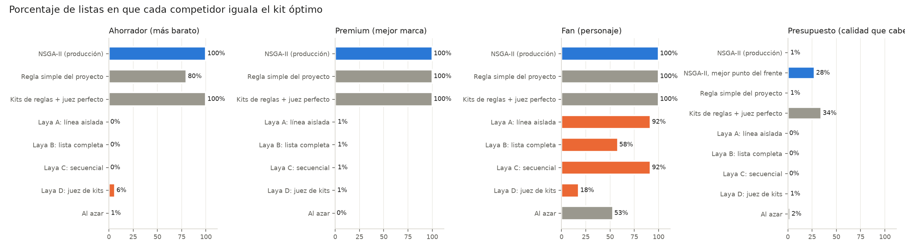
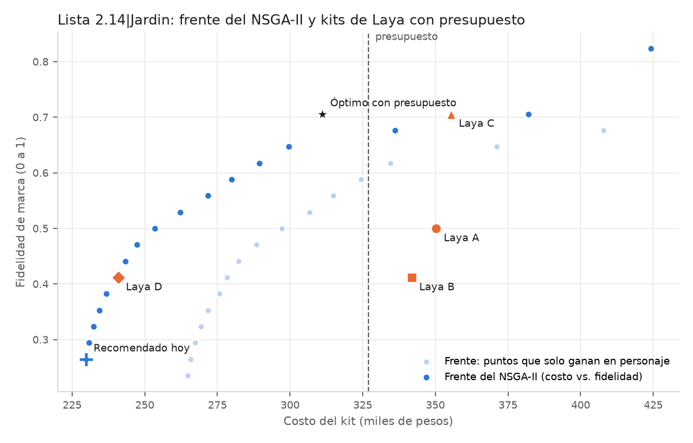

# Benchmark: Laya contra el optimizador NSGA-II

**Fecha:** 4 de octubre de 2026 · **Rama:** `bench/laya-vs-nsga` · **Código y datos:** [ensayos/bench_laya/](../../ensayos/bench_laya/)

## La pregunta

¿Un modelo de decisión de propósito general, de código abierto ([Laya](https://huggingface.co/convaiinnovations/laya), de Convai Innovations, Apache-2.0, 421 M de parámetros), arma kits escolares tan buenos como el optimizador multiobjetivo NSGA-II de Tukit?

Si la respuesta fuera sí, el NSGA-II sería complejidad sin retorno. Si es no, el benchmark dice dónde y por cuánto gana el optimizador.

## Respuesta corta

**No.** Laya no compite con el NSGA-II en ninguno de los cuatro escenarios. Cuando elige producto por producto (modalidades A, B y C), queda al nivel del azar en los kits Ahorrador y Premium. Cuando elige entre kits ya armados (D), el resultado se debe sobre todo a esos kits, no a Laya: un selector perfecto sobre los mismos kits iguala el óptimo en el 100 % de los casos, y Laya en el 6 % (Ahorrador) y el 1 % (Premium). Donde mejor le va es en elegir el kit con personaje, porque ahí basta con buscar una palabra en el texto. Con presupuesto, la mejor modalidad de Laya logra el 59 % de la calidad posible. El NSGA-II tiene en su frente kits que logran el 94 %.

Hay dos hallazgos más, sobre el propio Tukit, que importan tanto como la comparación:

1. **El kit que hoy se le recomienda a un papá con presupuesto desperdicia lo que el NSGA-II ya calculó.** `recomendar` elige solo entre los tres kits fijos: a un papá sin preferencia declarada por la calidad le recomienda el Ahorrador, y si el kit que le correspondería no cabe, cae al más barato. En este escenario eso logra el 40 % de la calidad posible. Sin embargo, el frente que el optimizador acaba de calcular trae un kit que cabe y logra el 94 %. El contrato (§6) promete "caer al siguiente punto del frente", y el código no lo hace.
2. **El frente del NSGA-II es aproximado, no exacto.** En el 68 % de los casos, un kit armado con una regla simple (subir de marca primero donde cuesta menos) domina al menos un punto del frente. Con presupuesto, esa regla, acompañada de un selector perfecto, logra el 93 % de la calidad posible frente al 94 % del NSGA-II, y alcanza el óptimo exacto más veces (34 % contra 28 %).

## Cómo se hizo

### Qué decide cada competidor

Lo único que cambia entre competidores es **qué producto va en cada línea del kit**. Todo lo anterior (lectura de la lista, parseo, emparejamiento con el catálogo) y todo lo posterior (unidades a comprar, consolidación, total, `recomendar`) es idéntico. Los kits de todos se miden con las funciones de producción de [optimizador.py](../../servicios/inteligencia/tukit_inteligencia/optimizador.py), así que "costo", "fidelidad" y "personaje" significan aquí lo mismo que en Tukit.

### Datos

- **175 listas oficiales** (17 colegios, todos sus grados; una no tiene ninguna línea comprable con candidatos, por eso los escenarios suman 174) de [items_lista.csv](../../datos/listas/items_lista.csv), pasadas por la misma normalización y el mismo emparejamiento del pipeline (`trabajos._normalizar`, `consulta.emparejar`).
- **Una foto fija del catálogo** (135 conceptos, 684 productos, huella `d60ef70e9428f7e6`), congelada en `instancias.json`. Todos los competidores deciden sobre exactamente los mismos renglones y candidatos.
- **Emparejamiento solo léxico.** La cuota de la API de Gemini se agotó durante la generación, así que todas las instancias se generaron sin el canal semántico. No afecta la comparación (todos reciben los mismos candidatos), pero el catálogo puede ofrecer menos candidatos de los que ofrecería en producción.
- En promedio, cada lista tiene **17 líneas en las que hay que elegir**, con **2,4 candidatos por línea** (máximo 3). En **137 de las 175 listas** el espacio supera 4.096 combinaciones y el NSGA-II corre de verdad; en las demás, el optimizador enumera el frente exacto.

### Escenarios de papá

| Escenario | Qué quiere el papá | Listas |
|---|---|---|
| Ahorrador | El kit más barato | 174 |
| Premium | La mejor marca posible | 174 |
| Fan | El personaje más frecuente en la lista, al menor costo | 157 (18 listas no tienen ningún producto con personaje) |
| Presupuesto | La mejor marca que quepa en un tope fijado a mitad de camino entre el kit más barato y el Premium | 174 |

### Competidores

| Competidor | Qué es |
|---|---|
| **Óptimo exacto** | El techo. Los cuatro objetivos se suman línea por línea, así que los extremos se resuelven exactamente y el escenario de presupuesto es una mochila de elección múltiple, resuelta exactamente por programación dinámica. Verificado contra fuerza bruta con 27 pruebas ([test_comun.py](../../ensayos/bench_laya/test_comun.py)). |
| **NSGA-II (producción)** | `armar_los_tres` tal como corre en Tukit, con 5 semillas. En presupuesto se toma el kit que `recomendar` marca. |
| **NSGA-II, mejor punto del frente** | Solo presupuesto: el mejor kit del frente que cabe. Es lo que el optimizador ya tiene y hoy no se entrega. |
| **Regla simple del proyecto** | `elegir_por_perfil`, la heurística que el optimizador usa como semilla y referencia. |
| **Kits de reglas + juez perfecto** | Los 5 kits que ve Laya en la modalidad D, con un selector que siempre acierta. Separa la calidad de los kits de la calidad de la elección de Laya. |
| **Laya A: línea aislada** | Una pregunta por línea, viendo solo ese renglón y sus candidatos. |
| **Laya B: lista completa** | El estado es la lista entera (hasta 7.010 tokens; el límite es 8.192) con el presupuesto, y se pregunta por cada línea en tandas. |
| **Laya C: secuencial** | Decide en orden. Cada pregunta ve el presupuesto restante y lo mínimo que cuestan las líneas que faltan. Sin presupuesto equivale a A. |
| **Laya D: juez de kits** | Se arman 5 kits completos con reglas simples (sin NSGA-II) y Laya elige uno. Es su mejor caso: pocas opciones completas. |
| **Al azar** | Un candidato al azar por línea. Sirve para leer a Laya. |

**Versión y formato de Laya.** Se probaron tres versiones publicadas (multilingüe, inglesa y `typed-decisions`) y cuatro formas de preguntar, sobre casos sintéticos (una ronda de 60 y otra de 200), **antes de mirar las instancias** ([cordura.py](../../ensayos/bench_laya/cordura.py), [cordura_variantes.py](../../ensayos/bench_laya/cordura_variantes.py)). La mejor fue `typed-decisions` con las opciones descritas completas en español, y esa es la que corre en el benchmark. No se entrenó a Laya con nuestros datos: los únicos ejemplos disponibles serían los kits del propio NSGA-II, y eso mediría imitación, no competencia.

## Resultados



#### Ahorrador (más barato)

| Competidor | n | Iguala óptimo | Sobrecosto medio | Dominado por el frente |
|---|---|---|---|---|
| Óptimo exacto | 174 | 100% | 0.0% | 0% |
| NSGA-II (producción) | 174 | 100% | 0.0% | 0% |
| Regla simple del proyecto | 174 | 80% | 0.4% | 52% |
| Kits de reglas + juez perfecto | 174 | 100% | 0.0% | 0% |
| Laya A: línea aislada | 174 | 0% | 52.0% | 93% |
| Laya B: lista completa | 174 | 0% | 45.3% | 95% |
| Laya C: secuencial | 174 | 0% | 52.0% | 93% |
| Laya D: juez de kits | 174 | 6% | 5.7% | 18% |
| Al azar | 174 | 1% | 42.6% | 97% |

#### Premium (mejor marca)

| Competidor | n | Iguala óptimo | Fidelidad perdida (0 a 1) | Costo vs. óptimo | Dominado por el frente |
|---|---|---|---|---|---|
| Óptimo exacto | 174 | 100% | 0.000 | +0.0% | 0% |
| NSGA-II (producción) | 174 | 100% | 0.000 | +0.0% | 0% |
| Regla simple del proyecto | 174 | 100% | 0.000 | +0.0% | 0% |
| Kits de reglas + juez perfecto | 174 | 100% | 0.000 | +0.0% | 0% |
| Laya A: línea aislada | 174 | 1% | 0.231 | -9.0% | 84% |
| Laya B: lista completa | 174 | 1% | 0.414 | -18.5% | 95% |
| Laya C: secuencial | 174 | 1% | 0.231 | -9.0% | 84% |
| Laya D: juez de kits | 174 | 1% | 0.416 | -36.4% | 18% |
| Al azar | 174 | 0% | 0.357 | -15.4% | 96% |

#### Fan (personaje)

| Competidor | n | Iguala óptimo | Personaje logrado vs. óptimo | Dominado por el frente |
|---|---|---|---|---|
| Óptimo exacto | 157 | 100% | 100% | 0% |
| NSGA-II (producción) | 157 | 100% | 100% | 0% |
| Regla simple del proyecto | 157 | 100% | 100% | 52% |
| Kits de reglas + juez perfecto | 157 | 100% | 100% | 82% |
| Laya A: línea aislada | 157 | 92% | 93% | 99% |
| Laya B: lista completa | 157 | 58% | 60% | 100% |
| Laya C: secuencial | 157 | 92% | 93% | 99% |
| Laya D: juez de kits | 157 | 18% | 18% | 18% |
| Al azar | 157 | 53% | 59% | 99% |

#### Presupuesto (calidad que cabe)

| Competidor | n | Cabe en el presupuesto | Calidad lograda vs. óptimo | Fidelidad cuando cabe | Exceso mediano | Iguala óptimo |
|---|---|---|---|---|---|---|
| Óptimo exacto | 174 | 100% | 100% | 0.704 | 0.0% | 100% |
| NSGA-II (producción) | 174 | 100% | 40% | 0.276 | 0.0% | 1% |
| NSGA-II, mejor punto del frente | 174 | 100% | 94% | 0.660 | 0.0% | 28% |
| Regla simple del proyecto | 174 | 100% | 37% | 0.256 | 0.0% | 1% |
| Kits de reglas + juez perfecto | 174 | 100% | 93% | 0.652 | 0.0% | 34% |
| Laya A: línea aislada | 174 | 18% | 10% | 0.421 | 10.5% | 0% |
| Laya B: lista completa | 174 | 50% | 26% | 0.382 | 0.0% | 0% |
| Laya C: secuencial | 174 | 18% | 13% | 0.541 | 10.6% | 0% |
| Laya D: juez de kits | 174 | 99% | 59% | 0.417 | 0.0% | 1% |
| Al azar | 174 | 43% | 28% | 0.443 | 1.9% | 2% |

"Dominado por el frente" es el porcentaje de listas en que algún punto del frente del NSGA-II es igual o mejor que ese kit en los cuatro objetivos, y estrictamente mejor en al menos uno. La regla simple del proyecto iguala el óptimo en personaje (Fan), pero el frente la domina en el 52 % de las listas porque elige por precio unitario y termina pagando más. Laya C equivale a Laya A cuando no hay presupuesto.

### Prueba de cordura: ¿Laya entiende precio y marca?

Antes del benchmark se le hicieron a Laya preguntas de una sola línea con respuesta conocida, de 2 a 6 opciones. Ronda final: 200 casos, con la versión `typed-decisions` y la multilingüe. El azar acierta un 31 %.

| Forma de preguntar | Versión | ¿Más barato? | ¿Mejor marca? | ¿Trae el personaje? |
|---|---|---|---|---|
| Opciones descritas completas (la usada en el benchmark) | typed-decisions | 30 % | 42 % | 56 % |
| Candidatos como JSON en el estado, opciones cortas | typed-decisions | 30 % | 30 % | 32 % |
| Una pregunta sí/no por candidato | typed-decisions | 31 % | 33 % | 52 % |
| Precio en palabras ("el más barato de todos") | typed-decisions | 23 % | 33 % | 51 % |
| Opciones descritas completas | multilingüe | 35 % | 32 % | 38 % |

La primera ronda (60 casos, también en inglés y con la versión inglesa) dio cifras parecidas. Esa ronda dejó elegida la combinación `typed-decisions` + opciones descritas en español antes de correr el benchmark.

Laya supera al azar donde la respuesta es encontrar una palabra (el personaje). Donde hay que comparar números o un orden de niveles, queda cerca del azar. Esto es coherente con lo que es: un codificador que responde de una pasada, no un modelo que razona sobre cantidades. Incluso cuando se le da la comparación ya hecha ("el más barato de todos"), no la aprovecha: acierta 23 %.

### Tiempos (máquina sola)

Medidos en 29 listas, un proceso, sin otras cargas. CPU de 16 núcleos y GPU RTX 4050 portátil (6 GB).

| Competidor | Qué produce | Media | Mediana | Máximo |
|---|---|---|---|---|
| NSGA-II (CPU) | los **tres** kits de la lista | 5,3 s | 6,3 s | 9,0 s |
| Laya A (GPU) | **un** kit | 1,1 s | 1,0 s | 2,5 s |
| Laya B (GPU) | un kit | 3,1 s | 2,1 s | 13,1 s |
| Laya C (GPU) | un kit | 1,0 s | 0,9 s | 2,3 s |
| Laya D (GPU) | un kit | 0,08 s | 0,08 s | 0,10 s |

Por kit, Laya A o C en GPU (unos 3 s por los tres kits) es algo más rápido que el NSGA-II en CPU (5,3 s). Pero esa ventaja solo existe con GPU y con kits que no sirven. Ninguno de los dos tiempos limita el producto: son del mismo orden que leer una sola página de la lista con Gemini (unos 5 s).

### Reproducibilidad del NSGA-II

El NSGA-II entrega el mismo kit con las 5 semillas en el 94,5 % de las listas en las que corre (y siempre en las que enumera). En las demás, el kit cambia con la semilla. En el Ahorrador eso significa que, en el 0,6 % de las corridas, el kit no es el más barato posible.

## Lectura de los resultados

**1. En los extremos, el NSGA-II es exacto y Laya no.** El NSGA-II iguala el óptimo en el 100 % de los Premium y Fan y en el 99,4 % de los Ahorrador (promediando semillas). Laya, en su mejor modalidad para cada caso, no pasa del 6 % de óptimos en Ahorrador ni del 1 % en Premium. En el Ahorrador, Laya con línea aislada paga en promedio un 52 % más que el kit más barato. El azar paga un 42 % más.

**2. Con presupuesto, ninguna modalidad de Laya se acerca.** La modalidad secuencial (C), diseñada para repartir el presupuesto, se pasa del tope en el 82 % de las listas. Darle la lista completa (B) tampoco ayuda: cabe en la mitad de los casos y logra el 26 % de la calidad posible, menos que elegir al azar (28 %). Ver toda la lista empeora a Laya incluso donde le iba bien: en Fan baja del 92 % al 58 % de óptimos. Esto coincide con su documentación, que reporta caídas de precisión con textos de miles de tokens. La mejor es el juez de kits (D), con un 59 % de la calidad posible. Pero ese 59 % se debe sobre todo a los kits que se le dan, no a Laya: un juez perfecto sobre los mismos 5 kits llega al 93 %.

**3. La complejidad del NSGA-II no se justifica por los tres kits fijos.** Para Ahorrador, Premium y Fan, una regla línea por línea da el óptimo exacto, porque los objetivos son separables. La heurística actual del proyecto ya acierta el 100 % de los Premium y logra todo el personaje posible en los Fan. Pero ordena por precio unitario y no por costo de línea (precio × unidades a comprar, que depende del empaque y la cantidad), así que falla en el 20 % de los Ahorrador y queda dominada por el frente en la mitad de los Fan. El NSGA-II corrige eso, pero una regla corregida también lo haría.

**4. Donde el NSGA-II sí aporta es en el compromiso con presupuesto, y hoy no se usa.** El frente trae kits que caben y logran el 94 % de la calidad posible, contra el 40 % del kit que hoy se recomienda.



La figura muestra una lista típica (17 líneas). El kit que hoy se recomienda (la cruz) es el más barato. El frente trae kits que caben bajo la línea del presupuesto con fidelidad hasta 0,65. El óptimo exacto (la estrella, 0,70) queda por encima de todo el frente. De los kits de Laya, A y C se pasan del presupuesto, y D cabe pero con fidelidad 0,41. Los puntos celestes son del frente de 4 objetivos: en el plano costo-fidelidad parecen dominados, pero no lo están porque ganan en el eje de personaje.

**5. El frente es mejorable.** En el 68 % de los casos, una regla de subida por costo marginal domina algún punto del frente (en promedio el 5 % de sus puntos). Coincide con la advertencia que ya está en el código: SBX y PM con redondeo son operadores ordinales sobre una variable nominal (el índice del candidato).

## Recomendaciones

1. **Implementar lo que promete el contrato §6 con presupuesto:** cuando el kit recomendado no cabe, recomendar el mejor punto del frente que sí cabe, en vez del kit más barato. La calidad del kit recomendado con presupuesto pasaría del 40 % al 94 % sin costo de cómputo adicional, porque el frente ya está calculado.
2. **Agregar el presupuesto al formulario de la web.** Hoy solo entra por la API.
3. **Corregir `elegir_por_perfil` para que ordene por costo de línea** (precio × unidades a comprar) y no por precio unitario. Así las semillas del NSGA-II ya parten del Ahorrador exacto.
4. **Si se quiere un frente más completo,** sembrar la población con los kits de la regla de subida por costo marginal, o usar un cruce uniforme por variable, como ya sugiere el docstring de `_frente_nsga`.
5. **No usar Laya para armar kits.** Si se quisiera aprovecharlo en Tukit, su perfil encaja mejor en clasificar texto (por ejemplo, el tipo de renglón) que en elegir productos por precio o marca.

## Limitaciones

- **Foto del catálogo a mitad de curaduría:** el catálogo se estaba completando en paralelo. Con más productos por línea, el espacio de búsqueda crece. Eso debería favorecer al NSGA-II frente a Laya, pero también puede cambiar la calidad del frente. Conviene repetir la corrida con el catálogo final (es un solo comando por paso; ver abajo).
- **Emparejamiento solo léxico,** por la cuota de Gemini agotada.
- **Un solo hijo por lista:** la consolidación entre hermanos no entra en juego.
- **"Fidelidad" mide el nivel de marca, no si el producto se parece a lo que escribió el colegio.** Ningún competidor se mide en eso.
- **El presupuesto se fija a mitad de camino entre el kit más barato y el Premium.** Con otros topes, las cifras absolutas cambian.
- **Tiempos de Laya en una RTX 4050 portátil.** La documentación de Laya reporta unos 33 ms por pregunta en una T4; aquí se midieron entre 70 y 100 ms.
- **Formato de la versión `typed-decisions`.** Al cargarla, Laya advierte que trae temperaturas de calibración fuera de rango y que sus confianzas no están calibradas. Por eso no se usan las confianzas de Laya en ninguna métrica.

## Cómo reproducirlo

El código y los datos de entrada (instancias, escenarios, corridas del NSGA-II y de Laya) están en [`ensayos/bench_laya/`](../../ensayos/bench_laya/). Los resultados que cita este informe (métricas, tablas, figuras, tiempos y pruebas de cordura) están en [`benchmark-laya/`](benchmark-laya/), y los scripts los escriben ahí.

Para recalcular las métricas sin la base de datos basta correr `evaluar.py` y `graficas.py`: leen directamente los `.json.gz`. Hay que tener en cuenta que `evaluar.py` mide con el optimizador vigente, así que con un optimizador posterior al de este informe las cifras cambian (ver «Lo que cambió después», abajo). Para repetir todo desde cero, desde la raíz del repositorio y con la base del catálogo arriba:

```bash
# 1. Foto del catalogo (venv del proyecto)
python ensayos/bench_laya/generar_instancias.py --sin-semantico
cd ensayos/bench_laya
python escenarios.py
python correr_nsga.py --procesos 10
# 2. Laya (entorno aparte: torch con CUDA + `pip install laya`)
../../.venv-laya/Scripts/python correr_laya.py D A C B
# 3. Medicion, tiempos y graficas
python evaluar.py
python tiempos.py nsga && ../../.venv-laya/Scripts/python tiempos.py laya
python graficas.py "<lista para la figura>"
# Pruebas del optimo exacto
python -m pytest test_comun.py
```

## Lo que cambió después

Las cifras de este informe son del optimizador del 4 de octubre de 2026 (versión v3 en el
[documento de algoritmos](../algoritmos/main.tex)). Sus recomendaciones 1, 3 y 4 se aplicaron
ese mismo día ([ADR 0029](../arquitectura/adr/0029-con-presupuesto-se-recomienda-la-mejor-marca-que-cabe.md)):
en las 174 listas (semilla 0), el kit recomendado con presupuesto pasó a caber siempre y a igualar
el óptimo exacto (antes 40 % de la calidad posible), la regla simple pasó a acertar el 100 % de los
Ahorrador (antes 80 %) y la escalera de costo marginal dejó de dominar puntos del frente (antes 68 %).
Los archivos de [`benchmark-laya/`](benchmark-laya/) conservan la medición original.
